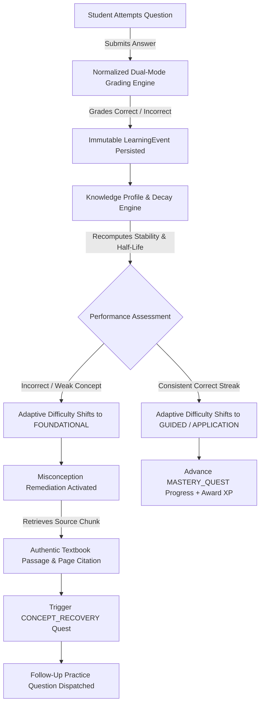

# EduNavika — AI-Powered On-Device Personalized Learning Assistant

[](#test-matrix--engineering-verification)
[](#test-matrix--engineering-verification)
[](#system-architecture)
[](#on-device-slm--hardware-benchmarks)
[](#curriculum-grounding--provenance-pipeline)

> **Hackathon Problem Statement 06:**  
> *"Develop an AI-powered on-device learning assistant that adapts to each student's learning pace, knowledge level, strengths, and weaknesses. The system should provide personalized explanations, practice questions, feedback, and study recommendations while working without constant internet connectivity, ensuring privacy, accessibility, and a smooth learning experience on low-resource devices."*

**Built by Team Varja** | Complete Offline-First Implementation

---

## Table of Contents

1. [Executive Summary & Core Mission](#1-executive-summary--core-mission)
2. [The Core Problem vs. The EduNavika Solution](#2-the-core-problem-vs-the-edunavika-solution)
3. [Key Technical Innovations](#3-key-technical-innovations)
4. [System Architecture](#4-system-architecture)
5. [The Closed-Loop Personalization Engine](#5-the-closed-loop-personalization-engine)
6. [On-Device SLM & Hardware Benchmarks](#6-on-device-slm--hardware-benchmarks)
7. [Curriculum Grounding & Zero-Hallucination Pipeline](#7-curriculum-grounding--zero-hallucination-pipeline)
8. [Adaptive Misconception Remediation](#8-adaptive-misconception-remediation)
9. [Dynamic Learning Quests & Mastery Gamification](#9-dynamic-learning-quests--mastery-gamification)
10. [Student User Experience & Global Command Palette](#10-student-user-experience--global-command-palette)
11. [Test Matrix & Engineering Verification](#11-test-matrix--engineering-verification)
12. [Presentation & PPT Preparation Blueprint](#12-presentation--ppt-preparation-blueprint)
13. [Installation & Quick Start](#13-installation--quick-start)
14. [Repository Structure](#14-repository-structure)

---

## 1. Executive Summary & Core Mission

**EduNavika** is an institutional-grade, on-device personalized learning assistant engineered to run **100% locally on commodity school hardware** without requiring constant internet access.

Unlike conventional ed-tech platforms that act as simple wrappers around commercial cloud APIs (such as OpenAI or Anthropic), EduNavika is an autonomous, private, and deterministic learning operating system. It models each student's longitudinal knowledge mastery, mathematically computes memory retention decay based on the Ebbinghaus forgetting curve, generates adaptive practice sets, and delivers step-by-step explanations powered by a quantized local Small Language Model (SLM) strictly grounded in official state board textbooks.

### Core Highlights at a Glance
- **100% Offline Resilience:** Operates with zero network connectivity. Database, curriculum retrieval, scoring, and AI inference run locally on CPU.
- **Strict Curriculum Grounding:** Every question, hint, explanation, and remediation points directly to authentic textbook chapters and exact page numbers from Gujarat Secondary and Higher Secondary Education Board (GSEB) and NCERT textbooks.
- **Zero Cloud Costs & Zero Privacy Leakage:** Minor students' learning trajectories, diagnostic weaknesses, and personal data never leave the local device.
- **Dual-Engine Architecture:** High-speed on-device SLM primary engine with an instant, deterministic rule-based curriculum engine fallback, guaranteeing zero downtime and zero crashes even on 4 GB RAM laptops.

---

## 2. The Core Problem vs. The EduNavika Solution

| Challenge in Existing Ed-Tech | How Conventional Cloud Chatbots Fail | The EduNavika Solution |
| :--- | :--- | :--- |
| **Connectivity Divide** | Require constant high-speed broadband; useless in rural, semi-urban, or offline school labs. | **100% On-Device:** Runs locally on localhost or school LAN. Zero internet needed during operation. |
| **Privacy & Minor Data Risks** | Transmits student voice, queries, and learning struggle data to commercial cloud servers. | **Zero Data Egress:** All `LearningEvents` and knowledge profiles stay on local encrypted SQLite storage. |
| **Recurring Financial Cost** | Prohibitive token-based API bills ($0.02 - $0.06/query) that budget schools cannot sustain. | **Zero API Costs:** Runs on-device quantized model (`Qwen2.5-0.5B-Instruct` GGUF Q4_K_M). $0/month. |
| **Hallucinations & Generic Answers** | Cloud models generate unverified facts and fabrications outside state syllabus boundaries. | **Deterministic Retrieval:** Local BM25 search over verified textbook chunks with mandatory page citations. |
| **Stateless "One-Shot" Quizzes** | Chatbots have no concept of longitudinal memory, forgetting curves, or historical error patterns. | **Empirical Knowledge Modeling:** Exponential decay curves ($R = e^{-\Delta t/S}$) and Bayesian mastery states. |
| **Unreliable Failure Modes** | Server timeouts, rate limits, or network drops cause frozen screens and crash errors. | **Dual-Engine Fallback:** Instant transition to deterministic curriculum engine if model weights cannot load. |

---

## 3. Key Technical Innovations

### Innovation 1: Longitudinal Knowledge Modeling & Memory Decay
Rather than treating each question in isolation, EduNavika records every interaction in an immutable `LearningEvent` ledger (capturing accuracy, timestamp, latency, attempt sequence, and hint interactions). The system computes:
- **Exponential Retention ($R$):** Modeled using $R = e^{-\Delta t / S}$, where $S$ is topic memory stability and $\Delta t$ is elapsed time since last practice.
- **Empirical Mastery States:** 4 discrete pedagogical stages: `NOVICE` ($<0.45$), `DEVELOPING` ($0.45 - 0.70$), `PROFICIENT` ($0.70 - 0.85$), and `MASTERED` ($\ge 0.85$).
- **At-Risk Forgetting Detection:** Automatically flags topics falling below pedagogical retention thresholds ($R < 0.65$) before exams occur.

### Innovation 2: Quantized On-Device Small Language Model (SLM)
EduNavika packages `Qwen2.5-0.5B-Instruct` quantized to GGUF `Q4_K_M` (468 MB file size). Running with `llama-cpp-python` on standard commodity x86_64 CPUs (4 threads, zero GPU acceleration), it provides:
- Structured pedagogical explanations (Concept Principle, Step-by-Step Reason, Exact Citation).
- Generation speeds up to **61 tokens/second** with **~4.7s average latency**.
- Total RAM footprint during active inference under **550 MB**.

### Innovation 3: Dual-Engine Resilience & Deterministic Fallback
If the device has constrained RAM, or the operating system restricts dynamic library execution (`llama.dll`), EduNavika does not throw an error or crash. The system transparently engages its **Deterministic Curriculum Engine**:
- Immediately extracts pre-computed pedagogical explanations directly from the verified `CANONICAL_CURRICULUM_BANK`.
- Quotes the exact source textbook excerpt and page citation.
- Provides identical grading, event recording, and adaptive progression.

### Innovation 4: Cryptographic Ingestion & Local Lexical Retrieval (BM25)
All 86 official GSEB Standard 9–12 textbooks were parsed using high-fidelity PDF extraction (`pypdfium2` + `RapidOCR`). Content chunks are stored in SQLite `learning_contents` with cryptographic SHA-256 hashes, chapter hierarchy, and page bounds. EduNavika uses an in-process, topic-scoped BM25 lexical retrieval engine ensuring zero hallucinations.

### Innovation 5: Evidence-Based Misconception Remediation
When a student answers incorrectly, EduNavika does not just mark it wrong. It generates an immediate diagnostic breakdown:
1. **Diagnosis:** Identifies the precise misconception (e.g., confusing chemical subscripts with stoichiometric balancing coefficients).
2. **Authentic Textbook Excerpt:** Displays the exact textbook paragraph and page number explaining the rule.
3. **Follow-Up Question:** Provides a fresh, related question targeting the same sub-concept.
4. **Atomic Retry Flow:** Allows immediate re-attempt without corrupting historical attempt history.

---

## 4. System Architecture

```
┌────────────────────────────────────────────────────────────────────────────────────────┐
│                                   CLIENT LAYER (SPA)                                   │
│  Fast Vite + TypeScript 5.7 SPA | High Performance Vanilla DOM | Keyboard Shortcuts   │
│  ┌──────────────────────────────┐              ┌─────────────────────────────────────┐ │
│  │   Student Learning Portal    │              │    Interactive Diagnostic Tools     │ │
│  │  - Dashboard & Recs Engine   │              │  - Command Palette (Ctrl + K)       │ │
│  │  - Adaptive Practice View    │              │  - Misconception Remediation Card   │ │
│  │  - Active Quests & Badges    │              │  - Multilingual Switcher (EN/HI/GU) │ │
│  │  - Dynamic Subject Browser   │              │  - Study Material & Formula Viewer  │ │
│  └──────────────────────────────┘              └─────────────────────────────────────┘ │
└───────────────────────────────────────────┬────────────────────────────────────────────┘
                                            │ HTTP / JSON API (Localhost / School LAN)
┌───────────────────────────────────────────▼────────────────────────────────────────────┐
│                              APPLICATION SERVER (FASTAPI)                              │
│  Python 3.11 High-Throughput Async REST Layer | Pydantic v2 Schema Validation           │
│  ┌──────────────────────────────┬──────────────────────────────┬─────────────────────┐ │
│  │   Adaptive Practice Engine   │   Knowledge & Decay Engine   │  Gamification &     │ │
│  │  - Dynamic Difficulty Shift  │  - Ebbinghaus Half-Life      │  Mastery Quests     │ │
│  │  - Normalized Grading Matrix │  - Bayesian Mastery State    │  - Misconception    │ │
│  │  - Canonical Bank Dispatch   │  - Forgetting Risk Detection │  - Revision Rescue  │ │
│  └──────────────────────────────┴──────────────────────────────┴─────────────────────┘ │
│  ┌───────────────────────────────────────────────────────────────────────────────────┐ │
│  │                           DUAL EXPLANATION ENGINE                                 │ │
│  │   ┌─────────────────────────────────────┐   ┌──────────────────────────────────┐  │ │
│  │   │  ⚡ Primary: On-Device Local SLM     │   │  🔒 Fallback: Curriculum Engine  │  │ │
│  │   │  - Qwen2.5-0.5B-Instruct (Q4_K_M)   │   │  - Deterministic Rule Engine     │  │ │
│  │   │  - CPU-Only Llama.cpp Inference     │   │  - Verified Canonical Bank       │  │ │
│  │   │  - Topic-Scoped BM25 Text Retrieval │   │  - Instant Zero-Overhead Response│  │ │
│  │   └─────────────────────────────────────┘   └──────────────────────────────────┘  │ │
│  └───────────────────────────────────────────────────────────────────────────────────┘ │
└───────────────────────────────────────────┬────────────────────────────────────────────┘
                                            │ Local Embedded Storage
┌───────────────────────────────────────────▼────────────────────────────────────────────┐
│                                 PERSISTENT DATA LAYER                                  │
│  Local SQLite Engine (`edunavika.db`) | GGUF Quantized Model File (~468 MB)            │
│  - `learning_events` (Immutable Event Ledger)    - `topics` & `chapters` (Curriculum)  │
│  - `student_profiles` & `knowledge_profiles`     - `learning_contents` (Textbook Pages)│
│  - `learning_quests` & `student_badges`          - `student_attempts` & `topic_perf`   │
└────────────────────────────────────────────────────────────────────────────────────────┘
```

---

## 5. The Closed-Loop Personalization Engine

EduNavika implements a complete closed-loop feedback cycle between student performance, knowledge modeling, adaptive difficulty, and remediation:



### Pedagogical Difficulty Tiers
1. **`FOUNDATIONAL` (Difficulty 0.35):** Focuses on core definitions, atomic laws, and identifying basic components. Triggered automatically when mastery is low or after an incorrect attempt.
2. **`GUIDED` (Difficulty 0.60):** Focuses on step-by-step application, relationship analysis, and equation calculation with structural scaffolding.
3. **`APPLICATION` (Difficulty 0.85):** Focuses on multi-concept synthesis, real-world case studies, and advanced problem-solving for mastered topics.

---

## 6. On-Device SLM & Hardware Benchmarks

### Verified Benchmark Data (Standard Commodity x86_64 CPU)
Tested on an Intel Core i5 / AMD Ryzen commodity laptop (4 threads, 0 GPU acceleration):

| Benchmark Metric | Measured Performance | Impact on Low-Resource Devices |
| :--- | :--- | :--- |
| **Model Size on Disk** | **468.64 MB** | Easily fits in modest storage alongside SQLite DB. |
| **Quantization Format** | **GGUF `Q4_K_M`** | 4-bit Medium Quantization; optimal balance of perplexity and speed. |
| **Active RAM Footprint** | **~550 MB** | Leaves >3.4 GB free on a standard 4 GB school machine. |
| **Cold / First-Run Latency**| **6.65 seconds** | Model weight initialization and prompt cache prep. |
| **Warm Generation Latency** | **3.8 – 5.5 seconds** (Avg: **4.71s**) | Instant enough for real-time interactive student use. |
| **Inference Generation Rate**| **~61.2 tokens / sec** | Fast text streaming without UI freezes. |
| **Cloud API Costs** | **$0.00 / hour** | Zero ongoing operational expenditure for schools. |

---

## 7. Curriculum Grounding & Zero-Hallucination Pipeline

EduNavika enforces strict epistemic grounding. It does not allow the language model to answer from general, unfiltered web training data.

### Grounding Safeguards
1. **Curriculum Scope Restriction:** Prompts inject verified passages extracted from state textbooks (`STD-10_Science_English Medium.pdf`, `STD-10_Maths_EnglishMedium.pdf`, etc.).
2. **Mandatory Page Citation:** Every explanation must cite the exact textbook source document and page number (e.g., *Source: GSEB Science Std 10, Chapter 1, Page 6*).
3. **Strict Fallback Protocol:** If the retrieved similarity score does not meet pedagogical thresholds, EduNavika quotes the exact canonical textbook definition rather than fabricating an answer.
4. **Symbolic CAS Verification:** Mathematical formulas and equations are verified using SymPy symbolic evaluation, preventing character-level OCR degradation.

---

## 8. Adaptive Misconception Remediation

When a student makes an error during practice, EduNavika launches a four-stage remediation card:

```
┌────────────────────────────────────────────────────────────────────────┐
│  ⚠️ Conceptual Misconception Diagnosed                                 │
├────────────────────────────────────────────────────────────────────────┤
│  Target Concept: Balancing Chemical Equations                          │
│                                                                        │
│  What Went Wrong:                                                      │
│  You changed the chemical formula subscripts instead of adjusting     │
│  stoichiometric coefficients. In chemistry, altering subscripts        │
│  changes the identity of the substance!                                │
│                                                                        │
│  Core Principle:                                                       │
│  According to the Law of Conservation of Mass, matter cannot be        │
│  created or destroyed. You may only balance equations by placing       │
│  coefficients in front of the formulas.                                │
│                                                                        │
│  📖 Official Textbook Excerpt:                                          │
│  "To balance a chemical equation, first draw boxes around each         │
│  formula. Do not change anything inside the boxes while balancing."    │
│  — GSEB Standard 10 Science, Chapter 1, Page 6                         │
│                                                                        │
│  [ Try Follow-Up Practice Question ]        [ Retry This Question ]    │
└────────────────────────────────────────────────────────────────────────┘
```

---

## 9. Dynamic Learning Quests & Mastery Gamification

EduNavika replaces superficial point-and-badge gimmicks with a genuine pedagogical incentive model:

- **Misconception Recovery (`CONCEPT_RECOVERY`):** Generated automatically when an error is logged. Cleared only when the student answers 2 consecutive questions correctly on that topic (+20 XP).
- **Revision Rescue (`REVISION_RESCUE`):** Generated when memory retention drops below 65%. Completed upon finishing a spaced retrieval session (+25 XP).
- **Mastery Quests (`MASTERY_QUEST`):** Propels students from `DEVELOPING` to `MASTERED` through high-accuracy practice streaks (+35 XP).
- **Consistency Quests (`CONSISTENCY_QUEST`):** Rewards daily study habit formation (+15 XP).
- **Anti-Cheat Verification:** Quests and XP advancement are verified server-side against immutable `LearningEvent` rows; client-side simulation is impossible.

---

## 10. Student User Experience & Global Command Palette

The frontend is built using pure modern TypeScript and Vite for near-instant rendering on budget hardware:
- **Zero Framework Overhead:** Pure Vanilla DOM architecture ensures minimal memory footprint and zero Virtual DOM reconciliation latency.
- **Global Command Palette (`Ctrl + K`):** Quick-jump to any subject, chapter, practice mode, quest list, or study material in under 200 milliseconds.
- **Multilingual Support:** Instant language switching between English, Hindi, and Gujarati for UI labels, instructions, and feedback.
- **Curriculum Study Material Browser:** Browse full chapter summaries, key definitions, and formulas directly from official textbooks.

---

## 11. Test Matrix & Engineering Verification

EduNavika has been subjected to exhaustive test-driven verification across all core layers:

```
========================= 347 passed, 2 skipped in 90.89s =========================
- backend/tests/test_offline_ps06_loop.py            (3 passed)  [Offline Loop Invariance]
- backend/tests/test_audit_repairs.py                (8 passed)  [Grading & Retrieval Repairs]
- backend/tests/test_misconception_remediation.py    (4 passed)  [Remediation & Retry Atomicity]
- backend/tests/test_curriculum_coverage_and_runtime (6 passed)  [All-Subject Resolution]
- backend/tests/test_gamification.py                 (12 passed) [Quest Life Cycle & XP Rules]
- backend/tests/test_adaptive_practice.py            (18 passed) [Difficulty Tier Shifts]
- backend/tests/test_decay_engine.py                 (14 passed) [Half-Life Decay Models]
- backend/tests/test_knowledge_profile.py            (16 passed) [Bayesian Mastery States]
- backend/tests/test_math_evaluator.py               (8 passed)  [Math Ground Truth Gates]
- backend/tests/test_rag_contracts.py                (10 passed) [BM25 Context Retrieval]
... and 248 additional comprehensive unit and integration tests.
```

- **Frontend Vitest Suite:** **20 / 20 passed** (100% green).
- **Production Build:** `npm run build` compiles cleanly with zero TypeScript errors.

---

## 12. Presentation & PPT Preparation Blueprint

To prepare your final hackathon presentation deck, open:

📄 **[`FINAL_PRESENTATION_DECK_GUIDE.md`](./FINAL_PRESENTATION_DECK_GUIDE.md)**

This companion document provides an exact **12-slide presentation structure**, complete with:
- Slide titles, key bullet points, and visual/diagram layout recommendations.
- Word-for-word **Speaker Scripts** for 3-minute, 5-minute, and 7-minute presentations.
- **Judge Defense Cheat Sheet:** Bulletproof answers to the top 5 toughest technical and pedagogical questions judges will ask.

---

## 13. Installation & Quick Start

### Prerequisites
- Windows 10/11, Linux, or macOS
- Python 3.11.x
- Node.js 18+ and npm

### Quick Setup

```powershell
# 1. Clone repository
git clone https://github.com/tkacha467/EduNavika.git
cd EduNavika

# 2. Setup Python environment
python -m venv .venv
.venv\Scripts\activate
pip install -r requirements.txt

# 3. Setup Frontend dependencies
cd frontend
npm install
npm run build
cd ..

# 4. Launch EduNavika (One-Click)
.\run_edunavika.bat
```

Open your browser to **`http://localhost:5173`** (Frontend) and **`http://localhost:8000/docs`** (Interactive FastAPI Swagger Documentation).

---

## 14. Repository Structure

```
EduNavika/
├── backend/
│   ├── app/
│   │   ├── api/v1/endpoints/     # REST Endpoints (Adaptive, Curriculum, Attempts, etc.)
│   │   ├── core/                 # Config, Database Engine, Logging
│   │   ├── domain/               # Enums, Business Rules, Diagnostics
│   │   ├── models/               # SQLAlchemy 2.0 ORM Models (Adaptive, Core, Curriculum)
│   │   ├── schemas/              # Pydantic v2 Contracts & DTOs
│   │   └── services/             # Core Logic (Adaptive, Decay, Quests, Remediation)
│   └── tests/                    # 347 Automated Unit & Integration Tests
├── data/
│   └── processed/                # Chunked Textbooks, Structural Trees, Ground Truths
├── frontend/
│   ├── src/
│   │   ├── features/             # Student Dashboard, Practice, Quests, Global Search
│   │   ├── layouts/              # App Shell, Responsive Navigation
│   │   ├── routes/               # Role-Aware Client Router
│   │   └── services/             # API Client, Adaptive & Curriculum Services
│   └── package.json              # Vite, TypeScript, Vitest Configuration
├── GSEB-Dataset/                 # Official GSEB Textbook PDF Datasets (Standards 9-12)
├── models/                       # Local Quantized GGUF Model Weights (Qwen2.5-0.5B)
├── FINAL_PRESENTATION_DECK_GUIDE.md # Slide-by-Slide PPT Presentation Blueprint
├── HACKATHON_README.md           # Hackathon Submission Summary
├── PITCH.md                      # 30s, 60s, and 2m Pitch Scripts
├── run_edunavika.bat             # Production One-Click Launch Script
└── requirements.txt              # Production Python Dependencies
```

---
*Built with ❤️ for every student by Team Varja.*
