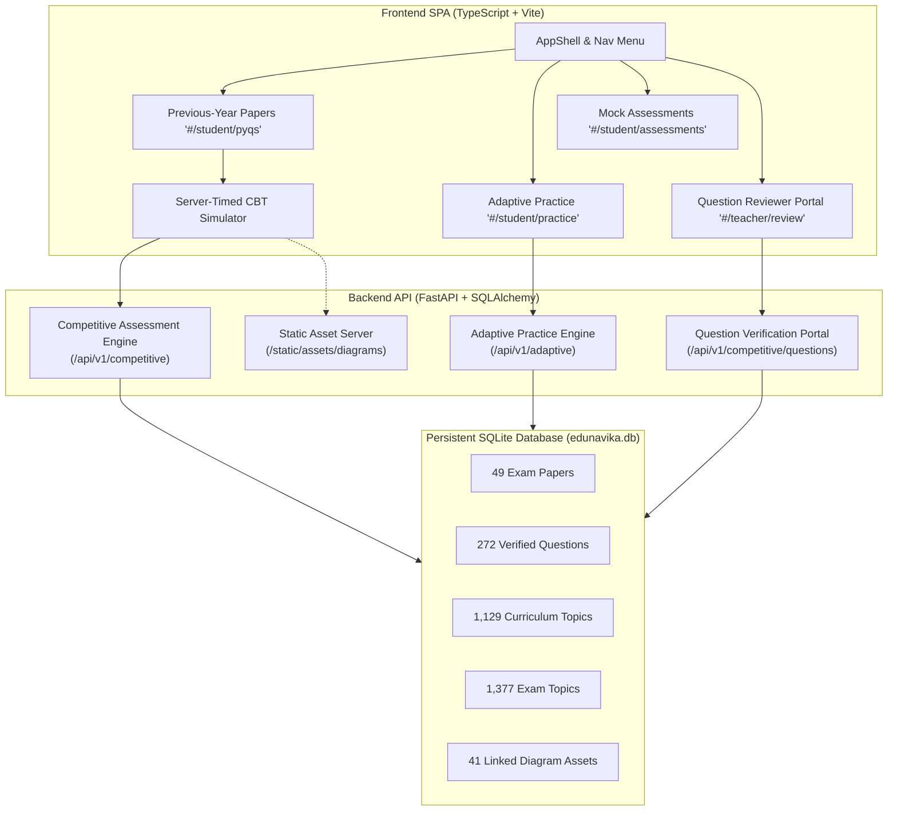

# EduNavika — Current Project Progress & Implementation Status

**Project:** EduNavika — AI-Powered On-Device Adaptive Learning & Competitive Exam Preparation Platform  
**Target Scope:** JEE Main, JEE Advanced, and NEET UG (GSEB / NCERT Standards 11 & 12 Science)  
**Current Date:** October 27, 2026  
**Repository:** [EduNavika (GitHub)](https://github.com/tkacha467/EduNavika.git)  
**Branch:** `master`  
**Latest Baseline Commit:** `14b4d9b` (`fix(practice): Apply authentic PYQ dataset to canonical DB, link diagram assets, and enable paper-specific mock tests`)  

---

## 1. High-Level Milestone Progress

| Milestone | Objective / Scope | Status | Evidence / Documentation |
|:---|:---|:---:|:---|
| **Milestone 1** | Repository Audit, Code Hygiene & Dataset Provenance Tracking | **COMPLETED** | [`docs/MILESTONE_1_REPOSITORY_AUDIT.md`](file:///d:/EduSens/docs/MILESTONE_1_REPOSITORY_AUDIT.md) |
| **Milestone 2** | Safe Cleanup, Reversibility Verification & Build Normalization | **COMPLETED** | [`docs/MILESTONE_2_CLEANUP_REPORT.md`](file:///d:/EduSens/docs/MILESTONE_2_CLEANUP_REPORT.md) |
| **Milestone 3** | Standards 11 & 12 Science Ingestion + Curriculum Topic Anchor | **COMPLETED** | [`docs/MILESTONE_3_VALIDATION_REPORT.md`](file:///d:/EduSens/docs/MILESTONE_3_VALIDATION_REPORT.md) |
| **Milestone 4** | Adaptive Learning Engine, Domain Decay & Exam Topic Mapping | **COMPLETED** | [`docs/MILESTONE_4_IMPLEMENTATION_REPORT.md`](file:///d:/EduSens/docs/MILESTONE_4_IMPLEMENTATION_REPORT.md) |
| **Milestone 5.1** | Digital PYQ Processing Pipeline & Exam PDF Extractor | **COMPLETED** | [`docs/milestone_5_1_digital_pyq_pipeline.md`](file:///d:/EduSens/docs/milestone_5_1_digital_pyq_pipeline.md) |
| **Milestone 5.2** | Automated Answer-Key Reconciliation Architecture | **COMPLETED** | [`docs/milestone_5_2_answer_key_reconciliation.md`](file:///d:/EduSens/docs/milestone_5_2_answer_key_reconciliation.md) |
| **Milestone 5.3** | NEET 2021 Independent Audit & Discrepancy Reconciliation | **COMPLETED** | [`docs/milestone_5_3_neet_2021_independent_audit.md`](file:///d:/EduSens/docs/milestone_5_3_neet_2021_independent_audit.md) |
| **Milestone 5.4** | Reproducible Quality Audit & 200-Question Dataset | **COMPLETED** | [`docs/milestone_5_4_reproducible_quality_audit.md`](file:///d:/EduSens/docs/milestone_5_4_reproducible_quality_audit.md) |
| **Milestone 5.5** | Audit Code Review & Parser Regularization | **COMPLETED** | [`docs/milestone_5_5_audit_code_review.md`](file:///d:/EduSens/docs/milestone_5_5_audit_code_review.md) |
| **Milestone 5.6** | Production Ingestion Gate & 10-Point Validation Rubric | **COMPLETED** | [`docs/milestone_5_6_ingestion_gate_review.md`](file:///d:/EduSens/docs/milestone_5_6_ingestion_gate_review.md) |
| **Milestone 5.7** | Vector Diagram Extractor (PyMuPDF Drawing Command Extraction) | **COMPLETED** | [`docs/milestone_5_7_vector_diagram_extraction.md`](file:///d:/EduSens/docs/milestone_5_7_vector_diagram_extraction.md) |
| **Milestone 5.8** | Diagram Asset Linking Service & Option Diagram Migration | **COMPLETED** | [`docs/milestone_5_8_asset_linking_and_review.md`](file:///d:/EduSens/docs/milestone_5_8_asset_linking_and_review.md) |
| **Milestone 5.9** | Authenticated Reviewer Portal & Official NTA Reconciliation | **COMPLETED** | [`docs/milestone_5_9_reviewer_and_answer_key_reconciliation.md`](file:///d:/EduSens/docs/milestone_5_9_reviewer_and_answer_key_reconciliation.md) |
| **Milestone 5.10** | Database Activation, Paper-Specific Mock Engine & Practice Fixes | **COMPLETED** | [`scripts/apply_authentic_pyqs_to_database.py`](file:///d:/EduSens/scripts/apply_authentic_pyqs_to_database.py) |
| **Milestone 6** | Deployment Hardening, Production Docker & Multi-Node Scalability | **IN PROGRESS** | Production build and security gates active |

---

## 2. Current Architecture & Subsystem Status



### 2.1 Competitive Examination & Assessment Engine
- **Server-Authoritative Evaluation:**
  - Evaluates attempts on the server using verified marking schemes.
  - Single Choice Questions (SCQ): `+4` (or `+3` for JEE Advanced), `-1` penalty for wrong, `0` for unattempted.
  - Multi-Correct Questions (MCQ_MULTI): Full marks `+4`, partial marks `+3/+2/+1`, `-2` negative marking for any incorrect selection.
  - Numerical Questions: Precision tolerance checking with epsilon bounds.
- **Paper-Specific CBT Simulator:**
  - Synchronized countdown timer with automatic expiry submission.
  - Real-time question status palette (Answered, Marked for Review, Unattempted).
  - Unlocks verified solutions, NCERT citations, and score breakdowns upon submission.
- **Paper-Specific Routing:**
  - Accepts `paper_id` in `/assessments/start` to load authentic questions specifically from the chosen paper.
  - Graceful fallback protects against empty sessions or missing chapter questions.

### 2.2 Vector Diagram Extraction & Asset Linking
- **Vector Extractor (`vector_diagram_extractor.py`):**
  - Extracts vector drawings, curves, lines, and rects directly from PDF vector commands via PyMuPDF.
  - Rasterizes diagram crops at 300 DPI PNG without lossy recompression artifacts.
  - Generated and validated all 41 graphical assets (stem diagrams & option diagrams) for NEET 2021 Booklet M4.
- **Asset Linking (`diagram_asset_linking_service.py`):**
  - Cryptographically validates SHA-256 checksums from manifest `data/processed/neet_2021_diagram_manifest.json`.
  - Maps stem and option images to web-accessible URLs (`/static/assets/diagrams/neet_2021/...`).
  - Supports first-class diagram rendering in question stems and multiple-choice options.

### 2.3 Reviewer Portal & Answer-Key Reconciliation
- **Authenticated Reviewer Portal (`/teacher/review`):**
  - Role-based authorization (`REVIEWER`, `TEACHER`, `ADMIN`).
  - Filter queue by exam code, review status, and diagram-only questions.
  - Mandatory audit notes (minimum 5 characters) for non-approval decisions (`REJECTED`, `NEEDS_CORRECTION`).
  - Captures full audit trails in `question_verification_logs`.
- **NTA Answer-Key Reconciliation:**
  - Reconciled against official authoritative document `Notice_20211101205130.pdf` (SHA-256: `838e0ba...`).
  - Strict tracking of official question statuses (`REGULAR`, `DROPPED`, `BONUS`).

### 2.4 Adaptive Practice & Spaced Repetition
- **Mastery Profiling (`adaptive_practice.py`):**
  - Dynamic difficulty selection (`FOUNDATIONAL`, `GUIDED`, `APPLICATION`, `CHALLENGE`) based on student empirical performance.
  - Automatic topic resolution: `/practice/{student_id}` accepts optional `topic_id` and falls back to the student's highest-priority revision recommendation.
  - Half-life forgetting curve modeling with targeted reinforcement queues.

---

## 3. Database State & Inventory

| Entity Table | Record Count | Description & Status |
|:---|:---:|:---|
| `examinations` | 3 | Supported exams (`JEE_MAIN`, `JEE_ADVANCED`, `NEET_UG`). |
| `standards` | 3 | Class 10, Class 11, Class 12. |
| `subjects` | 247 | Curriculum subjects across standards (Physics, Chemistry, Biology, Math). |
| `chapters` | 394 | Complete GSEB / NCERT chapters. |
| `topics` | 1,129 | Granular curriculum learning concepts. |
| `exam_topics` | 1,377 | Mapping of curriculum topics to competitive exam scopes (497 NEET, 444 JEE Adv, 436 JEE Main). |
| `exam_papers` | 49 | 11 NEET UG papers (2013–2024) + 38 JEE Advanced papers (2007–2025 P1 & P2). |
| `questions` | 272 | 200 NEET 2021 verified questions + 72 JEE Advanced 2024/2023 authentic questions. |
| `question_options` | 1,088 | 4 options per question with `diagram_asset_url` and verified correctness keys. |
| `mcq_questions` | 80 | Textbook-anchored canonical curriculum MCQs. |
| `users` | 244 | Default accounts across Student, Teacher, and Reviewer roles. |
| `alembic_version` | 1 | Migrated to `b2c3d4e5f6a7` (`20261025_m5_8_option_diagram_asset_url`). |

---

## 4. Verification & Testing Evidence

### 4.1 Backend Pytest Suites
Execution command:
```bash
pytest backend/tests/test_competitive_platform.py \
       backend/tests/test_reviewer_portal_and_reconciliation.py \
       backend/tests/test_asset_linking_and_review.py \
       backend/tests/test_digital_pyq_pipeline.py -q
```
**Results:** `45 passed, 0 failed, 4 warnings in 14.79s` (100% pass rate).

### 4.2 Frontend Type Checking & Production Build
Execution commands:
```bash
npm run typecheck   # tsc --noEmit
npm run build       # tsc && vite build
```
**Results:** Zero TypeScript compiler errors. Production bundle generated in 789ms:
- `dist/assets/main-5q5d_ng5.js` (423.72 kB)
- `dist/assets/main-8XosloMf.css` (41.08 kB)

---

## 5. Live User Experience Capabilities

1. **Previous-Year Papers (`http://localhost:3000/#/student/pyqs`):**
   - Filter by examination (JEE Advanced, NEET UG, JEE Main) and year pills.
   - **Inspect Qs Modal:** Displays authentic questions with rendered vector diagrams and choice keys.
   - **Take Mock Button:** Direct one-click launcher for that specific paper's CBT exam.
2. **Adaptive Practice (`http://localhost:3000/#/student/practice`):**
   - Clickable from sidebar navigation menu.
   - Automatically loads practice questions adapted to student mastery with zero undefined-topic errors.
3. **Timed Mock Test Simulator (`http://localhost:3000/#/student/assessments`):**
   - Simulates real NTA exam conditions with question palettes, mark-for-review, and instant scoring.
4. **Question Reviewer Portal (`http://localhost:3000/#/teacher/review`):**
   - Teachers and reviewers can audit ingested questions, inspect diagram crops, and submit approved/correction statuses.

---

## 6. Multi-Machine Setup Instructions (For Other Laptops)

To replicate this exact working state on another machine:

```bash
# 1. Pull latest master
git clone https://github.com/tkacha467/EduNavika.git  # or git pull origin master

# 2. Setup backend
cd EduNavika/backend
pip install -r requirements.txt
alembic -c alembic.ini upgrade head

# 3. Populate authentic papers and questions into database
cd ..
python scripts/apply_authentic_pyqs_to_database.py

# 4. Start backend
python -m uvicorn backend.app.main:app --host 127.0.0.1 --port 8000

# 5. Start frontend (in separate terminal)
cd frontend
npm install
npm run dev
```
Both frontend (`http://localhost:3000`) and backend (`http://localhost:8000`) will be fully operational with all practice and mock features functioning properly.
