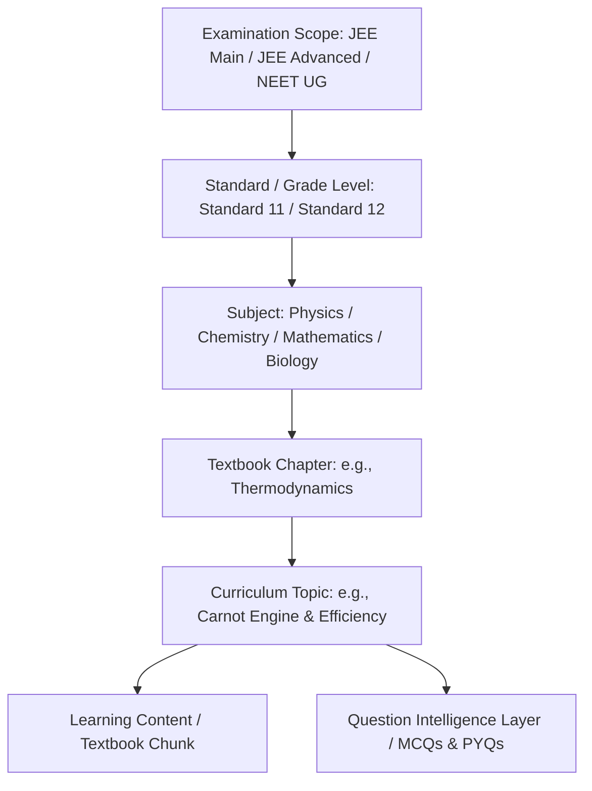
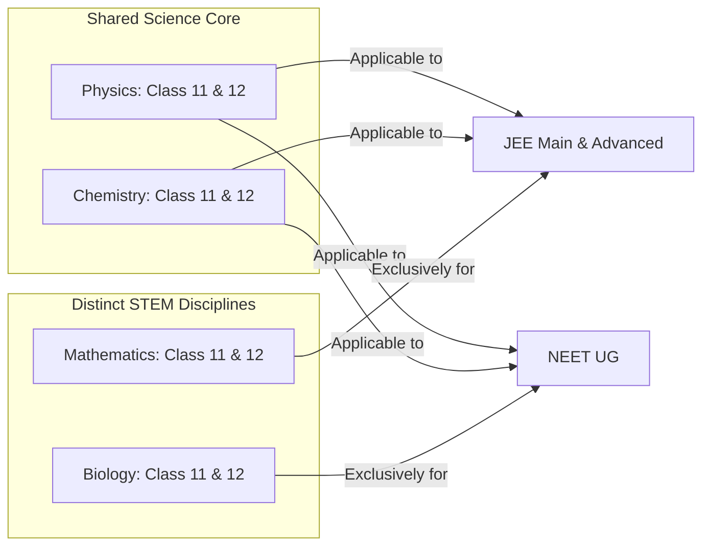

# EduNavika — JEE / NEET Canonical Curriculum Architecture

**Version:** 3.0.0  
**Target Examinations:** JEE Main, JEE Advanced, NEET UG  
**Target Grades:** GSEB / CBSE / NCERT Standards 11 & 12 (Science Stream)  
**Status:** Architecture Design Document (Milestone 3)

---

## 1. Executive Summary & Vision

EduNavika is transitioning from a general secondary curriculum platform into a high-precision, adaptive learning and exam-preparation system engineered specifically for:
- **JEE Main & JEE Advanced** (Physics, Chemistry, Mathematics)
- **NEET UG** (Physics, Chemistry, Biology: Botany & Zoology)

Competitive engineering and medical entrance examinations in India are anchored to the national **NCERT Standards 11 and 12 science syllabus**. Because the Gujarat Secondary and Higher Secondary Education Board (GSEB) adopts NCERT textbooks verbatim for Standards 11 and 12 Science stream, the core conceptual corpus is universally shared.

However, the cognitive demands, question patterns, and examination structures diverge significantly:
- **JEE Main:** Speed, conceptual accuracy, formula application, single-correct MCQs (SCQs) and non-negative integer numerical value questions.
- **JEE Advanced:** Multi-concept synthesis, multiple-correct MCQs (MCQs), matrix matches, paragraph/comprehension passages, and non-negative decimal/integer numericals with strict negative marking.
- **NEET UG:** High volume (200 questions, 180 to attempt in 200 minutes), deep NCERT textbook line-by-line factual recall, assertion-reasoning, match-the-column, and high-speed biological diagram/cycle recognition.

This document establishes the **canonical curriculum hierarchy**, cross-exam content deduplication model, provenance schema, and migration pathway.

---

## 2. Canonical Curriculum Hierarchy

The architecture establishes a 5-tier relational hierarchy:



### 2.1 Cross-Exam Content Sharing Strategy (Zero-Duplication Model)

A critical architectural pitfall in educational platforms is duplicating Physics and Chemistry content for each exam track (creating separate "JEE Physics" and "NEET Physics" chapters). In EduNavika:
1. **Core Curriculum is Canonical:** A single `Chapter` record (e.g. *Rotational Motion*, *Chemical Equilibrium*, or *Solutions*) and its constituent `Topic` records are stored **once** in the database.
2. **Subject-Exam Applicability is Explicit:**
   - **Physics:** Shared by JEE Main, JEE Advanced, and NEET UG.
   - **Chemistry:** Shared by JEE Main, JEE Advanced, and NEET UG.
   - **Mathematics:** Linked strictly to JEE Main and JEE Advanced.
   - **Biology:** Linked strictly to NEET UG (divided into Botany & Zoology modules).
3. **Question Bank is Exam-Aware & Multi-Dimensional:**
   Questions carry metadata for `examination` (e.g., `JEE_MAIN`, `JEE_ADVANCED`, `NEET_UG`), cognitive difficulty tier, and paper provenance, while attaching directly to the canonical `topic_id`.



---

## 3. Four-Tier Content Lineage & Provenance

To eliminate hallucinations and maintain pedagogical authority, all educational material is strictly partitioned into four distinct content types:

| Tier | Classification | Data Source | Invariants & Processing Rules |
|---|---|---|---|
| **Tier 1** | **Authoritative Textbook Corpus** | Official NCERT/GSEB Std 11 & 12 Science PDFs | 100% immutable text chunks. Carries exact `source_document`, `source_page`, and `chunk_identifier`. Used for RAG grounding and misconception remediation. |
| **Tier 2** | **Official Previous Year Questions (PYQs)** | NTA / IIT Joint Admission Board released exam papers | Verified question papers, year, session/shift, and official finalized answer keys. Untampered question wording and official diagrams. |
| **Tier 3** | **Curated Concept Notes & Formula Sheets** | Human-reviewed expert summaries | High-yield formula flashcards, derivation summaries, and mnemonic aids mapped to individual topics. |
| **Tier 4** | **Generated Adaptive Practice Questions** | Deterministic question bank & on-device SLM | Dynamically generated formative practice questions passed through the 10-Point Curriculum Validator. Must cite Tier 1 source page. |

---

## 4. Subject & Chapter Breakdown (Standards 11 & 12)

### 4.1 Physics (JEE Main, JEE Advanced, NEET UG)
- **Standard 11 (Parts 1 & 2):**
  1. Units and Measurements
  2. Motion in a Straight Line
  3. Motion in a Plane (Vectors, Projectile Motion, Circular Motion)
  4. Laws of Motion (Friction, Circular Dynamics)
  5. Work, Energy, and Power
  6. System of Particles and Rotational Motion
  7. Gravitation
  8. Mechanical Properties of Solids
  9. Mechanical Properties of Fluids
  10. Thermal Properties of Matter
  11. Thermodynamics
  12. Kinetic Theory of Gases
  13. Oscillations (SHM)
  14. Waves
- **Standard 12 (Parts 1 & 2):**
  1. Electric Charges and Fields
  2. Electrostatic Potential and Capacitance
  3. Current Electricity
  4. Moving Charges and Magnetism
  5. Magnetism and Matter
  6. Electromagnetic Induction
  7. Alternating Current
  8. Electromagnetic Waves
  9. Ray Optics and Optical Instruments
  10. Wave Optics
  11. Dual Nature of Radiation and Matter
  12. Atoms
  13. Nuclei
  14. Semiconductor Electronics: Materials, Devices and Simple Circuits

### 4.2 Chemistry (JEE Main, JEE Advanced, NEET UG)
- **Physical Chemistry (Std 11 & 12):**
  - Some Basic Concepts of Chemistry (Mole Concept, Stoichiometry)
  - Structure of Atom
  - Thermodynamics & Thermochemistry
  - Equilibrium (Chemical & Ionic)
  - Redox Reactions
  - Solutions & Colligative Properties
  - Electrochemistry
  - Chemical Kinetics
- **Inorganic Chemistry (Std 11 & 12):**
  - Classification of Elements and Periodicity in Properties
  - Chemical Bonding and Molecular Structure (VSEPR, Hybridization, MOT)
  - p-Block Elements (Groups 13 to 18)
  - d- and f-Block Elements
  - Coordination Compounds
- **Organic Chemistry (Std 11 & 12):**
  - Organic Chemistry: Some Basic Principles and Techniques (GOC, Isomerism)
  - Hydrocarbons (Alkanes, Alkenes, Alkynes, Aromatic)
  - Haloalkanes and Haloarenes
  - Alcohols, Phenols and Ethers
  - Aldehydes, Ketones and Carboxylic Acids
  - Amines & Nitrogen Compounds
  - Biomolecules (Carbohydrates, Proteins, Nucleic Acids)

### 4.3 Mathematics (Exclusively JEE Main & JEE Advanced)
- **Standard 11:** Sets, Relations and Functions, Trigonometric Functions, Complex Numbers and Quadratic Equations, Linear Inequalities, Permutations and Combinations, Binomial Theorem, Sequences and Series, Straight Lines, Conic Sections, Introduction to Three-Dimensional Geometry, Limits and Derivatives, Statistics, Probability.
- **Standard 12:** Relations and Functions, Inverse Trigonometric Functions, Matrices, Determinants, Continuity and Differentiability, Application of Derivatives, Integrals (Definite & Indefinite), Application of Integrals, Differential Equations, Vector Algebra, Three-Dimensional Geometry, Linear Programming, Probability.

### 4.4 Biology (Exclusively NEET UG)
- **Standard 11:**
  - Diversity in Living World (The Living World, Biological Classification, Plant Kingdom, Animal Kingdom)
  - Structural Organisation in Animals and Plants (Morphology & Anatomy of Flowering Plants, Animal Tissues)
  - Cell Structure and Function (Cell: The Unit of Life, Biomolecules, Cell Cycle and Cell Division)
  - Plant Physiology (Photosynthesis, Respiration in Plants, Plant Growth and Development)
  - Human Physiology (Breathing and Exchange of Gases, Body Fluids and Circulation, Excretory Products and their Elimination, Locomotion and Movement, Neural Control and Coordination, Chemical Coordination and Integration)
- **Standard 12:**
  - Reproduction (Sexual Reproduction in Flowering Plants, Human Reproduction, Reproductive Health)
  - Genetics and Evolution (Principles of Inheritance and Variation, Molecular Basis of Inheritance, Evolution)
  - Biology in Human Welfare (Human Health and Disease, Microbes in Human Welfare)
  - Biotechnology (Biotechnology: Principles and Processes, Biotechnology and its Applications)
  - Ecology and Environment (Organisms and Populations, Ecosystem, Biodiversity and Conservation)

---

## 5. Schema Evolution & Relational Design

To support multi-exam curriculum mappings without breaking backwards compatibility:

```sql
-- Exam Metadata Table
CREATE TABLE examinations (
    id VARCHAR(36) PRIMARY KEY,
    code VARCHAR(50) UNIQUE NOT NULL,       -- 'JEE_MAIN', 'JEE_ADVANCED', 'NEET_UG'
    name VARCHAR(150) NOT NULL,             -- 'Joint Entrance Examination (Main)'
    conducting_body VARCHAR(100) NOT NULL,  -- 'NTA', 'IIT_JAB'
    total_marks INTEGER NOT NULL,           -- 300 (JEE Main), 720 (NEET)
    duration_minutes INTEGER NOT NULL,      -- 180, 200
    is_active BOOLEAN DEFAULT TRUE NOT NULL
);

-- Subject-Exam Association Table
CREATE TABLE subject_examinations (
    id VARCHAR(36) PRIMARY KEY,
    subject_id VARCHAR(36) NOT NULL REFERENCES subjects(id) ON DELETE CASCADE,
    examination_id VARCHAR(36) NOT NULL REFERENCES examinations(id) ON DELETE CASCADE,
    weightage_percent FLOAT NULL,
    UNIQUE(subject_id, examination_id)
);

-- Topic-Exam Syllabus Scope Table
CREATE TABLE topic_examinations (
    id VARCHAR(36) PRIMARY KEY,
    topic_id VARCHAR(36) NOT NULL REFERENCES topics(id) ON DELETE CASCADE,
    examination_id VARCHAR(36) NOT NULL REFERENCES examinations(id) ON DELETE CASCADE,
    is_in_syllabus BOOLEAN DEFAULT TRUE NOT NULL,
    specific_notes TEXT NULL,               -- e.g. 'Semiconductors included in JEE Main, excluded in Advanced'
    UNIQUE(topic_id, examination_id)
);
```

### Invariants:
1. **Referential Cascade:** A topic belongs strictly to one canonical chapter, which belongs to one canonical subject and grade.
2. **Syllabus Granularity:** Certain topics (e.g., *Earth's Magnetism* or *Logic Gates*) are in JEE Main but explicitly pruned from JEE Advanced. The `topic_examinations` mapping specifies syllabus inclusion per exam.
3. **Backwards Compatibility:** Existing endpoints querying by `Standard` and `Subject` continue to function without disruption.

---

## 6. Migration Strategy (from GSEB 10 to JEE/NEET 11-12)

1. **Non-Destructive Standard Seeding:**
   Insert `Standard 11` (`grade_number = 11`) and `Standard 12` (`grade_number = 12`) into `standards` table.
2. **Subject Association:**
   Insert the 4 canonical subjects (Physics, Chemistry, Mathematics, Biology) under Standards 11 and 12.
3. **Synthetic Subject Cleanup:**
   The database audit identified 207 historical synthetic test fixtures (e.g. `Science Exp 050128`). A non-destructive isolation flag (`is_synthetic = TRUE` or scoped deprecation) will prevent them from appearing in student course explorers.
4. **Curriculum Package Distribution:**
   `backend/app/services/curriculum_package_service.py` will generate offline curriculum bundles (`curriculum_jee_main.json`, `curriculum_neet_ug.json`) containing chapters, formulas, and verified topic lists for zero-latency local client hydration.
