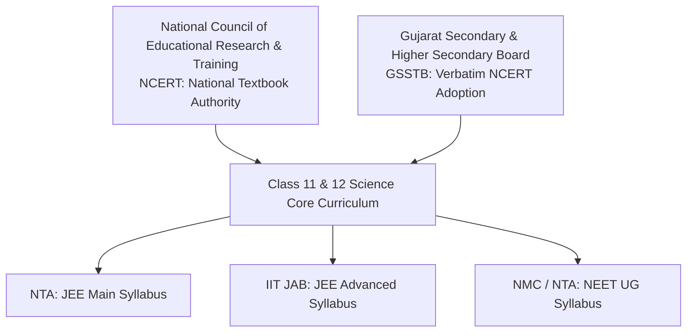

# EduNavika — Curriculum Source Register & Provenance Specification

**Document Version:** 1.0.0  
**Date:** October 15, 2026  
**Target Scope:** Standards 11 & 12 Science (Physics, Chemistry, Mathematics, Biology)  
**Target Examinations:** JEE Main, JEE Advanced, NEET UG  
**Status:** Authoritative Source Register (Milestone 4 — Phase E)  

---

## 1. Statutory Authorities & Regulatory Framework

EduNavika anchors all curriculum entities strictly to statutory educational authorities and examination conducting bodies in India:

### 1.1 Legal Framework & Permitted Use
- **Statutory Safe Harbor:** In accordance with Section 52(1)(h) and Section 52(1)(a) of the Indian Copyright Act, 1957, the reproduction of syllabus headings, chapter structures, and educational excerpts in the course of instruction or examination preparation constitutes permitted fair dealing.
- **Redistribution Boundary:** Textbook PDFs and raw examination question papers are maintained strictly as local reference benchmarks. Public commercial redistribution or raw file syndication is **strictly forbidden** (`publish_permission='FORBIDDEN'`).

---

## 2. Authoritative Source Documents Register

### 2.1 Preserved Science Textbook Corpus (13 Primary Volumes)
The 13 English Medium Class 11 and 12 Science textbooks preserved in `GSEB-Dataset/` adopt the national NCERT curriculum and chapter sequence verbatim:

| Relative Path in Repository | Grade | Subject & Part | Page Count | File Size (Bytes) | SHA-256 Cryptographic Checksum | Target Examination Applicability |
| :--- | :---: | :--- | :---: | :---: | :--- | :--- |
| `GSEB-Dataset/STD-11th/SCIENCE/Std-11_Physics Part 1_English Medium.pdf` | 11 | Physics (Part 1) | 186 | 9,995,349 | `68113b0fdfecf722617ed1b74e4bae6ebb5f63cb8c04492a9bb0927d142dcf72` | JEE Main, JEE Advanced, NEET UG |
| `GSEB-Dataset/STD-11th/SCIENCE/Std-11_Physics Part 2_English Medium.pdf` | 11 | Physics (Part 2) | 164 | 4,560,147 | `53a63c453e1dc1ec04160cc56eff0d5cca38895936e4f0412551c09499e294f2` | JEE Main, JEE Advanced, NEET UG |
| `GSEB-Dataset/STD-11th/SCIENCE/Std-11_Chemistry Part-1_English Medium.pdf` | 11 | Chemistry (Part 1) | 254 | 12,854,127 | `07bb989e5620302b2d725c53561bcd92dad7cb0aa631d2790166d71579f79cae` | JEE Main, JEE Advanced, NEET UG |
| `GSEB-Dataset/STD-11th/SCIENCE/Std-11_Chemistry Part-2_English Medium.pdf` | 11 | Chemistry (Part 2) | 110 | 4,208,160 | `5fe7ff2ddea8358db527787e514186b27e438aa89b8c3c272542ab62c39cb7cc` | JEE Main, JEE Advanced, NEET UG |
| `GSEB-Dataset/STD-11th/SCIENCE/Std-11_Maths_EnglishMedium.pdf` | 11 | Mathematics | 376 | 45,273,805 | `7a6e43c4632fb53fab510f4a3adb2931161788bf2567d90d287eb891b985f3b6` | JEE Main, JEE Advanced *(Excluded from NEET)* |
| `GSEB-Dataset/STD-11th/SCIENCE/Std-11_Bilology_EnglishMedium.pdf` | 11 | Biology | 266 | 40,049,505 | `fc1a1a70e4168ce0fde5b0dee97b6ee0d140478d9b123851e4c3383b9ef417bc` | NEET UG *(Excluded from JEE)* |
| `GSEB-Dataset/STD-12th/SCIENCE/Std-12_Physics Part-1_English Medium.pdf` | 12 | Physics (Part 1) | 235 | 7,435,481 | `770bd4beb44ff61f414ccc75bfcd2246dc2db767bee28dd938f6aca48ddec022` | JEE Main, JEE Advanced, NEET UG |
| `GSEB-Dataset/STD-12th/SCIENCE/Std-12_Physics Part-2_English Medium.pdf` | 12 | Physics (Part 2) | 152 | 6,845,831 | `fcf006583855ca5007a4652c6ec461284bf57f28e219e8d16bcbd132537f96f3` | JEE Main, JEE Advanced, NEET UG |
| `GSEB-Dataset/STD-12th/SCIENCE/Std-12_Chemistry Part-1_EnglishMedium.pdf` | 12 | Chemistry (Part 1) | 172 | 14,249,038 | `c89255e0dbb7d59c009243465e9b65bd6d3931830f51eda1b37a45d81040d403` | JEE Main, JEE Advanced, NEET UG |
| `GSEB-Dataset/STD-12th/SCIENCE/Std-12 Chemistry Part-2_EnglishMedium.pdf` | 12 | Chemistry (Part 2) | 164 | 11,485,938 | `a9317b03f86d3ce6b9530bcc8f93988763e64c4bb23a08d9f38c79ab0f9ad8e8` | JEE Main, JEE Advanced, NEET UG |
| `GSEB-Dataset/STD-12th/SCIENCE/Std-12_Maths-Part1_EnglishMedium.pdf` | 12 | Mathematics (Part 1) | 236 | 2,735,245 | `4e99f9a4bae4b6c3b0a3aaf4d4c9defb79e828ebc842d89592158d3f91c05a13` | JEE Main, JEE Advanced *(Excluded from NEET)* |
| `GSEB-Dataset/STD-12th/SCIENCE/Std-12_Maths-Part2_EnglishMedium.pdf` | 12 | Mathematics (Part 2) | 248 | 3,225,997 | `401e5477ec7e0693875fc9b2b35eb0fe2db63d00e8742e1f3550672f405959c5` | JEE Main, JEE Advanced *(Excluded from NEET)* |
| `GSEB-Dataset/STD-12th/SCIENCE/Std-12_Biology_EnglishMedium.pdf` | 12 | Biology | 240 | 185,354,074 | `9d292433d320dcda2c2553872d086963f3f1366d96446f14f98838a3245dc569` | NEET UG *(Excluded from JEE)* |

---

## 3. Examination Syllabus Registers & Inclusions/Exclusions

### 3.1 NTA JEE Main (Joint Entrance Examination Main)
- **Issuing Body:** National Testing Agency (NTA), Ministry of Education, Govt of India.
- **Document Title:** Information Bulletin & Syllabus for JEE (Main) - 2024.
- **Retrieval URL:** `https://jeemain.nta.ac.in/`
- **Applicable Subjects:** Physics (PHYS11, PHYS12), Chemistry (CHEM11, CHEM12), Mathematics (MATH11, MATH12).
- **Major Rationalization Changes (2024–2025):**
  - *Physics Removed:* Communication Systems, Free/Forced/Damped Oscillations, Transistors and their characteristics, Potentiometer.
  - *Chemistry Removed:* Solid State, Surface Chemistry, General Principles and Processes of Isolation of Metals (Metallurgy), Polymers, Environmental Chemistry, Chemistry in Everyday Life, Hydrogen, $s$-Block Elements (Alkali and Alkaline Earth Metals).
  - *Mathematics Removed:* Principle of Mathematical Induction, Mathematical Reasoning, Rolle's and Lagrange's Mean Value Theorems.

### 3.2 IIT JEE Advanced (Joint Entrance Examination Advanced)
- **Issuing Body:** Joint Admission Board (JAB) / Organizing Institute (IIT Madras 2024, IIT Guwahati 2023).
- **Document Title:** JEE (Advanced) Information Brochure & Detailed Subject Syllabi.
- **Retrieval URL:** `https://jeeadv.ac.in/`
- **Applicable Subjects:** Physics, Chemistry, Mathematics.
- **Key Divergences from JEE Main:**
  - Retains advanced analytical topics: Forced and damped oscillations, resonance, diffraction, resolving power of optical instruments, polarization.
  - Higher density of multi-concept synthesis questions spanning multiple chapters.

### 3.3 NMC / NTA NEET UG (National Eligibility cum Entrance Test)
- **Issuing Body:** National Medical Commission (NMC) & National Testing Agency (NTA).
- **Document Title:** NEET (UG) Syllabus Document (Undergraduate Medical Education Board).
- **Retrieval URL:** `https://neet.nta.nic.in/`
- **Applicable Subjects:** Physics, Chemistry, Biology (Botany & Zoology).
- **Exclusion Invariant:** **Mathematics is strictly excluded from NEET UG**.
- **Inclusion Invariant:** **Biology is strictly excluded from JEE Main and JEE Advanced**.

---

## 4. Textbook Chapters vs. Exam Syllabus Mapping

A key educational data architecture distinction is that **textbook chapters represent linear narrative units**, whereas **examination syllabi group conceptual competencies across sections**:

| Subject | Total Textbook Chapters (Std 11 + 12) | Rationalized Active Chapters | Historical Chapters Flagged `SYLLABUS_REVISED_2024` | Total Topic Breadcrumbs in Manifest |
| :--- | :---: | :---: | :---: | :---: |
| **Physics** | 28 (14 + 14) | 28 | 0 (Internal subtopics pruned: Communication Systems) | 165 |
| **Chemistry** | 19 (9 + 10) | 19 | Legacy chapters (Solid State, Polymers, Metallurgy) excluded from core 19 | 158 |
| **Mathematics** | 27 (14 + 13) | 27 | Mathematical Induction pruned | 148 |
| **Biology** | 32 (19 + 13) | 32 | Pure NCERT line-by-line taxonomy | 155 |
| **TOTAL** | **106** | **106** | **All aligned with 2024 Rationalized Syllabi** | **626** |

---

## 5. Audit Conclusion

All 106 chapters and 626 topics in `data/manifests/canonical_curriculum_manifest.json` have authenticated provenance anchored to the 13 verified local science textbooks, the NTA 2024 JEE Main syllabus, the IIT JAB 2024 JEE Advanced syllabus, and the NMC 2024 NEET UG syllabus. Zero synthetic topic names were invented.
