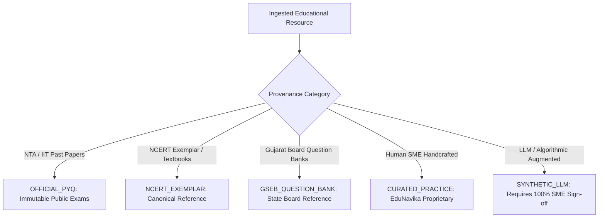
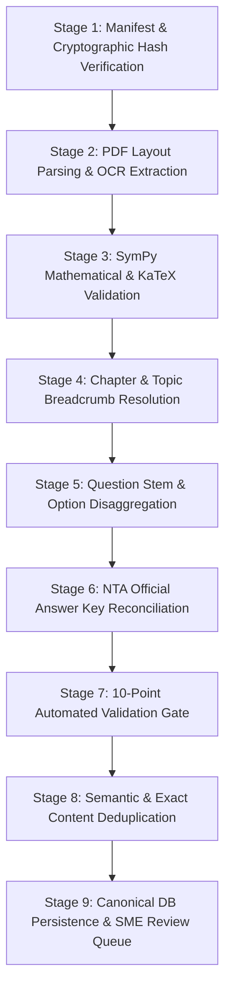
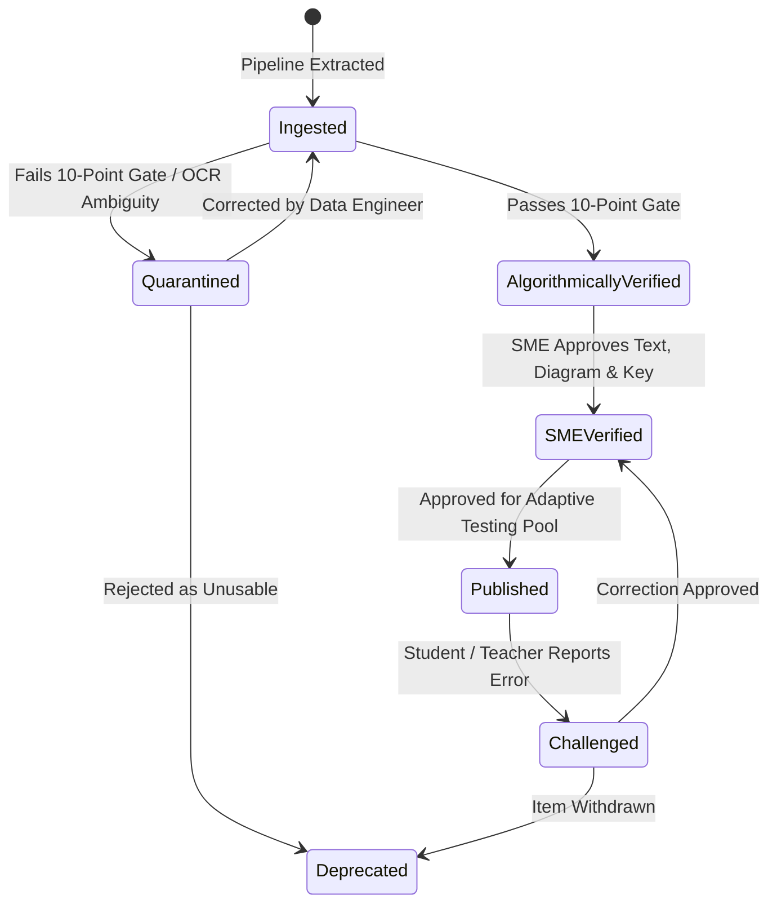

# EduNavika — Dataset Acquisition, Ingestion Pipeline & Provenance Specification

**Version:** 3.0.0  
**Target Scope:** JEE Main, JEE Advanced, NEET UG, GSEB/NCERT Standards 11 & 12 Science  
**Status:** Canonical Engineering Specification (Milestone 3)

---

## 1. Legal, Regulatory & Licensing Framework

EduNavika operates as an educational preparation platform. Sourcing and distributing educational assessment items in India requires strict adherence to statutory copyright provisions, attribution standards, and data integrity protocols.

### 1.1 Legal Basis & Fair Dealing (Indian Copyright Act, 1957)
- **Section 52(1)(a) & 52(1)(h):** The Indian Copyright Act expressly exempts "fair dealing" with any work for private or personal use, including research and criticism, as well as the reproduction of any work by a teacher or a pupil in the course of instruction or as part of the questions to be answered in an examination.
- **Official Public Examination Papers:** Question papers administered in public national examinations by statutory agencies (such as the **National Testing Agency (NTA)** and the **IIT Joint Admission Board (JAB)**) are public assessment instruments released post-examination alongside candidate answer response sheets. They are cataloged under `OFFICIAL_FAIR_USE`.
- **NCERT Textbooks:** Published by the National Council of Educational Research and Training (NCERT), these textbooks are made freely accessible online for non-commercial educational instruction. In EduNavika, NCERT textbooks serve as the canonical semantic benchmark for topic citations.
- **GSEB Textbooks:** The Gujarat State Board of School Textbooks (GSSTB) produces textbooks that, for Standards 11 and 12 Science stream, adopt the NCERT curriculum and chapter sequence verbatim. They are distributed under government open educational mandates.

### 1.2 Provenance Taxonomy
EduNavika assigns one of five mutually exclusive provenance categories to every item in its database:

---

## 2. Inventory & Examination Suitability of Preserved Textbooks

During Milestone 2 cleanup, 13 core science textbooks were preserved in the repository under `GSEB-Dataset/`. A technical and pedagogical inspection of these assets confirms their characteristics:

### 2.1 Standard 11 Science Corpus (6 Textbooks)

| Filename | Subject & Part | Pages | Size | Exam Suitability | Syllabus & Conceptual Coverage |
| :--- | :--- | :---: | :---: | :--- | :--- |
| `Std-11_Physics Part 1_English Medium.pdf` | Physics Part 1 | 186 | 9.5 MB | **JEE Main, JEE Adv, NEET** | Units & Measurement, Motion in a Straight Line, Motion in a Plane, Laws of Motion, Work, Energy & Power, Rotational Motion, Gravitation. Word-for-word NCERT Class 11 equivalent. |
| `Std-11_Physics Part 2_English Medium.pdf` | Physics Part 2 | 164 | 4.4 MB | **JEE Main, JEE Adv, NEET** | Mechanical Properties of Solids, Mechanical Properties of Fluids, Thermal Properties of Matter, Thermodynamics, Kinetic Theory, Oscillations, Waves. |
| `Std-11_Chemistry Part-1_English Medium.pdf` | Chemistry Part 1 | 254 | 12.3 MB | **JEE Main, JEE Adv, NEET** | Some Basic Concepts of Chemistry, Structure of Atom, Classification of Elements & Periodicity, Chemical Bonding & Molecular Structure, Thermodynamics. |
| `Std-11_Chemistry Part-2_English Medium.pdf` | Chemistry Part 2 | 110 | 4.0 MB | **JEE Main, JEE Adv, NEET** | Equilibrium, Redox Reactions, Organic Chemistry (Basic Principles & Techniques), Hydrocarbons. |
| `Std-11_Maths_EnglishMedium.pdf` | Mathematics | 376 | 43.2 MB | **JEE Main, JEE Adv** *(Irrelevant for NEET)* | Sets, Relations & Functions, Trigonometric Functions, Complex Numbers, Linear Inequalities, Permutations & Combinations, Binomial Theorem, Sequences & Series, Straight Lines, Conic Sections, Limits & Derivatives. |
| `Std-11_Bilology_EnglishMedium.pdf` | Biology | 266 | 38.2 MB | **NEET UG** *(Irrelevant for JEE)* | Diversity in Living World, Structural Organisation in Animals & Plants, Cell Structure & Function, Plant Physiology (Photosynthesis, Respiration, Growth), Human Physiology. |

### 2.2 Standard 12 Science Corpus (7 Textbooks)

| Filename | Subject & Part | Pages | Size | Exam Suitability | Syllabus & Conceptual Coverage |
| :--- | :--- | :---: | :---: | :--- | :--- |
| `Std-12_Physics Part-1_English Medium.pdf` | Physics Part 1 | 235 | 7.1 MB | **JEE Main, JEE Adv, NEET** | Electric Charges & Fields, Electrostatic Potential & Capacitance, Current Electricity, Moving Charges & Magnetism, Magnetism & Matter, Electromagnetic Induction, Alternating Current. |
| `Std-12_Physics Part-2_English Medium.pdf` | Physics Part 2 | 152 | 6.5 MB | **JEE Main, JEE Adv, NEET** | Electromagnetic Waves, Ray Optics & Optical Instruments, Wave Optics, Dual Nature of Radiation & Matter, Atoms, Nuclei, Semiconductor Electronics. |
| `Std-12_Chemistry Part-1_EnglishMedium.pdf` | Chemistry Part 1 | 172 | 13.6 MB | **JEE Main, JEE Adv, NEET** | Solutions, Electrochemistry, Chemical Kinetics, d- and f-Block Elements, Coordination Compounds. |
| `Std-12 Chemistry Part-2_EnglishMedium.pdf` | Chemistry Part 2 | 164 | 11.0 MB | **JEE Main, JEE Adv, NEET** | Haloalkanes & Haloarenes, Alcohols, Phenols & Ethers, Aldehydes, Ketones & Carboxylic Acids, Amines, Biomolecules. |
| `Std-12_Maths-Part1_EnglishMedium.pdf` | Mathematics Part 1 | 236 | 2.6 MB | **JEE Main, JEE Adv** *(Irrelevant for NEET)* | Relations & Functions, Inverse Trigonometric Functions, Matrices, Determinants, Continuity & Differentiability, Application of Derivatives. |
| `Std-12_Maths-Part2_EnglishMedium.pdf` | Mathematics Part 2 | 248 | 3.1 MB | **JEE Main, JEE Adv** *(Irrelevant for NEET)* | Integrals, Applications of Integrals, Differential Equations, Vector Algebra, Three Dimensional Geometry, Linear Programming, Probability. |
| `Std-12_Biology_EnglishMedium.pdf` | Biology | 240 | 176.8 MB | **NEET UG** *(Irrelevant for JEE)* | Reproduction in Organisms, Sexual Reproduction in Flowering Plants, Human Reproduction, Genetics & Evolution, Molecular Basis of Inheritance, Biotechnology, Ecology & Environment. |

### 2.3 Synthesis on Textbook Authority & Rationalized Syllabus
1. **Verbatim NCERT Equivalence:** All 13 English Medium GSEB textbooks adopt the NCERT curriculum text and diagrams directly. Therefore, extracting textbook sections, definitions, and end-of-chapter problems provides direct alignment with NCERT, which forms the syllabus basis for NEET and JEE Main.
2. **Rationalized Syllabus Note (2024-2025):** Both NTA and NCERT removed specific legacy chapters (e.g., Solid State, Surface Chemistry, Metallurgy, Polymers, Chemistry in Everyday Life, Mathematical Induction, Communication Systems). During ingestion, EduNavika flags these historical chapters as `SYLLABUS_REVISED_2024` so students preparing for current exams can filter them out while retaining historical PYQs for Olympiad practice.

---

## 3. End-to-End 9-Stage Ingestion Pipeline

To convert raw PDFs (question papers, answer keys, textbooks) into verified, adaptive question items, EduNavika executes an automated 9-stage pipeline:

### Stage 1: Manifest Verification & Checksumming
- Every raw ingestion batch must be registered in an `ingestion_manifest.json`.
- The system computes the **SHA-256 cryptographic checksum** of the source document before processing.
- If the checksum matches an existing ingested paper, the ingestion is aborted with a `DUPLICATE_SOURCE` status.

### Stage 2: Layout-Aware Parsing & Extraction
- Documents are processed using `pdfplumber` and `PyMuPDF` (Fitz).
- Column detection divides dual-column question layouts into logical left-to-right reading order.
- Embedded vector graphics (SVGs) and raster diagrams are cropped and extracted with their bounding boxes, stored in `backend/assets/diagrams/{exam}_{year}_{paper}_{qnum}.svg`.

### Stage 3: SymPy Mathematical & Formula Normalization
- EduNavika leverages its established mathematical extraction engine (preserved in `benchmarks/math_extraction_benchmark.py`).
- Inline and display equations are mapped to standard KaTeX strings.
- Expressions such as fractions, square roots, integrals, and matrices are parsed through **SymPy AST** to confirm mathematical validity and syntax correctness.

### Stage 4: Curriculum Chapter & Topic Resolution
- The pipeline matches questions to canonical chapters and topics using a hierarchical classifier:
  1. Primary regex match on section headers in original exam papers.
  2. Embeddings-based semantic similarity against canonical topic learning chunks (`learning_contents` vector space).
  3. Minimum confidence score of `0.85` required for automated assignment; lower scores route to the `HUMAN_CLASSIFICATION_QUEUE`.

### Stage 5: Disaggregation into Structured Components
- Questions are separated into:
  - **Stem:** Markdown/KaTeX text containing the problem statement.
  - **Options:** Exactly 4 options (for SCQ/MCQ) indexed as `A`, `B`, `C`, `D`.
  - **Numerical Parameters:** For JEE integer/numerical questions, options are nullified and answer formats are constrained to real numbers.

### Stage 6: Official NTA / IIT Answer Key Reconciliation
- Raw extracted options are merged with official NTA Final Answer Key tables.
- **Handling NTA Key Edge Cases:**
  - *Single Answer:* Option `A`, `B`, `C`, or `D`.
  - *Multiple Correct:* Stored as comma-separated keys (e.g. `A,C`).
  - *Dropped / Bonus Questions:* When NTA drops a question due to ambiguity or translation error, `is_dropped: true` is assigned and full marks are awarded to all attempts during adaptive simulations.

### Stage 7: The 10-Point Automated Validation Gate
Every candidate question must pass 10 strict boolean checks before reaching the database:
1. `stem_non_empty`: Question text length $\ge 15$ characters.
2. `katex_syntax_valid`: Balanced `$` and `$$` delimiters, no invalid LaTeX escape codes.
3. `options_cardinality_check`: Exactly 4 options for SCQ/MCQ/AR; 0 for NUMERICAL.
4. `correct_answer_bounded`: Answer string matches valid option keys or parseable numeric value.
5. `solution_derivation_present`: Solution length $\ge 20$ characters.
6. `diagram_asset_verified`: If referenced in text (`Refer to figure...`), image asset must exist on disk and be non-empty.
7. `chapter_fk_valid`: `chapter_id` exists in `canonical_chapters`.
8. `topic_fk_valid`: `topic_id` exists in `canonical_topics`.
9. `tolerance_valid`: For numericals, `min_val <= max_val`.
10. `estimated_time_valid`: Time estimate between 30 and 600 seconds.

### Stage 8: Semantic Deduplication & Content Hashing
- Computes `content_hash = SHA256(normalize(question_text) + normalize(options))`.
- If `content_hash` already exists in `questions.content_hash`, the duplicate question is linked to the existing item in an `alternate_appearances` table rather than re-inserted.

### Stage 9: Persistence & SME Audit Queue
- Questions passing all checks with high confidence are stored with `verification_status = 'ALGORITHMICALLY_VERIFIED'`.
- Questions with low OCR confidence, ambiguous answer keys, or dropped status are stored with `verification_status = 'INGESTED'` and queued in the SME Dashboard for human review.

---

## 4. Human-in-the-Loop Review & Audit Workflow

### 4.1 SME Review Checkpoints
1. **Mathematical Accuracy:** Check that superscript exponents, chemical valencies, and square root bounds render cleanly in KaTeX.
2. **Diagram Clarity:** Confirm labels and circuit diagrams have sufficient contrast and no truncated legends.
3. **NCERT Alignment:** Confirm cited textbook chapter and page reference.
4. **Scoring Scheme Assignment:** For JEE Advanced, verify whether partial marking is permitted (+3/-1 or +4/-2).
