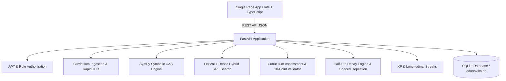

# EduNavika Milestone 1: Repository Audit & Safe Cleanup Plan

**Target Pivot:** Adaptive Learning Platform Exclusively for JEE (Main & Advanced) and NEET (UG) Aspirants  
**Scope:** Elimination of GSEB Standards 9–10 content; Preservation of core mathematical, OCR, telemetry, retrieval, adaptive scheduling, and assessment infrastructure; Preparation for Standards 11–12 Physics, Chemistry, Mathematics, Biology, and Competitive Exam PYQs.  
**Audit Date:** October 15, 2026  
**Status:** Audit Complete — Awaiting Approval Before File Deletion

---

## 1. Architecture Summary

EduNavika is built on a clean, decoupled two-tier architecture optimized for local and offline-first execution:



### Core Subsystems:
1. **Data Model & Persistence (`backend/app/models/`):**
   - Hierarchical relational schema: `Standard` $\rightarrow$ `Subject` $\rightarrow$ `Chapter` $\rightarrow$ `Topic` $\rightarrow$ `LearningContent`.
   - Assessment layer: `MCQQuestion` (with source content page & chunk provenance), `Assessment`, `Attempt`, `Answer`.
   - Longitudinal telemetry: `LearningEvent`, `TopicPerformance`, `ForgettingSignal`, `RevisionPlan`, `Quest`.
2. **Ingestion & Mathematical Engine (`backend/app/ingestion/`):**
   - High-throughput PDF extraction via `pypdfium2` and `rapidocr-onnxruntime`.
   - Mathematical region extraction, LaTeX normalization, and SymPy Computer Algebra System (CAS) evaluation.
3. **Retrieval & RAG (`backend/app/retrieval/`, `backend/app/rag/`):**
   - Reciprocal Rank Fusion (RRF) combining BM25 lexical search and dense embeddings.
4. **Adaptive Learning & Decay Engine (`backend/app/domain/`, `backend/app/services/`):**
   - Exponential forgetting curve with half-life stability updates based on answer correctness, recency, and response time.
   - Idempotent event recorder and multi-interval spaced repetition planner.
5. **Frontend Client (`frontend/src/`):**
   - TypeScript SPA with hash routing (`router.ts`), design system layout (`AppShell.ts`), interactive views (`StudentViews.ts`, `TeacherViews.ts`), and typed API clients (`authService.ts`, `adaptiveService.ts`, `curriculumService.ts`).

---

## 2. Component Inventory & Classification

Every directory and critical module has been audited and classified under one of five categories:
- **KEEP:** Reusable core infrastructure essential for the platform.
- **REFACTOR:** Architecture is sound, but internal references to Grade 10 / old scopes must be updated to Grade 11/12 & JEE/NEET.
- **MIGRATE:** Data structures, banks, or seed pipelines that require replacing Std 10 content with Std 11-12 & JEE/NEET PYQs.
- **REMOVE CANDIDATE:** Obsolete, demonstrably unused, or superseded files.
- **INVESTIGATE:** Secondary files requiring architectural confirmation.

### 2.1 Backend Core & Services

| Path | Category | Rationale & Evidence |
|---|---|---|
| `backend/app/core/` (`config.py`, `database.py`, `security.py`) | **KEEP** | Core database session management, JWT auth, and configuration settings. |
| `backend/app/models/` (`core_models.py`, `curriculum_models.py`, `assessment_models.py`, `adaptive_models.py`) | **KEEP** | Standard, Subject, Chapter, Topic, MCQ, LearningEvent schemas are completely curriculum-agnostic and fully support Standards 11 & 12. |
| `backend/app/domain/` (`decay_engine.py`, `enums.py`) | **KEEP** | Mathematical implementation of forgetting curves, mastery states, and revision priority. |
| `backend/app/ingestion/` (`cleaner.py`, `chunker.py`, `mapper.py`, `pdf_extractor.py`, `pipeline.py`, `structure.py`) | **KEEP** | PDF parser and chunking pipeline. Required for processing JEE/NEET textbooks. |
| `backend/app/ingestion/math/` (`evaluator.py`, `normalizer.py`, `region_detector.py`, `targeted_extractor.py`) | **KEEP** | SymPy symbolic CAS validation and LaTeX extraction. Essential for JEE/NEET mathematics and physics. |
| `backend/app/ingestion/ocr/` (`ocr_engine.py`, `ocr_benchmark.py`, `ocr_auditor.py`) | **KEEP** | RapidOCR onnxruntime pipeline and benchmark tooling. Required for diagram and mathematical paper scanning. |
| `backend/app/retrieval/` & `backend/app/rag/` | **KEEP** | Hybrid search, RRF fusion, and local context generation. |
| `backend/app/services/event_recorder.py` | **KEEP** | Idempotent event recorder for practice and assessment events. |
| `backend/app/services/knowledge_model.py` | **KEEP** | Computes 4-tier student topic mastery and trend analysis. |
| `backend/app/services/gamification_service.py` | **KEEP** | Education-focused XP, streaks, and milestone achievements. |
| `backend/app/services/topic_resolver.py` | **REFACTOR** | Resolves topic titles to IDs; contains hardcoded keyword fallback IDs for Std 10 topics that must be updated to Std 11/12 Physics, Chemistry, Math, Biology. |
| `backend/app/services/curriculum_question_bank.py` | **MIGRATE** | The 10-point `CurriculumQuestionValidator` engine is **KEEP**; the embedded `CANONICAL_CURRICULUM_BANK` contains Std 10 questions and must be migrated to JEE/NEET questions. |
| `backend/app/services/curriculum_translations.py` | **MIGRATE** | Multilingual utilities and reason localization are **KEEP**; question dictionary contains Std 10 questions to be migrated. |
| `backend/app/services/additional_curriculum_questions.py` | **REMOVE CANDIDATE** | Contains only Std 10 questions for Social Science, Yoga, Computer Studies, and Sanskrit. Not imported by any core engine except line 1969 of question bank. |
| `backend/app/services/adaptive_practice.py` | **REFACTOR** | Adaptive practice generation engine is solid; adjust default fallback textbook references from Std 10 to Std 11/12 Science. |
| `backend/app/services/revision_planner.py` | **REFACTOR** | Spaced repetition scheduler is solid; update default fallback textbook documents (`STD-10/Std-10_Science_English Medium.pdf` $\rightarrow$ Std 11/12). |
| `backend/app/services/recommendation_engine.py` | **REFACTOR** | Recommendation generator is solid; update starter topic fallbacks. |
| `backend/app/services/progress_service.py` | **REFACTOR** | Dynamic subject resolver is solid; update canonical subject code checks from Std 10 `science_and_technology` to Physics, Chemistry, Mathematics, Biology. |
| `backend/app/services/personalized_explanation.py` | **KEEP** | Grounded explanation engine integrating student profile + textbook retrieval. |

### 2.2 API Endpoints

| Path | Category | Rationale & Evidence |
|---|---|---|
| `backend/app/api/v1/endpoints/auth.py` | **KEEP** | User registration, login, JWT token issuance. |
| `backend/app/api/v1/endpoints/users.py` | **KEEP** | Profile management and role assignment. |
| `backend/app/api/v1/endpoints/curriculum.py` | **REFACTOR** | Change default query `grade: int = Query(10)` to `Query(11)` and add stream/exam query filters. |
| `backend/app/api/v1/endpoints/adaptive.py` | **KEEP** | Practice session generation, submission, decay detection, revision scheduling. |
| `backend/app/api/v1/endpoints/attempts.py` | **KEEP** | Formal assessment start, submission, and scoring. |
| `backend/app/api/v1/endpoints/assessments.py` | **KEEP** | Assessment creation and publishing. |
| `backend/app/api/v1/endpoints/learning_events.py` | **KEEP** | Raw telemetry ingest. |
| `backend/app/api/v1/endpoints/teacher_actions.py` | **KEEP** | Targeted teacher interventions. |
| `backend/app/api/v1/endpoints/mcqs.py` | **KEEP** | Direct MCQ creation and querying. |
| `backend/app/api/v1/endpoints/content.py`, `retrieval.py`, `revision.py`, `performance.py`, `forgetting_signals.py` | **KEEP** | Modular curriculum content and telemetry endpoints. |

### 2.3 Datasets and Storage

| Path | Category | Rationale & Evidence |
|---|---|---|
| `GSEB-Dataset/STD-9th/` (11 PDFs, ~450 MB) | **REMOVE CANDIDATE** | Non-target Std 9 textbooks (Sanskrit, Gujarati, Computer, Social Science, Shrimad Bhagwat Gita). Not part of JEE/NEET. |
| `GSEB-Dataset/STD-10th/` (12 PDFs, ~600 MB) | **REMOVE CANDIDATE** | Non-target Std 10 textbooks. Not part of JEE/NEET. |
| `GSEB-Dataset/STD-11th/SCIENCE/` (6 PDFs, ~117 MB) | **KEEP** | Std 11 NCERT/GSEB core textbooks: Physics Parts 1-2, Chemistry Parts 1-2, Mathematics, Biology. Essential for JEE/NEET base grounding. |
| `GSEB-Dataset/STD-12th/SCIENCE/` (7 PDFs, ~256 MB) | **KEEP** | Std 12 NCERT/GSEB core textbooks: Physics Parts 1-2, Chemistry Parts 1-2, Mathematics Parts 1-2, Biology. Essential for JEE/NEET base grounding. |
| `GSEB-Dataset/STD-11th/` (Non-Science PDFs) | **REMOVE CANDIDATE** | Non-science subjects (Geography, Psychology, Sociology, Sanskrit, Shrimad Bhagwat Gita, Yoga). |
| `GSEB-Dataset/STD-12th/` (Non-Science PDFs) | **REMOVE CANDIDATE** | Non-science subjects (including 986 MB `Std-12_Lapwimg English Medium.pdf`, Sanskrit, Sociology, etc.). |
| `data/processed/reports/` (25 benchmark files) | **KEEP** | Contains mathematical extraction benchmark artifacts (`math_ground_truth.json`, `hardened_ground_truth.json`, `ocr_benchmark_report.json`). Specifically protected by user constraint. |
| `models/qwen2.5-0.5b-instruct-q4_k_m.gguf` | **KEEP** | Local SLM inference fallback marker for on-device explanation capability. |
| `edunavika.db` | **REFACTOR** | Database contains schema and user profiles. Curriculum data will be refreshed with Standards 11-12 via seed migration. |

### 2.4 Frontend

| Path | Category | Rationale & Evidence |
|---|---|---|
| `frontend/src/layouts/AppShell.ts` | **REFACTOR** | Update default grade tag `'Grade 10 · Science'` to `'Grade 11 · JEE/NEET'`. |
| `frontend/src/features/student/StudentViews.ts` | **REFACTOR** | Update curriculum badges and subject listings from Std 10 subjects (Social Science, etc.) to JEE/NEET streams (Physics, Chemistry, Mathematics, Biology). |
| `frontend/src/features/teacher/TeacherViews.ts` | **REFACTOR** | Update teacher class overviews and subject assignment filters to JEE/NEET courses. |
| `frontend/src/services/authService.ts` | **REFACTOR** | Update mock default registration grade from `'Grade 10'` to `'Grade 11'`. |
| `frontend/src/services/curriculumService.ts` | **REFACTOR** | Update default hierarchy requests from `grade=10` to `grade=11`. |
| `frontend/src/services/adaptiveService.ts` | **KEEP** | API client for practice generation, submission, gamification, and revision planning. |
| `frontend/demo/` (`demo.css`, `demo.js`, `index.html`) | **INVESTIGATE** | Independent static demonstration harness. Check if referenced in marketing or pitch demos before removal. |

### 2.5 Scripts & Notebooks

| Path | Category | Rationale & Evidence |
|---|---|---|
| `scripts/benchmark_math_extraction.py` | **KEEP** | Core research verification for mathematical formula extraction. |
| `scripts/build_stratified_math_gt.py` | **KEEP** | Stratified mathematical ground-truth generator. |
| `scripts/validate_math_gt.py`, `generate_hardened_gt.py`, `audit_math_preservation.py` | **KEEP** | Math benchmark tooling. |
| `scripts/populate_all_curriculum_subjects.py` | **MIGRATE** | 646-line seed script for Std 10 subjects. Rewrite as `populate_jee_neet_curriculum.py` for Std 11 & 12 Science. |
| `scripts/generate_status_pdf.py` | **REMOVE CANDIDATE** | 757-line script for a temporary hackathon status PDF. |
| `notebooks/` (`01` through `05`) | **KEEP** | Educational tours of ingestion, RAG, math extraction, and decay logic. |

### 2.6 Root Markdown Files

| Path | Category | Rationale & Evidence |
|---|---|---|
| `README.md`, `PRODUCT_OVERVIEW.md`, `ARCHITECTURE.md` | **REFACTOR** | Update project descriptions from GSEB 9-10 to JEE/NEET platform. |
| `FINAL_PRESENTATION_DECK_GUIDE.md` | **KEEP** | Comprehensive presentation blueprint for the platform. |
| `HACKATHON_README.md`, `PITCH.md`, `JUDGE_TALKING_POINTS.md`, `DEMO_CHECKLIST.md`, `DEMO_BACKUP_PLAN.md` | **INVESTIGATE** | Hackathon pitch collateral; can be archived into `docs/archive/hackathon/` to de-clutter workspace. |
| `STEP1_MCQ_RELIABILITY_REPORT.md`, `STEP2_MISCONCEPTION_REMEDIATION_REPORT.md`, `STEP3_ADAPTIVE_QUESTS_AND_REWARDS_REPORT.md`, `ADAPTIVE_PRACTICE_FREEZE_REPORT.md`, `CURRICULUM_COVERAGE_AND_RUNTIME_REPORT.md`, `CURRICULUM_QUESTION_AUDIT.md`, `ENGINEERING_AUDIT.md`, `MCQ_GROUNDING_REPORT.md`, `OFFLINE_VERIFICATION.md` | **REMOVE CANDIDATE** | Temporary progress logs generated during previous phase audits. No runtime code dependencies. |

---

## 3. Dependency Tracing: Source Code vs. Data Records

A critical distinction must be maintained between **software engines** and **curriculum data**:

```
[Ingestion & Math Pipeline]        <-- 100% Reusable Source Code (KEEP)
[Decay Engine & Spaced Repetition] <-- 100% Reusable Source Code (KEEP)
[Event Recorder & Telemetry]       <-- 100% Reusable Source Code (KEEP)
[MCQ Validator (10-point)]         <-- 100% Reusable Source Code (KEEP)
      |
      +---> [Data: Std 9-10 PDFs]  <-- Data Records to be Pruned (REMOVE)
      +---> [Data: Std 9-10 MCQs]  <-- Data Records to be Migrated (MIGRATE)
      +---> [Data: Std 11-12 PDFs] <-- Target Dataset to Ingest (KEEP/INGEST)
      +---> [Data: JEE/NEET PYQs]  <-- New Target Dataset to Ingest (ADD)
```

No core algorithm relies on a specific grade number. The entire codebase is parametrized by `standard_id`, `subject_id`, and `topic_id`. Replacing the curriculum involves seeding new `Standard`, `Subject`, `Chapter`, and `Topic` records for Grades 11 and 12, without rewriting the underlying engines.

---

## 4. GSEB Std 9–10 Findings Across Codebase

1. **Backend Database Models:** Fully grade-agnostic (`grade_number` integer in `standards` table).
2. **Hardcoded Fallbacks in Backend Services:**
   - `revision_planner.py:85-86`: Default source document fallbacks point to `STD-10/Std-10_Mathematics_English Medium.pdf` and `STD-10/Std-10_Science_English Medium.pdf`.
   - `progress_service.py:121`: Default subject lookup checks for code `science_and_technology`.
   - `topic_resolver.py:120-153`: Substring matching hardcodes UUIDs for Std 10 topics (Real Numbers, Polynomials, Chemical Reactions, Acids & Bases).
   - `curriculum.py:115`: Default grade query parameter is `10`.
3. **Frontend UI Text:**
   - `AppShell.ts`, `StudentViews.ts`, `TeacherViews.ts`, and `authService.ts` currently display `'Grade 10 · Science'`.

---

## 5. Security, Secrets, and Storage Audit

1. **Credentials & Secrets:**
   - No committed `.env` files detected.
   - `backend/app/core/config.py` contains a default secret `SECRET_KEY = "edunavika-insecure-secret-key-change-in-production"`. For production, this must be overridden via an environment variable.
2. **CORS Configuration:**
   - `BACKEND_CORS_ORIGINS = ["*"]` is currently set to wildcard for local development ease. Should be scoped to frontend origin in production.
3. **Oversized Assets in Local Directory:**
   - `GSEB-Dataset/STD-12th/Std-12_Lapwimg English Medium.pdf`: **986.5 MB** (almost 1 GB for a single non-science reader!).
   - `GSEB-Dataset/STD-9th/` and `STD-10th/`: Over **1.05 GB** of non-target PDFs.
   - All `.pdf` files are properly gitignored, preventing accidental pushes to GitHub.

---

## 6. Exact Proposed Cleanup List

### 6.1 Datasets Proposed for Removal (Saves ~2.1 GB of local disk space)
```text
GSEB-Dataset/STD-9th/                                              [Entire folder: 11 PDFs, ~450 MB]
GSEB-Dataset/STD-10th/                                             [Entire folder: 12 PDFs, ~600 MB]
GSEB-Dataset/STD-11th/Std-11 Flamingo_Supplementry_Reader.pdf       [42 MB]
GSEB-Dataset/STD-11th/Std-11-Geography_Eng_M.pdf                    [67 MB]
GSEB-Dataset/STD-11th/Std-11-Psaychology EnglishMedium.pdf          [68 MB]
GSEB-Dataset/STD-11th/Std-11_Sociology English Medium.pdf           [37 MB]
GSEB-Dataset/STD-11th/Std-11_Yog Health EnglishMedium.pdf           [92 MB]
GSEB-Dataset/STD-11th/STD-11_HISTORY_English Medium.pdf             [80 MB]
GSEB-Dataset/STD-11th/STD-11_COMPUTER_STUDIES_EnglishMedium.pdf     [96 MB]
GSEB-Dataset/STD-11th/Std-11_ShrimadBhagwatGita_EnglishM.pdf        [9.5 MB]
GSEB-Dataset/STD-11th/Std_11_Political Science_English Medium.pdf   [13.5 MB]
GSEB-Dataset/STD-11th/Std_11_Sanskrit_Eng_M.pdf                     [22 MB]
GSEB-Dataset/STD-12th/Std-12_Lapwimg English Medium.pdf             [986.5 MB]
GSEB-Dataset/STD-12th/Std-12 Lapwing__Supplementry_Reader.pdf       [39 MB]
GSEB-Dataset/STD-12th/STD-12_COMPUTER_STUDIES_ENG.pdf               [151 MB]
GSEB-Dataset/STD-12th/STD-12_HISTORY_English Medium.pdf             [82 MB]
GSEB-Dataset/STD-12th/Std-12 Geography E.M.pdf                      [23 MB]
GSEB-Dataset/STD-12th/Std-12 Psychology E.M.pdf                     [21 MB]
GSEB-Dataset/STD-12th/Std-12 Sanskrit E.M.pdf                       [14 MB]
GSEB-Dataset/STD-12th/Std-12 Sociology E.M.pdf                      [86 MB]
GSEB-Dataset/STD-12th/Std-12 Sociology English Medium.pdf           [18 MB]
GSEB-Dataset/STD-12th/Std-12 Yoga Health and Physical Education... [21 MB]
GSEB-Dataset/STD-12th/Std-12_ShrimadBhagwatGita_EnglishM.pdf        [8.9 MB]
GSEB-Dataset/STD-12th/Std-12_Vistas-English Suppl Reader Core.pdf   [10.4 MB]
GSEB-Dataset/STD-12th/Std-12_psaychology English Medium.pdf         [25 MB]
```
*(Datasets kept: `GSEB-Dataset/STD-11th/SCIENCE/` and `GSEB-Dataset/STD-12th/SCIENCE/` containing Physics, Chemistry, Mathematics, and Biology).*

### 6.2 Code & Scripts Proposed for Removal / Migration
```text
backend/app/services/additional_curriculum_questions.py  [REMOVE: Only contains Std 10 Social Science/Yoga MCQs]
scripts/generate_status_pdf.py                           [REMOVE: Temporary hackathon script]
scripts/populate_all_curriculum_subjects.py              [MIGRATE -> replace with populate_jee_neet_curriculum.py]
```

### 6.3 Temporary Root Reports Proposed for Cleanup (Archive or Remove)
```text
ADAPTIVE_PRACTICE_FREEZE_REPORT.md
CURRICULUM_COVERAGE_AND_RUNTIME_REPORT.md
CURRICULUM_QUESTION_AUDIT.md
ENGINEERING_AUDIT.md
MCQ_GROUNDING_REPORT.md
OFFLINE_VERIFICATION.md
STEP1_MCQ_RELIABILITY_REPORT.md
STEP2_MISCONCEPTION_REMEDIATION_REPORT.md
STEP3_ADAPTIVE_QUESTS_AND_REWARDS_REPORT.md
```

---

## 7. Safe Backup and Cleanup Procedure

Prior to executing any file deletion or database pruning, the following safety protocol must be followed:

1. **Database Snapshot:**
   ```powershell
   Copy-Item "edunavika.db" "edunavika.db.backup_pre_cleanup"
   ```
2. **Git Baseline Tag:**
   Ensure clean commit state and create an archival recovery tag:
   ```bash
   git tag pre-jee-neet-cleanup-milestone-1
   ```
3. **Execution Sequence:**
   - **Step 1:** Archive temporary root markdown files into `docs/archive/`.
   - **Step 2:** Delete obsolete non-science/Std 9-10 dataset PDFs.
   - **Step 3:** Remove `additional_curriculum_questions.py` and decouple its import from `curriculum_question_bank.py`.
   - **Step 4:** Execute full test suite (`pytest`) to ensure 100% of core unit tests pass without errors.

---

## 8. Clean Target Architecture for JEE/NEET

```text
EduNavika/
├── backend/
│   ├── alembic/                      # Database migrations
│   ├── app/
│   │   ├── api/v1/endpoints/         # REST API routers
│   │   ├── core/                     # Database, security, config
│   │   ├── domain/                   # Decay engine, spaced repetition models
│   │   ├── ingestion/                # PDF parser, RapidOCR, SymPy CAS
│   │   ├── models/                   # Relational database models
│   │   ├── rag/                      # Grounded context generator
│   │   ├── retrieval/                # RRF hybrid lexical/dense search
│   │   ├── schemas/                  # Pydantic v2 data transfer schemas
│   │   └── services/                 # Adaptive practice, gamification, revision
│   └── tests/                        # 40+ pytest automated test suites
├── data/
│   ├── processed/reports/            # Mathematical extraction benchmarks (KEPT)
│   └── question_banks/               # JEE Main, JEE Adv, NEET UG canonical banks
├── docs/                             # Permanent system documentation
│   ├── MILESTONE_1_REPOSITORY_AUDIT.md
│   ├── ARCHITECTURE.md
│   └── QUESTION_BANK_PIPELINE.md
├── frontend/
│   ├── src/
│   │   ├── features/student/         # Student portal (JEE/NEET streams)
│   │   ├── features/teacher/         # Teacher analytics
│   │   ├── layouts/AppShell.ts       # Main layout & navigation
│   │   └── services/                 # API clients
├── models/                           # Local on-device GGUF SLM models
├── scripts/                          # Ingestion & evaluation scripts
│   └── populate_jee_neet_curriculum.py
├── edunavika.db                      # Local SQLite database
└── requirements.txt                  # Python dependencies
```

---

## 9. Next Implementation Steps (Milestones 2–4)

1. **Milestone 2 — Execution of Approved Cleanup:**
   - Back up `edunavika.db`.
   - Remove obsolete Std 9/10 PDFs and dead script files.
   - Archive root markdown reports into `docs/archive/`.
2. **Milestone 3 — JEE/NEET Curriculum Ingestion & Question Bank Migration:**
   - Ingest Standards 11 and 12 Science textbooks: Physics, Chemistry, Mathematics, Biology.
   - Ingest JEE Main, JEE Advanced, and NEET UG canonical question banks and Previous Year Questions (PYQs).
   - Update `populate_jee_neet_curriculum.py` to seed Standards 11 & 12 into SQLite.
3. **Milestone 4 — UI/UX & Service Alignment for Competitive Exams:**
   - Update frontend navigation and badges to reflect Standards 11 & 12 (Science: JEE / NEET).
   - Add exam selection filter (JEE Main, JEE Advanced, NEET UG) to the practice and mock exam runners.
   - Validate end-to-end learning loop (Diagnostics $\rightarrow$ Practice $\rightarrow$ Telemetry $\rightarrow$ Gamification $\rightarrow$ Revision Planning).

---

*End of Milestone 1 Audit Report. Awaiting user review and approval prior to proceeding with deletions.*
