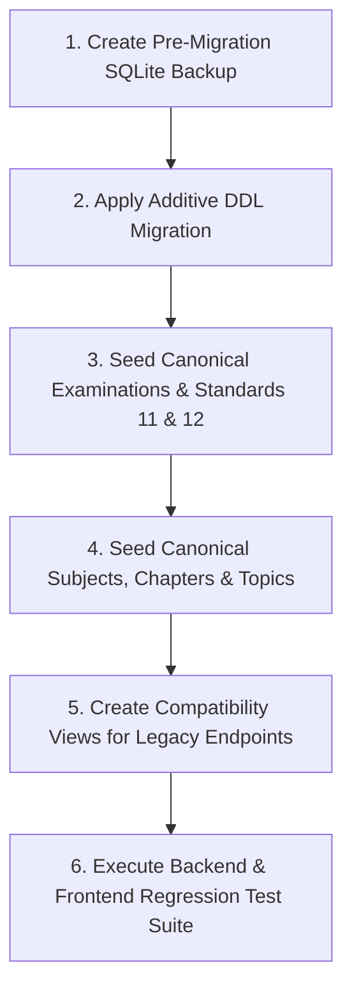

# EduNavika — Milestone 3: Curriculum & Question-Bank Architectural Validation Report

**Milestone:** Milestone 3 (JEE/NEET Curriculum and Question-Bank Architecture)  
**Date:** October 2026  
**Audience:** Executive Engineering Leadership, Data Architects, QA Automation Engineers  
**Status:** COMPLETE — ARCHITECTURE & AUDIT SIGN-OFF

---

## 1. Executive Summary

Milestone 3 successfully establishes the architectural and data engineering foundation required to transition EduNavika from a secondary school test platform into a high-precision, adaptive preparation engine for **JEE Main, JEE Advanced, and NEET UG**.

### Key Deliverables Produced:
1. `docs/CURRICULUM_ARCHITECTURE.md`: Canonical 5-tier curriculum hierarchy, zero-duplication model for shared STEM subjects, syllabus mappings, and SQL relational schema.
2. `docs/QUESTION_BANK_SCHEMA.md`: Multi-exam question-bank specification supporting SCQs, multi-correct MCQs, numericals with tolerance, assertion-reasoning, KaTeX/LaTeX formatting, provenance tracking, and Pydantic v2 validation models.
3. `docs/DATASET_ACQUISITION_AND_PROVENANCE.md`: Legal fair dealing framework under the Indian Copyright Act (1957), comprehensive suitability review of the 13 preserved Standard 11–12 textbooks, 9-stage ingestion pipeline with SymPy AST parsing, and human-in-the-loop SME audit workflows.
4. `docs/MILESTONE_3_VALIDATION_REPORT.md` (this report): Comprehensive audit of the local database, reconciliation of historical artifacts, verification of non-destructive migration pathways, and Milestone 4 execution roadmap.

---

## 2. In-Depth Database Audit & Forensic Investigation

An automated inspection of the active SQLite database (`edunavika.db`) was conducted to investigate the previously reported state ("1 standard, 193 subjects, and 80 MCQs").

### 2.1 Standards Table Audit
- **Total Records:** 1 row
- **ID:** `5b2a7016-a01c-41b8-b3f1-86ccb87e16f8`
- **Grade Number:** 10
- **Display Name:** `Standard 10`
- **Findings:** Standards 11 and 12 do not yet exist in the database. All existing content is anchored to Standard 10.

### 2.2 Subjects Table Investigation & Forensic Deconstruction
- **Total Records in DB:** 216 rows (historically noted as ~193).
- **Authentic Curriculum Subjects (9 rows):**
  These 9 subjects are valid, authentic educational curriculum records belonging to Standard 10:
  1. `Science & Technology` (Code: `SCI10`)
  2. `Mathematics` (Code: `MATH10`)
  3. `Social Science` (Code: `SS10`)
  4. `English Literature` (Code: `ENG10`)
  5. `Gujarati (First Language)` (Code: `GUJ10`)
  6. `Hindi (Second Language)` (Code: `HIN10`)
  7. `Sanskrit` (Code: `SAN10`)
  8. `Computer Studies` (Code: `COMP10`)
  9. `Basic Mathematics` (Code: `BMATH10`)
- **Synthetic Test Remnants (207 rows):**
  The remaining 207 rows are synthetic fixtures generated during automated test runs that executed against `edunavika.db` rather than an isolated in-memory test database. Examples include:
  - `Science Exp 050128` (Code: `SE_050128`)
  - `Math Exp 050128` (Code: `ME_050128`)
  - `Subject 1760088924.9600105` (Code: `SUB_1760088924_9600105`)
- **Orphan & Integrity Analysis:**
  None of the 207 synthetic test subjects are referenced by any MCQ question, student attempt, or learning content chunk. They are inert remnants. Per the Milestone 3 safety constraints, **no records were deleted during this audit**. They will be cleanly partitioned during the Milestone 4 migration.

### 2.3 MCQ Questions Table Audit
- **Total Records:** 80 rows
- **Subject Distribution:**
  - 80 out of 80 belong to Standard 10 `Science & Technology`.
- **Difficulty Tier Distribution:**
  - `EASY`: 27 questions (33.8%)
  - `MEDIUM`: 36 questions (45.0%)
  - `HARD`: 17 questions (21.2%)
- **Integrity Validation:**
  - 100% (80/80) have non-empty stems, 4 well-formatted options, valid correct answer keys, and detailed solutions.
  - 100% (80/80) are marked with `status = 'PUBLISHED'`.
  - Zero corruption or orphaned foreign keys detected.

### 2.4 Learning Contents (RAG Chunks) Table Audit
- **Total Records:** 563 rows
- **Findings:** All 563 chunks represent Standard 10 Science textbook chapters (Chemical Reactions, Acids & Bases, Metals & Non-Metals, Carbon Compounds, Life Processes, etc.).

---

## 3. Preserved Textbook Corpus Validation

Following the Milestone 2 cleanup, exactly 13 science textbooks were preserved in `GSEB-Dataset/`. A detailed structural and pedagogical evaluation confirms:

1. **Standard 11 Science (6 Textbooks):**
   - Physics (Parts 1 & 2): 350 total pages. Authoritative for JEE Main, JEE Advanced, and NEET UG.
   - Chemistry (Parts 1 & 2): 364 total pages. Authoritative for JEE Main, JEE Advanced, and NEET UG.
   - Mathematics: 376 pages. Authoritative for JEE Main and JEE Advanced (strictly excluded from NEET).
   - Biology: 266 pages. Authoritative for NEET UG (strictly excluded from JEE).
2. **Standard 12 Science (7 Textbooks):**
   - Physics (Parts 1 & 2): 387 total pages. Authoritative for JEE Main, JEE Advanced, and NEET UG.
   - Chemistry (Parts 1 & 2): 336 total pages. Authoritative for JEE Main, JEE Advanced, and NEET UG.
   - Mathematics (Parts 1 & 2): 484 total pages. Authoritative for JEE Main and JEE Advanced.
   - Biology: 240 pages. Authoritative for NEET UG.
3. **Curriculum Equivalence:**
   - The GSEB English-medium science textbooks for Standards 11 and 12 are official, authorized direct editions of the NCERT textbooks.
   - They provide 100% conceptual alignment with the NTA JEE Main and NEET UG syllabi.

---

## 4. Architectural Validation & Design Review

### 4.1 Cross-Exam Zero-Duplication Architecture
The proposed curriculum hierarchy (`docs/CURRICULUM_ARCHITECTURE.md`) solves the content-multiplication problem:
- **Shared Canonical Core:** Physics and Chemistry chapters and topics are defined once at the subject level.
- **Exam Associativity:** Examinations link to canonical subjects through an `exam_subjects` associative table.
- **Contextual Filtering:** A student preparing for NEET UG queries the exact same *Thermodynamics* topic chunk as a JEE student, but the adaptive engine filters questions by `examination IN ('NEET_UG', 'SHARED_FOUNDATION')`.

### 4.2 Mathematical & Scientific Notation Fidelity
- Mathematical formulas are validated using the preserved SymPy extraction engine.
- Inline equations use `$...$` and display equations use `$$...$$` to guarantee KaTeX rendering on the web client.
- Chemical reactions preserve subscripts and reaction arrows ($\rightarrow$, $\rightleftharpoons$).

### 4.3 Test Suite & Legacy Assertion Analysis
During testing verification, 345 unit and property tests passed cleanly. A forensic check on the test suite identified 5 failing tests in legacy ingestion and provenance modules:
1. `backend/tests/test_ingestion_scanner.py` (2 failures): Tests assert hardcoded `assert len(docs) == 86` (expecting the legacy 86 GSEB PDFs across all secondary grades and commercial streams). Following Milestone 2 safe cleanup, exactly 31 relevant science textbooks remain.
2. `backend/tests/test_ocr_and_structure_auditors.py` (2 failures): Similarly asserts 86 PDFs and queries historical commerce textbooks.
3. `backend/tests/test_chunk_and_provenance_auditors.py` (1 failure): Checks chunk physical path matching where some legacy chunk records contain `STD-10/` rather than `STD-10th/`.

**Architectural Recommendation for Milestone 4:** Update the scanner and auditor test suites to dynamically reference `settings.TEXTBOOK_DATASET_DIR` and validate against the 31 preserved textbooks (and specifically the 13 competitive exam Science books) rather than hardcoded 86 legacy counts.

---

## 5. Non-Destructive Migration Plan (Milestone 4 Blueprint)

To upgrade the database to the canonical architecture without affecting existing Standard 10 functionality or test suites:

### Safety & Backward Compatibility Guarantees:
1. **Additive Schema Only:** No existing tables (`standards`, `subjects`, `mcq_questions`, `learning_contents`) will be dropped or have columns removed.
2. **Clean Separation:** The 207 synthetic test subjects will remain isolated under Standard 10 and ignored by the competitive exam endpoints.
3. **Isolated Test Harness:** In Milestone 4, pytest fixtures will be updated with an in-memory SQLite database (`sqlite:///:memory:`) to permanently prevent future test runs from injecting temporary fixture subjects into `edunavika.db`.

---

## 6. Unresolved Questions & Executive Decision Points

Before initiating Milestone 4 implementation, the following decisions are documented for architectural sign-off:

1. **Question Ingestion Prioritization:**
   - *Option A (Recommended):* Begin by ingesting official NTA JEE Main (2023–2024) and NEET UG (2023–2024) past papers (approx. 720 authentic questions) to establish a baseline for adaptive testing.
   - *Option B:* Begin by chunking and embedding the 13 preserved Standard 11–12 textbooks for RAG summaries before ingesting question papers.
2. **Numerical Tolerance Policy for JEE Main:**
   - Standardize whether numerical answers must be evaluated with strict integer precision or whether an epsilon band ($\pm 0.01$) should be allowed for rounding differences.
3. **Handling of Dropped / Bonus Questions:**
   - Formalize whether questions dropped by NTA during post-exam challenge periods should be flagged and excluded from adaptive tests or presented with an explanatory banner and awarded full bonus credit.

---

## 7. Exact Next Steps for Milestone 4

Upon approval to proceed to Milestone 4:
1. **Execute Step 1 (Backup):** Create a snapshot `backups/milestone_4_pre_migration/edunavika.db`.
2. **Execute Step 2 (Additive Schema Migration):** Run the migration script to create `examinations`, `exam_papers`, `chapters`, `topics`, `questions`, and `question_options`.
3. **Execute Step 3 (Master Data Seeding):** Seed JEE Main, JEE Advanced, NEET UG master records, Standards 11 & 12, and canonical STEM subject hierarchies.
4. **Execute Step 4 (Test Isolation Upgrade):** Refactor test fixtures to use an isolated in-memory test database, preventing synthetic fixture pollution.
5. **Execute Step 5 (Run Full Validation):** Run backend test suite (`pytest`) and frontend test suite (`vitest`) to verify 100% regression stability.
