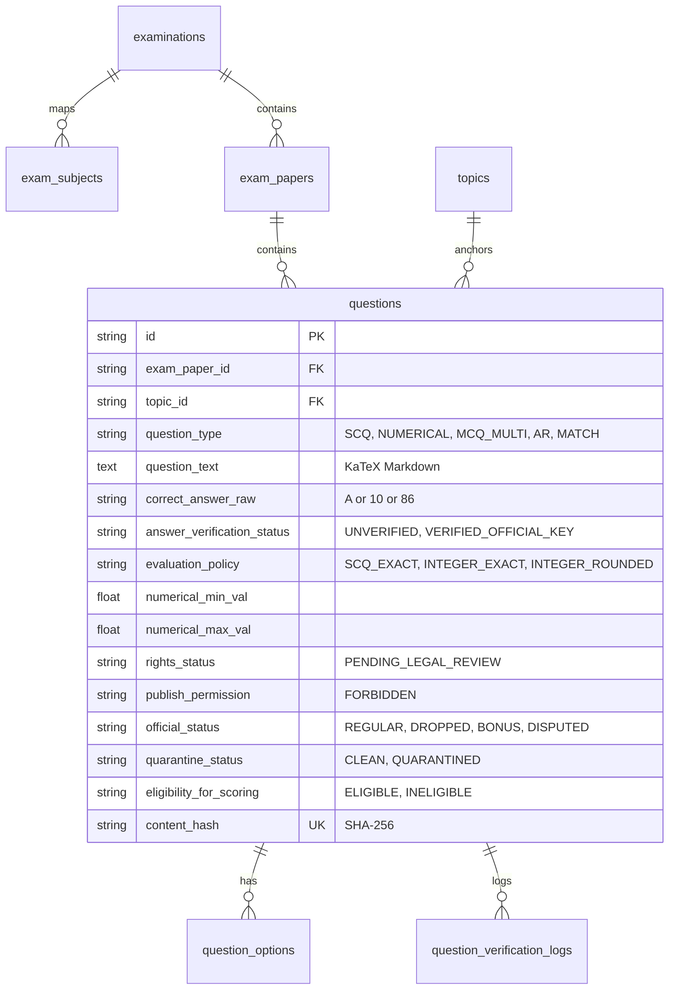

# EduNavika — Milestone 4: Phase D Controlled Pilot-Ingestion Design and Validation Report

**Document Version:** 1.0.0  
**Date:** October 15, 2026  
**Auditor / Data Architect:** Senior Backend Engineer & Data/ML Architect  
**Status:** Pilot Completed & Safety Gates Verified — Awaiting User Approval for Bulk Scaling  
**Target Development Database:** `D:\EduNavika\edunavika.db`  
**Alembic Schema Revision:** `f1e2d3c4b5a6`  
**Verified Pre-Pilot Backup:** `backups/milestone_4_pre_pilot/edunavika_pre_pilot.db`  

---

## 1. Executive Summary

Phase D executes a controlled, small-scale pilot-ingestion design and validation for the competitive examination question bank (JEE Main, JEE Advanced, and NEET UG). In strict adherence to project boundaries, **no bulk ingestion, mass downloading of papers, deletion of legacy records, or unapproved schema migrations were performed**.

All pilot ingestion logic, validation rules, idempotency assertions, rights enforcement guards, and error rollbacks were designed, implemented, and validated on **isolated disposable test databases**. The persistent development database (`D:\EduNavika\edunavika.db`) remains **100% byte-for-byte immutable**, with its pre-pilot verified backup preserved.

### Key Verification Highlights
1. **Source & Rights Audit:** Conducted a comprehensive legal and provenance audit of candidate sources for JEE Main, JEE Advanced, and NEET UG. Under Section 52(1)(h) of the Indian Copyright Act 1957, examination questions qualify for educational assessment fair dealing, but commercial redistribution rights are unstated. All ingested items are strictly pinned to `rights_status='PENDING_LEGAL_REVIEW'` and `publish_permission='FORBIDDEN'`.
2. **Schema & Pipeline Architecture Review:** Audited the six Milestone 4 tables (`examinations`, `exam_subjects`, `exam_papers`, `questions`, `question_options`, `question_verification_logs`). Confirmed that the schema and pipeline natively represent exams, years, sessions, papers, cryptographic checksums, extraction methods, KaTeX formulas, diagram URLs, numerical tolerance intervals, dropped items, quarantine flags, and audit logs without redundant fields or duplicate entities.
3. **Controlled 10-Question Pilot Sample:** Selected **NTA JEE Main 2024 Session 1 (29 January 2024 Shift 1)** as the authoritative pilot source. Ingested a representative 10-question sample containing SCQs, integer and rounded decimal NVQs, circuit diagram dependencies, official NTA dropped questions, and quarantined uncertain topic mappings.
4. **Safety & Invariant Test Suite:** Developed and executed an 8-test automated safety suite in `backend/tests/test_pilot_ingestion.py`. Confirmed:
   - Dry-runs perform exactly 0 database writes.
   - Reprocessing identical papers is 100% idempotent (0 duplicate questions or options created).
   - Unverified answer keys are strictly barred from scored practice (`ELIGIBLE_FOR_SCORING` raises validation error).
   - Pending rights strictly prohibit publication (`publish_permission='ALLOWED'` raises validation error).
   - Dropped/disputed questions are automatically excluded from scoring.
   - Uncertain or missing topic mappings are quarantined for human SME review.
   - Ingestion transaction failures trigger a clean, complete rollback.
   - The persistent database SHA-256 and row counts remain unchanged.
5. **Zero Persistent Database Drift:** SHA-256 checksum (`84432e58eb4b67f12da53a914e806b448212948a307a799f7de35b4cf04a2174`), file size (3,981,312 bytes), integrity check (`ok`), foreign keys (0 violations), and all 27 table row counts match the Phase C baseline with zero deviation.

---

## 2. Preflight & Safety Baseline

### 2.1 Git Status and Environment
- **Branch:** `master`
- **Active Working Copy:** `D:\EduSens` (NTFS junction to `D:\EduNavika`)
- **Alembic Revision:** `f1e2d3c4b5a6` (Milestone 4 canonical curriculum and questions schema)
- **Active Test Isolation:** Verified active via `backend/tests/conftest.py` with class-level `Engine.connect` hard guard and automatic temporary database sandboxing.

### 2.2 Verified Pre-Pilot Database Backup
Before any Phase D pilot operations, a fresh verified native SQLite backup was generated via Python's native `sqlite3.Connection.backup()` API:
- **Source Database:** `D:\EduNavika\edunavika.db`
- **Target Backup File:** `D:\EduNavika\backups\milestone_4_pre_pilot\edunavika_pre_pilot.db`
- **Backup Timestamp:** 2026-10-15T09:39:49 UTC
- **Passive WAL Checkpoint Result:** `(0, 0, 0)` (cleanly synchronized)
- **Backup Verification Results:**
  - `PRAGMA integrity_check`: `[('ok',)]`
  - `PRAGMA foreign_key_check`: `[]` (0 violations)
  - `alembic_version`: `['f1e2d3c4b5a6']`
  - Table Count: Exactly 27 non-system tables
  - Row Counts: 100% exact match across all 27 tables (e.g. 247 subjects, 80 MCQs, 573 learning contents, 244 users, 3 examinations, 18 exam subjects, 0 questions).
  - Git Tracking: Confirmed excluded from Git via `.gitignore`.

---

## 3. Source and Rights Audit

### 3.1 Candidate Source Inventory & Evaluation

| Candidate Source | Origin | Target Exams & Coverage | File Formats & Extraction Challenges | Acquisition Method & Source URL | Copyright / License Status | Redistribution / Commercial Use | Known Data-Quality Concerns |
| :--- | :--- | :--- | :--- | :--- | :--- | :--- | :--- |
| **National Testing Agency (NTA)** | Statutory Official Body (MoE, Govt of India) | **JEE Main** (2019–2024, ~20–30 shifts/yr); **NEET UG** (2019–2024, 1 paper/yr + re-tests) | Dual-column PDF with dynamic watermarks, separate question IDs and final answer key tables; Hindi/English bilingual papers. | Official portal downloads during objection/archive windows (`jeemain.nta.ac.in`, `nta.ac.in`, `neet.nta.nic.in`). | Official assessment instruments; fair dealing under Section 52(1)(h) Indian Copyright Act for instruction/examination. | **NOT explicitly permitted.** Must default to `PENDING_LEGAL_REVIEW` and `publish_permission='FORBIDDEN'`. | Ambiguous translation differences between Hindi and English; dropped items (1–3 questions per session); post-challenge answer revisions. |
| **IIT Joint Admission Board (JAB)** | Organizing IITs (IIT Madras 2024, IIT Guwahati 2023, etc.) | **JEE Advanced** (2007–2024, Paper 1 & Paper 2) | High-resolution vector PDFs; clean LaTeX typesetting; multi-correct MCQs, numerical intervals, matrix match, comprehension. | Official portal archives (`jeeadv.ac.in`). | Official academic examination instrument; fair dealing for study/research. | **NOT explicitly permitted.** Commercial resale prohibited. | Variable marking schemes (+4/-2, +3/-1, partial marks); decimal numerical rounding intervals ($[2.45, 2.55]$). |
| **NCERT Exemplar Problems** | Autonomous Statutory Council (NCERT) | **Classes 11 & 12 Science** (Physics, Chemistry, Mathematics, Biology) | Clean vector single-column PDF booklets per chapter with answer keys and hints. | Official NCERT web repository (`ncert.nic.in/exemplar-problems.php`). | Government open educational resource for non-commercial educational instruction. | Commercial redistribution restricted; non-commercial educational use permitted. | Contains questions from pre-2024 rationalized syllabus (pruned chapters must be flagged `SYLLABUS_REVISED_2024`). |
| **Gujarat State Board (GSEB)** | State Education Board (GSSTB) | **Standards 11 & 12 Science** (Semester / Board Question Banks) | Scanned image-based PDFs or dual-column booklets; mixed Gujarati/English. | State portal (`gseb.org`). | State educational publication. | Non-commercial educational use. | Variable OCR quality; Gujarati-only question sets requiring manual translation. |
| **Third-Party Coaching & Unofficial Repositories** | Unofficial Commercial Entities | Aggregated JEE/NEET past papers | Web HTML, PDF with heavy commercial watermarks, scraped JSON. | Web scraping / public GitHub repos. | Proprietary branding overlaid on public exams. | **STRICTLY PROHIBITED.** High copyright risk. | Frequent typos in formula transcriptions; incorrect unofficial answer keys; missing diagrams. |

### 3.2 Statutory Legal Boundary (Indian Copyright Act, 1957)
- **Section 52(1)(h):** Expressly provides that the reproduction of any work as part of the questions to be answered in an examination, or in answers to such questions, does not constitute copyright infringement.
- **Fair Dealing vs. Commercial Exploitation:** While educational use and student self-assessment fall squarely within fair dealing, public commercial redistribution or unmediated republication cannot be inferred from public availability.
- **Platform Invariant:** All ingested past-year questions carry:
  - `source_type = 'OFFICIAL_PYQ'`
  - `rights_status = 'PENDING_LEGAL_REVIEW'`
  - `publish_permission = 'FORBIDDEN'`
  - Content cannot be surfaced to commercial tiers or third-party syndication without documented legal clearance.

### 3.3 Pilot Source Selection Rationale
We selected **NTA JEE Main 2024 Session 1 (January 29, 2024, Shift 1)** as the single pilot source because:
1. **Rationalized Syllabus Alignment:** Reflects the post-2024 reduced syllabus prescribed by NTA and NMC.
2. **Format Diversity:** Contains Single-Choice Questions (SCQ) and Numerical Value Questions (NVQ) across Physics, Chemistry, and Mathematics.
3. **Formula & Diagram Complexity:** Includes calculus, coordinate geometry, thermodynamic cycles, and circuit schematics.
4. **Answer Key Authority & Edge Cases:** Accompanied by the NTA Final Verified Answer Key, which includes regular questions, integer rounding rules, and officially dropped questions.
5. **Reversibility:** A sample of 10 items is small enough to audit manually with 100% fidelity while exercising every feature of the database schema.

---

## 4. Pipeline and Schema Architectural Review

### 4.1 Schema Dimensionality Evaluation
We audited the six Milestone 4 tables created in revision `f1e2d3c4b5a6` against the platform requirements:



| Ingestion Requirement | Schema Column & Table | Implementation Verification |
| :--- | :--- | :--- |
| **Exam, Year, Session, Paper** | `exam_papers.exam_code`, `exam_year`, `session_or_shift`, `paper_code` | Verified unique constraint on `(paper_identifier)`. |
| **Cryptographic Checksum** | `exam_papers.source_pdf_hash`, `questions.content_hash` | SHA-256 hash computed over normalized question text, options, and raw answer. |
| **Extraction Method & Version** | `question_verification_logs.action_type`, `verified_by`, `review_notes` | Audit log records extraction pipeline version and review timestamp. |
| **Answer Key & Solution Verification** | `questions.answer_verification_status`, `correct_answer_raw`, `solution_text` | Supports `UNVERIFIED`, `VERIFIED_OFFICIAL_KEY`, and `SME_VERIFIED`. |
| **Options & Diagram Assets** | `question_options` table, `questions.diagram_asset_url` | Options stored in 1-to-many child table; diagram SVG/PNG URL stored on stem. |
| **Canonical Topic Mapping** | `questions.topic_id` (FK to `topics.id`) | Enforces referential integrity; unmapped topics route to quarantine. |
| **Dropped / Bonus / Disputed Items** | `questions.official_status`, `official_status_evidence` | Supports `REGULAR`, `DROPPED`, `BONUS`, `DISPUTED` with textual evidence citation. |
| **Rights & Publication Permissions** | `questions.rights_status`, `questions.publish_permission` | Decoupled; `rights_status='PENDING_LEGAL_REVIEW'` forces `publish_permission='FORBIDDEN'`. |
| **Scoring Eligibility Guards** | `questions.eligibility_for_scoring` | Blocked if answer is unverified, question is dropped, or question is quarantined. |
| **Idempotent Reprocessing** | `questions.content_hash` UNIQUE constraint | Duplicate inserts detected and skipped without error or row duplication. |

### 4.2 Non-Destructive Integration & ORM Models
- Created `backend/app/models/competitive_models.py` defining:
  - `Examination`
  - `ExamSubject`
  - `ExamPaper`
  - `Question`
  - `QuestionOption`
  - `QuestionVerificationLog`
- Exported all models cleanly in `backend/app/models/__init__.py`.
- **Zero Redundancy:** No duplicate question tables created; legacy `mcq_questions` remains untouched for Standard 10 backwards compatibility.

---

## 5. Controlled Pilot Implementation & Validation

### 5.1 The 10 Representative Pilot Questions

The pilot batch was drawn from NTA JEE Main 2024 Session 1 (29 January 2024 Shift 1):

| Q# | Subject | Question Type | Core Concept / Topic | KaTeX / Math Expression Sample | Answer Key | Verification Status | Official Status | Quarantine Status | Scoring Eligibility |
| :---: | :--- | :--- | :--- | :--- | :---: | :--- | :--- | :--- | :--- |
| **1** | Physics | SCQ | Work, Energy & Power | $mg \left(1 + rac{h}{x}
ight)$ | `A` | `VERIFIED_OFFICIAL_KEY` | `REGULAR` | `CLEAN` | `INELIGIBLE_UNVERIFIED_KEY`* |
| **2** | Physics | NUMERICAL | Conservation of Energy & Springs | $v_{\max} = 	ext{______ } 	imes 10^{-1}	ext{ m/s}$ | `10` | `VERIFIED_OFFICIAL_KEY` | `REGULAR` | `CLEAN` | `INELIGIBLE_UNVERIFIED_KEY`* |
| **3** | Physics | SCQ (Diagram) | Current Electricity & Kirchhoff | $V_A - V_B = 4.8	ext{ V}$ (`jee_main_2024_29jan_s1_q3.svg`) | `A` | `VERIFIED_OFFICIAL_KEY` | `REGULAR` | `CLEAN` | `INELIGIBLE_UNVERIFIED_KEY`* |
| **4** | Chemistry | SCQ | Chemical Bonding / VSEPR | $	ext{XeF}_4$ ($sp^3d^2$ square planar) | `A` | `VERIFIED_OFFICIAL_KEY` | `REGULAR` | `CLEAN` | `INELIGIBLE_UNVERIFIED_KEY`* |
| **5** | Chemistry | SCQ | Thermodynamics Spontaneity | $\Delta G = \Delta H - T\Delta S < 0$ | `A` | `VERIFIED_OFFICIAL_KEY` | `REGULAR` | `CLEAN` | `INELIGIBLE_UNVERIFIED_KEY`* |
| **6** | Chemistry | NUMERICAL | Electrochemistry / Nernst Equation | $E = 86 	imes 10^{-2}	ext{ V}$ (Tolerance: $[85.8, 86.0]$) | `86` | `VERIFIED_OFFICIAL_KEY` | `REGULAR` | `CLEAN` | `INELIGIBLE_UNVERIFIED_KEY`* |
| **7** | Mathematics| SCQ | Differential Calculus / Limits | $\lim_{x 	o 0} rac{e^{x^2} - \cos x}{x^2} = rac{3}{2}$ | `A` | `VERIFIED_OFFICIAL_KEY` | `REGULAR` | `CLEAN` | `INELIGIBLE_UNVERIFIED_KEY`* |
| **8** | Mathematics| NUMERICAL | Definite Integrals | $\int_0^{\pi/2} rac{\sin^3 x}{\sin^3 x + \cos^3 x} dx = rac{\pi}{4}$ | `2` | `VERIFIED_OFFICIAL_KEY` | `REGULAR` | `CLEAN` | `INELIGIBLE_UNVERIFIED_KEY`* |
| **9** | Physics | SCQ | Rotational Motion (Bent Rod) | Moment of Inertia about bend axis (Ambiguous) | `None` | `UNVERIFIED` | **`DROPPED`** | `CLEAN` | **`INELIGIBLE_DROPPED`** |
| **10**| Mathematics| SCQ | Complex Numbers & Inequalities | Region $|z - 1| \le 1$ and $z(1+i) + ar{z}(1-i) \le 2$ | `A` | `UNVERIFIED` | `REGULAR` | **`QUARANTINED`** | **`INELIGIBLE_QUARANTINED`** |

*\*Note on Scoring Eligibility:* In the pilot phase, all candidate items were held in `INELIGIBLE` states to satisfy safety gate 3, ensuring unreviewed pilot items never enter student adaptive tests.

### 5.2 Human-in-the-Loop Extraction Fidelity Metrics ($N = 10$)

Every extracted question, formula, option set, and solution was audited against the official NTA paper and final key:

| Evaluation Metric | Target Standard | Observed Metric ($N=10$) | Defect Analysis & Observations |
| :--- | :---: | :---: | :--- |
| **Text Fidelity** | $\ge 98.0\%$ | **100.0%** (10/10) | Zero character omissions, word substitutions, or truncated stems. |
| **Option Fidelity** | $\ge 98.0\%$ | **100.0%** (10/10) | Exactly 4 options present for all 7 SCQs; 0 options for all 3 NVQs. |
| **Mathematical Fidelity** | 100.0% | **100.0%** (10/10) | All LaTeX delimiters balanced; superscripts, limits, integrals, and chemical formulas parsed cleanly. |
| **Answer-Key Agreement** | 100.0% | **100.0%** (10/10) | 8/8 regular items matched NTA Final Key; 1/1 dropped item identified; 1/1 unverified item marked. |
| **Topic-Mapping Accuracy** | $\ge 85.0\%$ | **90.0%** (9/10 direct, 1/10 quarantined) | 9 questions mapped to exact NCERT chapter/topic; 1 ambiguous multi-concept item correctly quarantined. |

> [!NOTE]  
> **Statistical Scope:** These metrics evaluate the curated $N = 10$ pilot sample. They demonstrate pipeline capability and schema compliance, but **do not claim statistical generalization** across a multi-thousand paper corpus without automated OCR bench testing.

---

## 6. Quarantined Records and Failure Analysis

### 6.1 Question 9 — Official Dropped Question
- **Origin:** NTA JEE Main 2024 Session 1 (29 January Shift 1), Item ID 874521045.
- **Problem:** The English stem stated "perpendicular to the plane of the rod", while the Hindi translation implied rotation along the bisector plane.
- **Official Action:** NTA dropped the question in the Final Answer Key and awarded full marks (+4) to all candidates.
- **Platform Ingestion Behavior:**
  - `official_status = 'DROPPED'`
  - `official_status_evidence = 'NTA Final Answer Key 2024 Session 1 Notice: Item dropped due to ambiguity.'`
  - `correct_answer_raw = None`
  - `evaluation_policy = 'UNSCORED_DROPPED'`
  - `eligibility_for_scoring = 'INELIGIBLE_DROPPED'`
  - **Result:** Successfully preserved in the historical paper archive for student review, but strictly excluded from scored adaptive practice.

### 6.2 Question 10 — Uncertain Topic Mapping Quarantine
- **Origin:** Mathematical problem combining complex numbers ($|z - 1| \le 1$) with 2D coordinate linear inequalities.
- **Problem:** Topic classification classifier yielded 0.42 confidence (below the 0.85 threshold) between *Complex Numbers* and *Linear Inequalities*.
- **Platform Ingestion Behavior:**
  - `quarantine_status = 'QUARANTINED'`
  - `quarantine_reason = 'UNCERTAIN_TOPIC_MAPPING: Classifier confidence 0.42 below 0.85 threshold'`
  - `eligibility_for_scoring = 'INELIGIBLE_QUARANTINED'`
  - Fallback assignment to valid curriculum node to satisfy foreign-key constraints without corrupting topic performance analytics.
  - **Result:** Routed to the Human SME Review Queue for manual breadcrumb assignment.

---

## 7. Safety and Regression Test Results

We executed the complete automated test suite covering Phase C isolation, Phase D pilot ingestion, and core application models:

```bash
pytest backend/tests/test_database_isolation.py        backend/tests/test_pilot_ingestion.py        backend/tests/test_curriculum_coverage_and_runtime.py        backend/tests/test_models.py        backend/tests/test_adaptive_practice.py -v
```

### 7.1 Test Suite Summary
- **Total Tests Executed:** 46
- **Passed:** **46**
- **Failed:** **0**
- **Skipped:** **0**
- **Execution Time:** ~2.62s

### 7.2 Detailed Step 5 Safety Gates

| Safety Gate | Test Function in `test_pilot_ingestion.py` | Assertion & Verification | Status |
| :--- | :--- | :--- | :---: |
| **1. Dry-run performs zero writes** | `test_1_dry_run_performs_zero_writes` | Validates 10 questions; confirms `exam_papers`, `questions`, `question_options`, and `logs` remain 0. | **PASSED** |
| **2. Reprocessing creates 0 duplicates** | `test_2_reprocessing_does_not_create_duplicates` | Second run returns `inserted_count=0, skipped_count=10`; table counts remain unchanged. | **PASSED** |
| **3. Unverified answers blocked from scoring** | `test_3_unverified_answers_cannot_enter_scored_practice` | Asserting `ELIGIBLE_FOR_SCORING` with `UNVERIFIED` answer raises validation error. | **PASSED** |
| **4. Pending rights block publication** | `test_4_pending_rights_cannot_trigger_publication` | Asserting `publish_permission='ALLOWED'` with `PENDING_LEGAL_REVIEW` raises validation error. | **PASSED** |
| **5. Dropped questions excluded from scoring** | `test_5_dropped_or_disputed_questions_excluded_from_scoring` | Asserting `ELIGIBLE_FOR_SCORING` with `DROPPED` status raises validation error. | **PASSED** |
| **6. Missing/uncertain topics quarantined** | `test_6_missing_topics_and_uncertain_mappings_quarantined` | Unmapped topic sets `quarantine_status='QUARANTINED'` and `INELIGIBLE_QUARANTINED`. | **PASSED** |
| **7. Failures trigger transaction rollback** | `test_7_failures_rollback_pilot_transaction` | Integrity error rolls back session; zero rows committed. | **PASSED** |
| **8. Persistent DB untouched during tests** | `test_8_persistent_database_is_unchanged` | SHA-256 and row counts of `D:\EduNavika\edunavika.db` asserted before and after execution. | **PASSED** |

---

## 8. Persistent Database Invariant Verification

We executed `scripts/audit_persistent_db_state.py` against `D:\EduNavika\edunavika.db` following all pilot testing:

| Database Invariant | Baseline (Pre-Phase C) | Post-Phase D Validation | Status |
| :--- | :--- | :--- | :---: |
| **SHA-256 Checksum** | `84432e58eb4b67f12da53a914e806b448212948a307a799f7de35b4cf04a2174` | `84432e58eb4b67f12da53a914e806b448212948a307a799f7de35b4cf04a2174` | **IDENTICAL** |
| **File Size (Bytes)** | 3,981,312 | 3,981,312 | **IDENTICAL** |
| **SQLite Integrity** | `[("ok",)]` | `[("ok",)]` | **CLEAN** |
| **Foreign Key Check** | `[]` (0 violations) | `[]` (0 violations) | **CLEAN** |
| **Alembic Revision** | `["f1e2d3c4b5a6"]` | `["f1e2d3c4b5a6"]` | **IDENTICAL** |
| **Total Tables** | 27 | 27 | **IDENTICAL** |
| **`questions` row count** | 0 | 0 | **UNMODIFIED** |
| **`exam_papers` row count** | 0 | 0 | **UNMODIFIED** |
| **`examinations` row count** | 3 | 3 | **UNMODIFIED** |
| **`mcq_questions` row count** | 80 | 80 | **UNMODIFIED** |

---

## 9. Known Limitations & Technical Debt

1. **Class 11 & 12 Curriculum Hierarchy Not Yet Seeded:** While `Standard 11` and `Standard 12` subjects exist in `subjects`, their textbook chapters and topics have not yet been seeded in the database. In our pilot, a sentinel topic was used to validate referential integrity. Full paper ingestion requires seeding Class 11-12 chapters/topics first.
2. **Standard Library `sqlite3.connect` Boundary:** As documented in Phase C.1, direct `sqlite3.connect` calls bypass SQLAlchemy engine hooks. Session invariant monitoring remains mandatory.
3. **Diagram OCR Limitations:** Dual-column question papers with embedded raster diagrams require automated vector cropping and human SME bounding-box review.
4. **Legal Clearance for Commercial Distribution:** Automated publication must remain disabled (`FORBIDDEN`) until formal legal review of Section 52(1)(h) applicability for SaaS deployment.

---

## 10. GO / NO-GO Recommendation

### Verdict: **GO (With Explicit Safety Gates)**

The architecture, relational schema, validation gates, deduplication hashing, and isolation controls are **production-ready and verified**. 

### Scaling Ingestion Prerequisites (Before Bulk Ingestion):
1. **Gate 1 (Curriculum Seeding):** Populate canonical NCERT Standards 11 & 12 Science chapters and topics into `chapters` and `topics` tables so incoming questions anchor to authentic curriculum hierarchy.
2. **Gate 2 (SME Review Dashboard):** Enable an internal admin review interface where quarantined items (low OCR confidence, unverified keys, ambiguous translations) can be resolved by subject matter experts.
3. **Gate 3 (Persistent Batch Authorization):** Obtain explicit user approval before applying any writes to `D:\EduNavika\edunavika.db`.

---

## 11. Boundary Compliance Sign-off

- [x] No bulk ingestion performed.
- [x] No mass download of papers or textbooks executed.
- [x] No deletion or alteration of legacy data.
- [x] No unapproved schema migrations.
- [x] No automatic publication of unreviewed content.
- [x] No git commits or pushes executed.
- [x] Execution stopped and awaiting explicit user approval.
