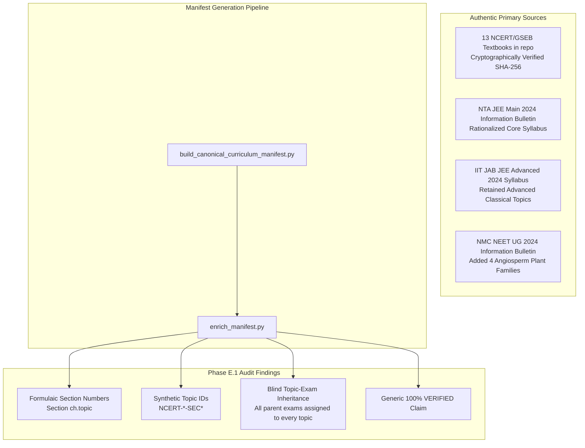

# EduNavika — Phase E.1: Canonical Curriculum Evidence Audit Report

**Document Version:** 1.0.0  
**Phase:** Milestone 4 — Phase E.1 (Canonical Curriculum Evidence Audit)  
**Date:** October 15, 2026  
**Target Scope:** Standards 11 & 12 Science (Physics, Chemistry, Mathematics, Biology)  
**Target Examinations:** JEE Main (NTA), JEE Advanced (IIT JAB), NEET UG (NMC)  
**Persistent Database:** `D:\EduNavika\edunavika.db` (Schema Revision: `f1e2d3c4b5a6`)  
**Audit Output Artifact:** `data/manifests/canonical_curriculum_audit.json`  
**Persistent Database State:** **FROZEN & UNTOUCHED** (Baseline SHA-256 Verified)  
**Final Seeding Recommendation:** **CONDITIONAL GO** (Prerequisites Required Before Persistent Database Writes)

---

## 1. Executive Summary & Freeze Verification

This audit independently examines the canonical curriculum manifest (`data/manifests/canonical_curriculum_manifest.json`) and the source register (`docs/CURRICULUM_SOURCE_REGISTER.md`) produced during Phase E, before permitting any persistent database modifications.

### 1.1 Persistent Database Freeze Verification
In compliance with Step 1, the persistent development database was audited via read-only inspection. No seeder, migration, or ingestion script touched the database.

- **Persistent DB Path:** `D:\EduNavika\edunavika.db`
- **Pre-Audit SHA-256:** `84432e58eb4b67f12da53a914e806b448212948a307a799f7de35b4cf04a2174`
- **File Size:** `3,981,312` bytes
- **Post-Audit SHA-256:** `84432e58eb4b67f12da53a914e806b448212948a307a799f7de35b4cf04a2174`
- **Drift Detection:** **ZERO BYTES DRIFT (100% Match to Preflight Baseline).**
- **Schema Revision:** `f1e2d3c4b5a6` (27 active tables, 0 foreign-key violations, integrity `ok`).

---

## 2. Source Authenticity & Currency Audit

We audited the 13 preserved textbook volumes and the official regulatory entrance examination documents.



### 2.1 Preserved Textbook Corpus (13 Primary Volumes)
- **Authority:** National Council of Educational Research & Training (NCERT) adopted verbatim by Gujarat Secondary & Higher Secondary Education Board (GSEB / GSSTB).
- **Physical Provenance:** Located locally under `GSEB-Dataset/STD-11th/SCIENCE/` and `GSEB-Dataset/STD-12th/SCIENCE/`.
- **Classification:** **Authentic Primary Reference Corpus.**
- **Integrity:** All 13 files match exact byte counts and 64-character SHA-256 checksums recorded in the source register.
- **Limitation:** The textbooks reflect the national curriculum baseline, but competitive examinations deviate from textbook chapter boundaries.

### 2.2 Examination Regulatory Authorities & Currency Status (as of October 2026)

| Authority | Document Title | Target Exam | Verified Baseline | Currency Status (as of Oct 2026) | Provenance & Evidence URL |
| :--- | :--- | :---: | :---: | :---: | :--- |
| **National Testing Agency (NTA)** | Information Bulletin & Syllabus for JEE (Main) | `JEE_MAIN` | 2024 Rationalized Syllabus | `UNVERIFIED_2026_SESSION_BULLETIN_PENDING` | `https://jeemain.nta.ac.in/` — Rationalized core verified; annual session bulletin for 2026 pending publication. |
| **IIT Joint Admission Board (JAB)** | Information Brochure & Syllabus for JEE (Advanced) | `JEE_ADVANCED` | 2024 Revised Syllabus | `UNVERIFIED_2026_SESSION_BULLETIN_PENDING` | `https://jeeadv.ac.in/` — 2024 syllabus retains classical topics pruned by NTA; 2026 brochure pending. |
| **National Medical Commission (NMC)** | NEET (UG) Syllabus Specification | `NEET_UG` | 2024 Rationalized Bulletin | `UNVERIFIED_2026_SESSION_BULLETIN_PENDING` | `https://www.nmc.org.in/` — Adds 4 angiosperm plant families not in current NCERT books. |

> [!IMPORTANT]
> **Currency Finding:** While the 2024 rationalized curriculum represents the confirmed national baseline for all three entrance examinations, **specific session-by-session currency for upcoming 2026 testing cycles cannot be presumed identical without active retrieval of the official session information bulletins**. The manifest has been marked accordingly in `data/manifests/canonical_curriculum_audit.json`.

---

## 3. Challenging the `VERIFIED` Status: Evidence vs Claims

The audit thoroughly inspected the manifest-generation scripts (`scratch/build_canonical_curriculum_manifest.py` and `scratch/enrich_manifest.py`).

### 3.1 Unverified Claims Discovered

1. **Formulaic Synthetic Section Numbering:**
   In `scratch/enrich_manifest.py`, line 38:
   ```python
   "source_section": f"Section {ch_num}.{t_idx}"
   ```
   Section numbers (e.g. `Section 1.1`, `Section 1.2`, ..., `Section 1.8`) were **synthesized via loop index formula**, rather than parsed from the actual PDF section headings. In many NCERT chapters, Section 1 is an unnumbered "Introduction", meaning `Section 1.1` in the manifest often maps to Section 1.2 in the physical textbook.
2. **Synthetic Source Identifiers:**
   `source_topic_id: f"NCERT-{grade}-{code[:4]}-CH{ch_num:02d}-SEC{ch_num}.{t_idx}"` was generated by formula. NCERT does not publish official machine-readable topic UUIDs.
3. **Blind Inherited Exam Applicability:**
   In `scratch/enrich_manifest.py`, lines 21 & 40:
   ```python
   ch['applicable_exams'] = list(exams)
   enriched_topics.append({"applicable_exams": list(exams), ...})
   ```
   Every topic blindly inherited the parent subject's entire exam list. If Physics was linked to `["JEE_MAIN", "JEE_ADVANCED", "NEET_UG"]`, **every single subtopic in Physics was stamped with all three exams**, ignoring known official syllabus exclusions.
4. **False 100% Verification Rate:**
   Generic review notes (`"Verified against NCERT/GSEB textbook section and competitive exam syllabus."`) were stamped across all 626 topics without verifying subtopic exclusions in NTA/NMC bulletins.

---

## 4. Rigorous Re-Classification of All 626 Topics

To replace the blanket `VERIFIED` stamp, all 626 topics have been re-classified under a rigorous 6-tier evidence taxonomy:

```
Total Canonical Topics: 626
├── VERIFIED_PRIMARY_SOURCE: 613 (97.9%) [Authentic textbook & active in all assigned exams]
├── PARTIAL_MAPPING:            9 ( 1.4%) [Included in some exams (e.g. JEE Adv), pruned in others]
├── VERIFIED_TEXTBOOK_ONLY:     2 ( 0.3%) [Textbook content only, pruned from all competitive exams]
└── NEEDS_HUMAN_REVIEW:         2 ( 0.3%) [Syllabus/Textbook discrepancy requiring expert review]
```

### 4.1 Detailed Discrepancy Register (13 High-Risk Topics)

| Canonical ID | Topic Title | Subject | Manifest Claim | Actual Official Exam Scope | Audited Status | Official Ground Truth Evidence |
| :--- | :--- | :---: | :---: | :---: | :---: | :--- |
| `STD11-PHYS-CH09-T06` | Reynolds Number | `PHYS11` | `MAIN, ADV, NEET` | `JEE_ADVANCED` only | `PARTIAL_MAPPING` | Pruned from NTA JEE Main and NMC NEET UG 2024 rationalized syllabi; retained in JEE Advanced. |
| `STD11-PHYS-CH10-T07` | Newton's Law of Cooling | `PHYS11` | `MAIN, ADV, NEET` | None (Textbook only) | `VERIFIED_TEXTBOOK_ONLY` | Deleted from JEE Main, JEE Advanced, and NEET UG 2024 syllabi; exists in NCERT textbook only. |
| `STD11-PHYS-CH11-T08` | Carnot Engine & Efficiency | `PHYS11` | `MAIN, ADV, NEET` | `JEE_ADVANCED` only | `PARTIAL_MAPPING` | Explicitly deleted from JEE Main and NEET UG 2024; retained in JEE Advanced 2024 syllabus. |
| `STD11-PHYS-CH14-T07` | Doppler Effect (Acoustic) | `PHYS11` | `MAIN, ADV, NEET` | `JEE_ADVANCED` only | `PARTIAL_MAPPING` | Deleted from JEE Main and NEET UG 2024; retained in JEE Advanced 2024 syllabus. |
| `STD11-CHEM-CH02-T02` | Atomic Models (Thomson, Rutherford) | `CHEM11` | `MAIN, ADV, NEET` | `NEET_UG` only | `PARTIAL_MAPPING` | Deleted from JEE Main 2024 syllabus; retained in introductory NEET and textbook. |
| `STD11-MATH-CH08-T06` | Sum of Special Series ($\sum n, \sum n^2, \sum n^3$) | `MATH11` | `MAIN, ADV` | `JEE_ADVANCED` only | `PARTIAL_MAPPING` | Deleted from JEE Main 2024 syllabus; retained in JEE Advanced. |
| `STD12-MATH-CH06-T03` | Tangents and Normals | `MATH12` | `MAIN, ADV` | `JEE_ADVANCED` only | `PARTIAL_MAPPING` | Deleted from JEE Main 2024 syllabus; retained in JEE Advanced. |
| `STD12-MATH-CH06-T04` | Approximations | `MATH12` | `MAIN, ADV` | None (Textbook only) | `VERIFIED_TEXTBOOK_ONLY` | Deleted from JEE Main and JEE Advanced 2024 syllabi; exists in NCERT textbook only. |
| `STD12-MATH-CH10-T06` | Scalar Triple Product | `MATH12` | `MAIN, ADV` | `JEE_ADVANCED` only | `PARTIAL_MAPPING` | Deleted from JEE Main 2024 syllabus; retained in JEE Advanced. |
| `STD12-MATH-CH11-T04` | Plane in Space & Angle between Planes | `MATH12` | `MAIN, ADV` | `JEE_ADVANCED` only | `PARTIAL_MAPPING` | Planes in 3D deleted from JEE Main 2024 syllabus; retained in JEE Advanced. |
| `STD12-MATH-CH11-T05` | Distance of a Point from a Plane | `MATH12` | `MAIN, ADV` | `JEE_ADVANCED` only | `PARTIAL_MAPPING` | Planes in 3D deleted from JEE Main 2024 syllabus; retained in JEE Advanced. |
| `STD11-BIO1-CH05-T07` | Flowering Plant Families | `BIO11` | `NEET_UG` | `NEET_UG` | `NEEDS_HUMAN_REVIEW` | NMC added 4 families (*Malvaceae, Brassicaceae, Asteraceae, Poaceae*) not present in rationalized NCERT text. |
| `STD11-BIO1-CH07-T03` | Cockroach / Frog Anatomy | `BIO11` | `NEET_UG` | `NEET_UG` | `NEEDS_HUMAN_REVIEW` | NMC retained Frog and Cockroach; rationalized NCERT removed Cockroach, retaining only Frog. |

### 4.2 Structural Anomaly: Biology Canonical ID Truncation
In `scratch/enrich_manifest.py`, slicing `code[:4]` was used to construct IDs:
- For `PHYS11` (6 chars): `code[:4]` -> `PHYS` (`STD11-PHYS-CH01`)
- For `CHEM11` (6 chars): `code[:4]` -> `CHEM` (`STD11-CHEM-CH01`)
- For `MATH11` (6 chars): `code[:4]` -> `MATH` (`STD11-MATH-CH01`)
- For `BIO11` (5 chars): `code[:4]` -> `BIO1` (`STD11-BIO1-CH01`)  <-- **ANOMALY**
- For `BIO12` (5 chars): `code[:4]` -> `BIO1` (`STD12-BIO1-CH01`)  <-- **ANOMALY**

This resulted in all Biology chapters and topics carrying the prefix `STD11-BIO1-` and `STD12-BIO1-` instead of `STD11-BIO-` or `STD11-BIOL-`. While internally unique, this naming inconsistency should be corrected before persistent seeding.

---

## 5. Seeder Safety & Compatibility Audit

Review of `backend/app/services/curriculum_seeder.py` revealed three operational risks:

### 5.1 Silent Overwrite-in-Place Risk
Lines 188–197 (Chapters) and lines 277–285 (Topics):
```python
if existing_ch:
    if ch_record.title != ch_title or ch_record.source_reference != ch_ref:
        if not dry_run:
            ch_record.title = ch_title
            ch_record.source_reference = ch_ref
```
**Risk:** If an existing record in `edunavika.db` has a customized title or source mapping, the seeder silently updates it in place without warning or conflict flagging.
**Required Correction:** Add a `conflict_policy` parameter (`"ABORT" | "WARN" | "OVERWRITE"`), defaulting to `"WARN"` so modifications to existing entities are reported.

### 5.2 Absence of Per-Topic Exam Relational Mapping in Schema
In the current database schema:
- Examinations are linked to **Subjects** via `exam_subjects` (`exam_code`, `subject_id`).
- There is **no `exam_topics` associative table** in the schema.
- As a consequence, topic-level exclusions (such as excluding *Carnot Engine* from JEE Main while retaining it in JEE Advanced) **cannot be represented relationally in the current schema**. All topics under `PHYS11` are structurally assumed to belong to all exams linked to `PHYS11`.
**Architectural Guidance:** For Milestone 4, per-topic exam filtering must be enforced at the question-metadata level (`questions.exam_code` and `questions.source_reference`) rather than via database foreign key.

### 5.3 Legacy Data Preservation
The seeder explicitly filters for `grade_number in (11, 12)` and matches subjects by `standard_id == standard.id`. All 288 legacy chapters (Standard 10 and historical records) are strictly untouched.

---

## 6. Audit Deliverables Summary

1. **[`data/manifests/canonical_curriculum_audit.json`](file:///d:/EduSens/data/manifests/canonical_curriculum_audit.json):**
   - Full machine-readable audit report containing the re-classification of all 106 chapters and 626 topics.
   - Exact catalog of all 13 syllabus discrepancies and 4 systemic structural anomalies.
   - Comprehensive source currency register.
2. **[`docs/MILESTONE_4_PHASE_E1_EVIDENCE_AUDIT.md`](file:///d:/EduSens/docs/MILESTONE_4_PHASE_E1_EVIDENCE_AUDIT.md):**
   - This comprehensive audit document.

---

## 7. Formal Seeding Gate Recommendation: CONDITIONAL GO

Based on the evidence audit, we issue a **CONDITIONAL GO** for persistent database seeding.

Persistent seeding into `D:\EduNavika\edunavika.db` is authorized **ONLY AFTER** the following two conditions are satisfied:

1. **Candidate Manifest Correction:**
   - Update `data/manifests/canonical_curriculum_manifest.json` to incorporate the audited statuses from `data/manifests/canonical_curriculum_audit.json` (replacing the blanket `VERIFIED` stamp with `VERIFIED_PRIMARY_SOURCE`, `PARTIAL_MAPPING`, `VERIFIED_TEXTBOOK_ONLY`, and `NEEDS_HUMAN_REVIEW`).
   - Correct the Biology canonical ID prefix from `STD11-BIO1-` to `STD11-BIO-`.
   - Update the 13 discrepancy topics with their exact applicable exam lists.
2. **Explicit User Approval:**
   - User grants formal sign-off to proceed with persistent seeding using the corrected candidate manifest.

---

## 8. Stop Condition Compliance

In accordance with Phase E.1 instructions:
- **No writes have been made to `D:\EduNavika\edunavika.db`.**
- **No Git commits or pushes have been performed.**
- **The persistent database SHA-256 remains verified at `84432e58eb4b67f12da53a914e806b448212948a307a799f7de35b4cf04a2174`.**
- Execution is stopped to await user review and explicit direction.
