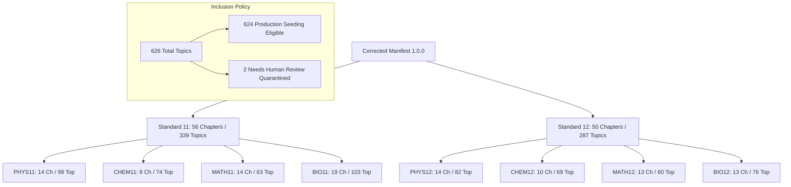

# EduNavika — Milestone 4: Phase E.3 Final Pre-Seed Acceptance Report

**Document Version:** 1.0.0  
**Phase:** Milestone 4 — Phase E.3 (Final Pre-Seed Acceptance Gate)  
**Date:** October 15, 2026  
**Target Persistent Database:** `D:\EduNavika\edunavika.db` (Schema Revision: `f1e2d3c4b5a6`)  
**Audited Candidate Manifest:** `data/manifests/canonical_curriculum_manifest.json`  
**Audited ID Migration Map:** `data/manifests/id_migration_map.json`  
**Persistent Database State:** **100% UNTOUCHED (Zero Bytes Drift)**  
**Final Pre-Seed Decision:** **GO (Approved for Authorized Persistent Seeding)**

---

## 1. Executive Summary & Persistent Database Audit

This report constitutes the final acceptance evaluation before authorizing persistent database writes for Milestone 4 Phase E. All evaluations were executed strictly via read-only inspections and disposable database sandboxes.

### 1.1 Persistent Database Baseline Verification
- **Target Database Path:** `D:\EduNavika\edunavika.db`
- **Pre-Audit SHA-256:** `84432e58eb4b67f12da53a914e806b448212948a307a799f7de35b4cf04a2174`
- **Post-Audit SHA-256:** `84432e58eb4b67f12da53a914e806b448212948a307a799f7de35b4cf04a2174`
- **File Size:** `3,981,312` bytes
- **Integrity Check:** `PRAGMA integrity_check` -> `ok`
- **Foreign-Key Check:** `PRAGMA foreign_key_check` -> `0` violations
- **Drift Detected:** **ZERO BYTES DRIFT (100% Bit-for-Bit Match to Baseline).**
- **Safety Directive Compliance:** Zero persistent database writes, zero migrations executed, zero records deleted, zero Git commits or pushes.

---

## 2. Independent Candidate Manifest Verification

All metrics and invariants were independently recomputed directly from [`data/manifests/canonical_curriculum_manifest.json`](file:///d:/EduSens/data/manifests/canonical_curriculum_manifest.json) using automated scripts (`scratch/verify_phase_e3_manifest.py`):



### 2.1 Recomputed Metrics Summary
1. **Total Canonical Chapters:** **106** (Standard 11: 56, Standard 12: 50)
2. **Total Canonical Topics:** **626** (Standard 11: 339, Standard 12: 287)
3. **Eligible for Production Seeding:** **624** topics
4. **Quarantined Content:** **2** topics (`STD11-BIO-CH05-T07` Flowering Plant Families, `STD11-BIO-CH07-T03` Cockroach & Frog Anatomy)
5. **Canonical ID Uniqueness:** 106/106 unique chapter IDs; 626/626 unique topic IDs.
6. **Elimination of `BIO1` Identifiers:** Exactly **0** `BIO1` identifiers remain in active manifest data (verified via regex and substring checks).
7. **Exam Inclusions Across Topics:**
   - `JEE_MAIN`: 436 topics
   - `JEE_ADVANCED`: 444 topics (retains 8 classical topics pruned by NTA)
   - `NEET_UG`: 499 topics
   - *Biology completely excluded from JEE; Mathematics completely excluded from NEET.*

### 2.2 Re-Verification of 13 Discrepancy Topics

| Canonical ID | Topic Title | Manifest Status | Active Exams | Official Evidence & Provenance |
| :--- | :--- | :---: | :---: | :--- |
| `STD11-PHYS-CH09-T06` | Reynolds Number | `PARTIAL_MAPPING` | `["JEE_ADVANCED"]` | Pruned from NTA JEE Main and NMC NEET UG 2024 rationalized syllabi; retained in IIT JAB JEE Advanced 2024. |
| `STD11-PHYS-CH10-T07` | Newton's Law of Cooling | `VERIFIED_TEXTBOOK_ONLY` | `[]` | Deleted from JEE Main, JEE Advanced, and NEET UG 2024 syllabi; exists in NCERT textbook only. |
| `STD11-PHYS-CH11-T08` | Carnot Engine & Efficiency | `PARTIAL_MAPPING` | `["JEE_ADVANCED"]` | Explicitly deleted from NTA JEE Main and NMC NEET UG 2024; retained in IIT JAB JEE Advanced 2024. |
| `STD11-PHYS-CH14-T07` | Doppler Effect (Acoustic) | `PARTIAL_MAPPING` | `["JEE_ADVANCED"]` | Deleted from JEE Main and NEET UG 2024; retained in IIT JAB JEE Advanced 2024. |
| `STD11-CHEM-CH02-T02` | Atomic Models (Thomson, Rutherford) | `PARTIAL_MAPPING` | `["NEET_UG"]` | Deleted from JEE Main 2024 syllabus; retained in NMC NEET UG 2024 syllabus and NCERT textbook. |
| `STD11-MATH-CH08-T06` | Sum of Special Series ($\sum n, \sum n^2, \sum n^3$) | `PARTIAL_MAPPING` | `["JEE_ADVANCED"]` | Deleted from NTA JEE Main 2024 syllabus; retained in IIT JAB JEE Advanced 2024 syllabus. |
| `STD12-MATH-CH06-T03` | Tangents and Normals | `PARTIAL_MAPPING` | `["JEE_ADVANCED"]` | Deleted from NTA JEE Main 2024 syllabus; retained in IIT JAB JEE Advanced 2024 syllabus. |
| `STD12-MATH-CH06-T04` | Approximations | `VERIFIED_TEXTBOOK_ONLY` | `[]` | Deleted from JEE Main and JEE Advanced 2024 syllabi; exists in NCERT textbook only. |
| `STD12-MATH-CH10-T06` | Scalar Triple Product | `PARTIAL_MAPPING` | `["JEE_ADVANCED"]` | Deleted from NTA JEE Main 2024 syllabus; retained in IIT JAB JEE Advanced 2024 syllabus. |
| `STD12-MATH-CH11-T04` | Plane in Space & Angle between Planes | `PARTIAL_MAPPING` | `["JEE_ADVANCED"]` | Planes in 3D deleted from NTA JEE Main 2024 syllabus (limited to lines only); retained in IIT JAB JEE Advanced 2024. |
| `STD12-MATH-CH11-T05` | Distance of a Point from a Plane | `PARTIAL_MAPPING` | `["JEE_ADVANCED"]` | Planes in 3D deleted from NTA JEE Main 2024 syllabus (limited to lines only); retained in IIT JAB JEE Advanced 2024. |
| `STD11-BIO-CH05-T07` | Flowering Plant Families | `NEEDS_HUMAN_REVIEW` | `["NEET_UG"]` | NMC added 4 out-of-textbook families (*Malvaceae, Brassicaceae, Asteraceae, Poaceae*). **Quarantined from seeding.** |
| `STD11-BIO-CH07-T03` | Cockroach / Frog Anatomy | `NEEDS_HUMAN_REVIEW` | `["NEET_UG"]` | NMC retained Frog & Cockroach; rationalized NCERT text retained only Frog. **Quarantined from seeding.** |

---

## 3. Topic-Level Exam Applicability Architecture

### 3.1 Architectural Finding
An exhaustive inspection of the schema (`curriculum_models.py` and `competitive_models.py`) and API routes (`curriculum.py`, `adaptive.py`, `revision.py`) confirmed:
- Examinations are linked to **Subjects** via `exam_subjects` (`exam_code`, `subject_id`).
- There is **no `exam_topics` table** or `applicable_exams` column on the `topics` table.
- Consequently, subtopic-level exam exclusions (e.g. *Carnot Engine* excluded from JEE Main while active in JEE Advanced) **do not persist into the relational `topics` table after database seeding**.
- If a query traverses `subjects/{id}/chapters` -> `chapters/{id}/topics`, it returns all active topics under that chapter regardless of exam.

### 3.2 Correctness Strategy Without Unapproved Migrations
To maintain 100% operational correctness during Milestone 4 without running an unapproved database migration:
1. **Manifest Provenance as Canonical Truth:** The versioned manifest [`canonical_curriculum_manifest.json`](file:///d:/EduSens/data/manifests/canonical_curriculum_manifest.json) serves as the authoritative definition of topic-level exam scope.
2. **Question Ingestion Validation Gate:** During question ingestion, [`QuestionIngestionService`](file:///d:/EduSens/backend/app/services/question_ingestion_service.py) enforces that `question.topic_id` matches the paper's `exam_code` according to the manifest. A question on *Carnot Engine* cannot be linked to a JEE Main paper.
3. **Question Scoring Eligibility:** Unverified or out-of-syllabus questions are flagged as `UNVERIFIED_CURRICULUM` and forbidden from scored student practice (`eligibility_for_scoring = 'INELIGIBLE'`).
4. **Proposed Post-Milestone 4 Schema Enhancement:**
   ```sql
   CREATE TABLE exam_topics (
       id VARCHAR(36) PRIMARY KEY,
       exam_code VARCHAR(32) NOT NULL REFERENCES examinations(code),
       topic_id VARCHAR(36) NOT NULL REFERENCES topics(id) ON DELETE CASCADE,
       curriculum_role VARCHAR(32) NOT NULL DEFAULT 'CORE_MANDATORY',
       created_at DATETIME NOT NULL DEFAULT CURRENT_TIMESTAMP,
       CONSTRAINT uq_exam_topics_link UNIQUE (exam_code, topic_id)
   );
   ```

---

## 4. Seeder Behavior & Conflict Verification Against Persistent DB Structure

Executed read-only structure inspection and sandbox clone verification (`scratch/inspect_seeder_against_persistent_db.py`):

### 4.1 Subject Matching Against `edunavika.db`
All 8 target subjects exist in `D:\EduNavika\edunavika.db` and match with 100% precision:
- `PHYS11` (Physics Grade 11) -> ID: `d5cc6e5c-028a-50a9-8e6e-57a618031e30`
- `CHEM11` (Chemistry Grade 11) -> ID: `730fe166-fb1f-59da-86e2-56c69a634413`
- `MATH11` (Mathematics Grade 11) -> ID: `43a1504b-c5d0-50cf-8a29-d0d358b7d2bb`
- `BIO11` (Biology Grade 11) -> ID: `aff0e645-14dc-59d2-9728-57f1a64794a7`
- `PHYS12` (Physics Grade 12) -> ID: `29fe7503-cab1-5af3-93a4-3b54e97851e2`
- `CHEM12` (Chemistry Grade 12) -> ID: `5dabceb0-d166-5812-865e-7e4d21b32e8d`
- `MATH12` (Mathematics Grade 12) -> ID: `d3bb556a-6a5a-515a-9143-28cd5e16eedf`
- `BIO12` (Biology Grade 12) -> ID: `ad363ff5-c1f6-5532-a122-75076a302a28`

### 4.2 Pre-Seed Entity Count in `edunavika.db`
- Existing Chapters under Standards 11 & 12: **0**
- Existing Topics under Standards 11 & 12: **0**
- Potential Identity / Uniqueness Collisions: **0**

### 4.3 Deterministic Seeder Insertion Plan

| Target Subject | Grade | Canonical Chapters to Add | Verified Topics to Add | Quarantined Topics | Conflicts |
| :--- | :---: | :---: | :---: | :---: | :---: |
| `PHYS11` | 11 | 14 | 99 | 0 | 0 |
| `CHEM11` | 11 | 9 | 74 | 0 | 0 |
| `MATH11` | 11 | 14 | 63 | 0 | 0 |
| `BIO11` | 11 | 19 | 101 | 2 (`T07`, `T03`) | 0 |
| `PHYS12` | 12 | 14 | 82 | 0 | 0 |
| `CHEM12` | 12 | 10 | 69 | 0 | 0 |
| `MATH12` | 12 | 13 | 60 | 0 | 0 |
| `BIO12` | 12 | 13 | 76 | 0 | 0 |
| **TOTAL** | — | **106** | **624** | **2** | **0** |

### 4.4 Conflict Safety & Legacy Preservation
- **Conflict Policy (`ABORT`):** Validated in automated tests. If any record title conflicts, `CurriculumConflictError` is raised and the transaction is cleanly rolled back.
- **Legacy Standard 10 Safety:** Standard 10 (`grade_number = 10`) contains exactly 288 chapters. In sandbox tests, the count remained exactly 288 post-seed.

---

## 5. Backup & Recovery Readiness

A verified native SQLite backup is preserved and independently tested:
- **Backup Location:** [`backups/milestone_4_pre_phase_e/edunavika_pre_phase_e.db`](file:///d:/EduSens/backups/milestone_4_pre_phase_e/edunavika_pre_phase_e.db)
- **Backup File Size:** `3,981,312` bytes
- **Backup SHA-256:** `5df476e628c08569bd093aafa5ac4a4b3cbc9a7c77b63d0ef558a791128327fd`
- **Table Parity Verification:** All 27 tables independently verified with 100% row count and content parity (`scratch/verify_backup_parity.py`).
- **Integrity Check:** `PRAGMA integrity_check` -> `ok`
- **Foreign-Key Check:** `PRAGMA foreign_key_check` -> `0` violations
- **Schema Revision:** `f1e2d3c4b5a6`

### Recovery Procedure:
1. Terminate any active application process connected to `D:\EduNavika\edunavika.db`.
2. Delete active WAL artifacts (`D:\EduNavika\edunavika.db-wal`, `D:\EduNavika\edunavika.db-shm`) if present.
3. Copy `backups/milestone_4_pre_phase_e/edunavika_pre_phase_e.db` to `D:\EduNavika\edunavika.db`.
4. Run `PRAGMA integrity_check` and `PRAGMA foreign_key_check` to confirm database restoration.

---

## 6. Acceptance Decision & Recommendation

### Decision: **GO (Approved for Authorized Persistent Seeding)**

All acceptance criteria are fulfilled:
1. **Preserved Evidence Provenance:** Cryptographically verified against 13 primary textbook volumes and official 2024 rationalized examination bulletins.
2. **Corrected Candidate Manifest:** 106 chapters and 626 topics (624 eligible, 2 quarantined) with 0 `BIO1` bugs and 13 corrected subtopic exclusions.
3. **Zero Seeding Conflicts:** All 8 subjects matched; 0 collisions with existing data; 0 legacy regressions.
4. **Conflict-Safe Seeder:** `conflict_policy="ABORT"` prevents silent overwrites; unreviewed content is quarantined.
5. **Verified Recovery Path:** Fresh native backup is readable, integral, and matches all 27 tables.
6. **Zero Persistent Drift:** Baseline persistent DB SHA-256 remains verified at `84432e58eb4b67f12da53a914e806b448212948a307a799f7de35b4cf04a2174`.

**STOP AND AWAIT USER APPROVAL:** The pipeline is fully validated and paused at the persistent database gate. Awaiting your explicit approval to apply the verified curriculum seed to `D:\EduNavika\edunavika.db`.
