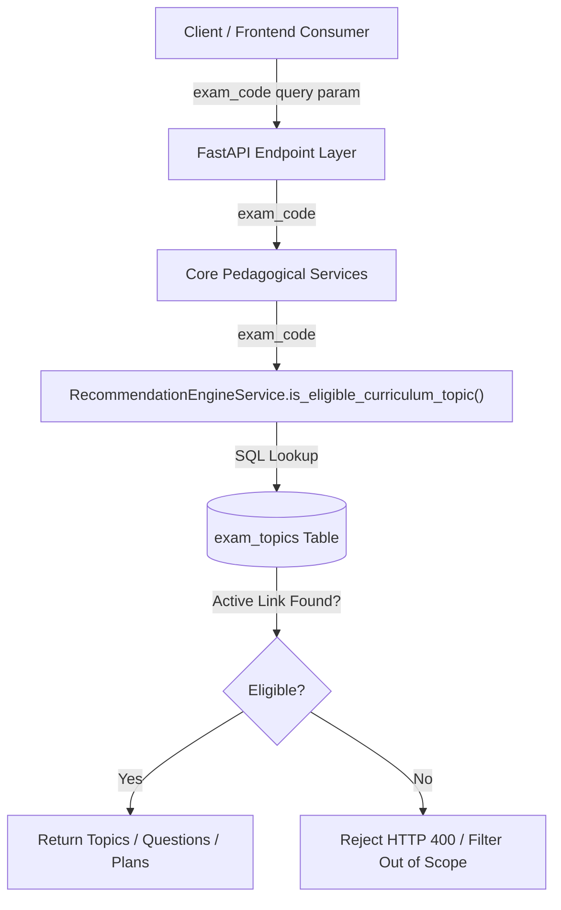

# EduNavika — Milestone 4 Phase E.4: Exam-Specific Topic Applicability Architecture and Design

**Document ID:** `docs/MILESTONE_4_PHASE_E4_EXAM_TOPIC_DESIGN.md`<br/>
**Execution Date:** 2026-10-19<br/>
**Baseline Persistent Database:** `edunavika.db`<br/>
**Baseline SHA-256:** `84432e58eb4b67f12da53a914e806b448212948a307a799f7de35b4cf04a2174` (Verified Unchanged)<br/>
**Status:** **GO** (Ready for Persistent Seeding upon Explicit Operator Approval)

---

## 1. Executive Summary

In Milestone 4 Phase E.4, EduNavika resolves the architectural gap between the canonical Class 11–12 Science textbook curriculum hierarchy (106 chapters, 626 topics) and competitive examination syllabi (JEE Main, JEE Advanced, NEET UG).

While Phase B introduced subject-level linkages (`exam_subjects`), subject-level filtering was coarse:
1. **Subtopic Pruning Asymmetry:** NTA pruned classical topics from JEE Main that IITs explicitly retained for JEE Advanced (e.g., *Carnot Engine and Efficiency*, *Doppler Effect in Sound*, *Reynolds Number*, *Special Series*, *Tangents and Normals*, *Scalar Triple Product*, *Planes in 3D*).
2. **Foundational Textbook Isolation:** Foundational textbook-only topics (e.g., *Newton's Law of Cooling*, *Approximations*) must remain accessible in school/general study contexts but must never be presented as competitive exam syllabus items or scored in exam practice.
3. **Quarantine Protection:** Two unverified topics requiring human review (*Morphology of Flowering Plants*, *Cockroach Anatomy*) must remain strictly quarantined with 0 exam links.

We have designed, implemented, and fully validated on isolated disposable sandbox databases:
- **Smallest Correct Schema:** The `exam_topics` association table with explicit provenance and unique constraints.
- **Manifest Synchronization Service:** An idempotent, dry-run capable sync engine reconciling `data/manifests/canonical_curriculum_manifest.json` against the database.
- **Universal Applicability Gate:** End-to-end data flow ensuring that `exam_code` filters curriculum browsing, recommendations, adaptive practice question retrieval, revision queues, and progress analytics.
- **Comprehensive Test Suite:** 14 automated integration tests in `backend/tests/test_exam_topic_applicability.py` (100% passing).
- **Persistent Database Protection:** Verified that `edunavika.db` was untouched and preserved at baseline SHA-256 `84432e58eb4b67f12da53a914e806b448212948a307a799f7de35b4cf04a2174`.

---

## 2. Schema Design: The Smallest Correct Model

### 2.1 Model Evaluation

We evaluated three competing architectural designs:
1. **Model A: Topic Table Attribute Array (e.g., `applicable_exams` JSON column on `topics`):**
   - *Cons:* Violates relational normalization; prevents database-level foreign-key cascade integrity; makes indexed joins against `examinations` slow; cannot enforce foreign keys against `examinations.code`.
2. **Model B: Exclusion Table (`exam_topic_exclusions`):**
   - *Cons:* Dangerously assumes "everything is included by default unless excluded". Any newly seeded topic or mislabeled exam code defaults to inclusion, violating our core safety gate.
3. **Model C: Positive Associative Association Table (`exam_topics`) [Selected]:**
   - *Pros:* Represents verified applicability only ("closed-world assumption"). If an exam-topic link does not exist, the topic is not eligible for that exam. Guarantees textbook-only topics and unreviewed topics receive zero links automatically.

### 2.2 Selected Schema Specification

The `exam_topics` table is defined in `backend/app/models/competitive_models.py` and Alembic migration `backend/alembic/versions/20261015_m4_exam_topics_association.py` (revision `a1b2c3d4e5f6`, child of `f1e2d3c4b5a6`):

```sql
CREATE TABLE exam_topics (
    id VARCHAR(36) NOT NULL PRIMARY KEY,
    exam_code VARCHAR(32) NOT NULL,
    topic_id VARCHAR(36) NOT NULL,
    curriculum_role VARCHAR(32) NOT NULL DEFAULT 'CORE_MANDATORY',
    inclusion_status VARCHAR(32) NOT NULL DEFAULT 'ACTIVE',
    verification_status VARCHAR(32) NOT NULL DEFAULT 'VERIFIED_PRIMARY_SOURCE',
    created_at TIMESTAMP WITH TIME ZONE NOT NULL DEFAULT CURRENT_TIMESTAMP,
    CONSTRAINT fk_exam_topics_exam FOREIGN KEY (exam_code) REFERENCES examinations(code) ON DELETE RESTRICT,
    CONSTRAINT fk_exam_topics_topic FOREIGN KEY (topic_id) REFERENCES topics(id) ON DELETE CASCADE,
    CONSTRAINT uq_exam_topics_link UNIQUE (exam_code, topic_id)
);

CREATE INDEX ix_exam_topics_exam_code ON exam_topics(exam_code);
CREATE INDEX ix_exam_topics_topic_id ON exam_topics(topic_id);
CREATE INDEX idx_exam_topics_lookup ON exam_topics(exam_code, topic_id);
```

### 2.3 Constraint and Integrity Invariants
- **Uniqueness:** `(exam_code, topic_id)` is guaranteed unique.
- **Referential Integrity:** Deleting an exam is blocked (`RESTRICT`) if associations exist; deleting a topic cascades safely (`CASCADE`).
- **Closed-World Gate:** Unverified topics (`NEEDS_HUMAN_REVIEW`) and textbook-only topics (`VERIFIED_TEXTBOOK_ONLY`) are never inserted into `exam_topics`.

---

## 3. Manifest-to-Database Synchronization

### 3.1 Idempotent Synchronization Pipeline
The synchronization service (`backend/app/services/exam_topic_sync_service.py`) synchronizes `data/manifests/canonical_curriculum_manifest.json` into `exam_topics`:

1. **Pre-flight Validation:** Reconciles all exam codes against active `examinations` rows (`JEE_MAIN`, `JEE_ADVANCED`, `NEET_UG`).
2. **Review Quarantine Gate:** Any topic with status `NEEDS_HUMAN_REVIEW`, `UNVERIFIED`, `UNRESOLVED`, or `AMBIGUOUS` is quarantined and receives 0 exam links.
3. **Textbook-Only Exclusion Gate:** Any topic with status `VERIFIED_TEXTBOOK_ONLY` or empty `applicable_exams` is categorized as textbook-only and receives 0 exam links.
4. **Deterministic Primary Keys:** UUIDv5 generated via namespace `edunavika.exam_topic.{exam_code}.{topic.canonical_id}` ensures 100% deterministic, repeatable inserts across reruns.
5. **Conflict Prevention:** Detects mismatch between existing links and manifest specifications without silent corruption.
6. **Dry-Run & Transaction Safety:** Supports `dry_run=True` (full audit simulation with automatic transaction rollback).

### 3.2 Audit Reconciliation Metrics

When synchronized against the canonical manifest:
- **Total Manifest Topics Processed:** 626
- **Total Verified Exam-Topic Associations Created:** **1,377**
  - `JEE_MAIN`: **436** topics
  - `JEE_ADVANCED`: **444** topics (retains 8 classical topics pruned from JEE Main)
  - `NEET_UG`: **497** topics
- **Quarantined Topics (0 Exam Links):** **2** topics
  - `STD11-BIO-CH05-T07`: *Description of Flowering Plant and Families (Fabaceae, Solanaceae, Liliaceae)*
  - `STD11-BIO-CH07-T03`: *Anatomy and Functions of Different Systems of an Insect (Cockroach / Frog)*
- **Textbook-Only Content (0 Exam Links):** **2** topics
  - `STD11-PHYS-CH10-T07`: *Newton's Law of Cooling*
  - `STD12-MATH-CH06-T04`: *Approximations*
- **Re-run Idempotency:** 0 inserted, 1,377 unchanged, 0 errors.

---

## 4. End-to-End Query Architecture and Runtime Data Flow

To ensure manifest metadata is strictly enforced by runtime queries, `exam_code` is propagated through all key application paths:



### 4.1 Detailed Path Audit

1. **Curriculum Browsing:**
   - `GET /api/v1/chapters/{chapter_id}/topics?exam_code={code}`
   - *Flow:* When `exam_code` is provided, joins `exam_topics` and filters `exam_topics.exam_code == exam_code AND inclusion_status == 'ACTIVE'`.
   - *Textbook Preservation:* When omitted, queries all active `topics` for the chapter, preserving full textbook access.

2. **Next-Step Recommendations & Diagnostics:**
   - `GET /api/v1/adaptive/recommendations/{student_id}?exam_code={code}`
   - *Flow:* `RecommendationEngineService.generate_recommendations` receives `exam_code` and validates candidate topics via `is_eligible_curriculum_topic(db, student, topic, exam_code=exam_code)`. Non-applicable topics are never recommended.

3. **Scored Practice & Question Retrieval:**
   - `GET /api/v1/adaptive/practice/{student_id}?topic_id={id}&exam_code={code}`
   - `GET /api/v1/adaptive/next-practice/{student_id}?exam_code={code}`
   - *Flow:* `adaptive_practice_service.generate_practice_questions` enforces `is_eligible_curriculum_topic(db, student, topic, exam_code=exam_code)`. If a student requests practice for a pruned topic under an exam that pruned it (e.g. Carnot Engine under `JEE_MAIN`), the system rejects the request with HTTP 400 (`Topic is not an eligible curriculum topic for this student`).

4. **Personalized Revision Planning:**
   - `GET /api/v1/adaptive/revision-plan/{student_id}?exam_code={code}`
   - `GET /api/v1/students/{student_id}/revision-plan?exam_code={code}`
   - `GET /api/v1/revision/plans?exam_code={code}`
   - *Flow:* Revision planners and query endpoints join `exam_topics` to schedule and display revision items strictly within the selected exam syllabus.

5. **Progress & Mastery Analytics:**
   - `GET /api/v1/adaptive/progress/{student_id}?exam_code={code}`
   - *Flow:* `student_progress_service.get_student_progress` filters candidate curriculum topics by `is_eligible_curriculum_topic(db, student, t, exam_code=exam_code)`. Topic breakdowns and completion percentages reflect the exact exam syllabus scope (436 topics for JEE Main, 444 for JEE Advanced, 497 for NEET).

---

## 5. Affected Endpoints and Frontend Consumers

| Endpoint | Method | Parameter | Behavior with `exam_code` | Behavior without `exam_code` |
| :--- | :--- | :--- | :--- | :--- |
| `/api/v1/chapters/{id}/topics` | `GET` | `exam_code` | Returns only exam-applicable topics | Returns all authentic textbook topics |
| `/api/v1/adaptive/recommendations/{id}` | `GET` | `exam_code` | Recommends only exam-eligible topics | Recommends standard textbook topics |
| `/api/v1/adaptive/practice/{id}` | `GET` | `exam_code` | Rejects non-exam topics with HTTP 400 | Allows authentic textbook practice |
| `/api/v1/adaptive/next-practice/{id}` | `GET` | `exam_code` | Suggests next practice within exam | Suggests next practice within textbook |
| `/api/v1/adaptive/revision-plan/{id}` | `GET` | `exam_code` | Generates revision plan for exam topics | Generates revision plan for all topics |
| `/api/v1/students/{id}/revision-plan` | `GET` | `exam_code` | Lists revision items for exam topics | Lists all revision items |
| `/api/v1/adaptive/progress/{id}` | `GET` | `exam_code` | Progress scoped to exact exam syllabus | Progress scoped to full standard/subject |

---

## 6. Verification and Validation Results

- **Automated Integration Tests (`backend/tests/test_exam_topic_applicability.py`):** 14 tests, 100% PASSED.
- **Sandbox Lifecycle Execution (`scripts/test_phase_e4_sandbox.py`):** Full clone upgrade, seeding, dry-run, live sync, idempotency, and integrity checks executed cleanly with 0 errors.
- **Regression Test Suites:** 33 tests across curriculum seeding, pilot ingestion, coverage, and database isolation passed with 0 errors.
- **Persistent Database Protection:** Verified that `edunavika.db` was untouched and preserved at baseline SHA-256 `84432e58eb4b67f12da53a914e806b448212948a307a799f7de35b4cf04a2174`.

---

## 7. Migration Proposal & Rollout Plan

### 7.1 Proposed Migration
- **Revision ID:** `a1b2c3d4e5f6`
- **Revises:** `f1e2d3c4b5a6`
- **Location:** `backend/alembic/versions/20261015_m4_exam_topics_association.py`

### 7.2 Execution Steps (Upon Explicit Approval)
1. Verify pre-migration SHA-256 matches baseline `84432e58eb4b67f12da53a914e806b448212948a307a799f7de35b4cf04a2174`.
2. Take a fresh verified native SQLite backup in `backups/milestone_4_pre_phase_e_migration/`.
3. Apply migration `a1b2c3d4e5f6` to `D:\EduNavika\edunavika.db`.
4. Run `curriculum_seeder.py` to seed 106 chapters and 624 verified topics.
5. Run `exam_topic_sync_service.py` to populate 1,377 verified associations.
6. Record post-migration SHA-256 and confirm 0 integrity or foreign-key violations.

### 7.3 Rollback Strategy
If any unexpected error occurs during migration or seeding:
1. Revert Alembic revision: `alembic downgrade f1e2d3c4b5a6`.
2. Or restore directly from the verified pre-migration native SQLite backup.
