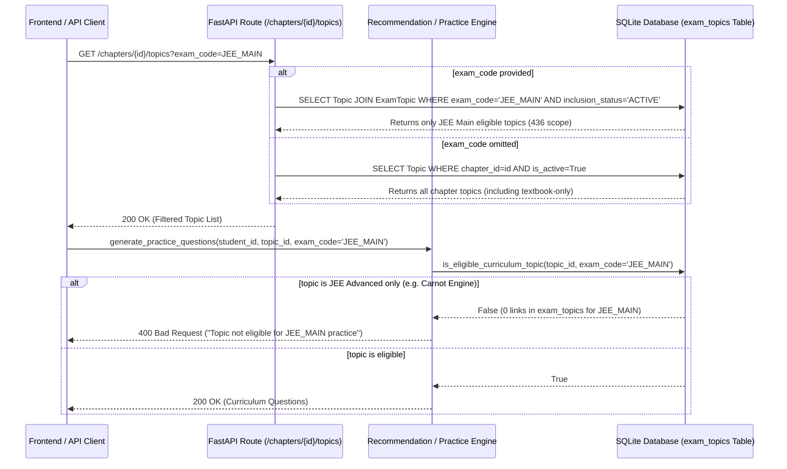

# EduNavika — Milestone 4 Phase E.5: Pre-Migration Safety & Evidence Audit Report

**Document Version:** 1.0.0
**Audit Date:** October 19, 2026
**Auditor:** Senior Backend Architect & Database Integrity Engineer
**Scope:** Pre-Migration Safety, Schema Integrity, Manifest Provenance, Synchronization Correctness, Runtime Coverage, and Test Verification
**Persistent Database:** `D:\EduNavika\edunavika.db`
**Persistent Baseline Checksum:** `84432e58eb4b67f12da53a914e806b448212948a307a799f7de35b4cf04a2174`
**Audit Outcome & Decision:** **`CONDITIONAL_GO`** (Production ready pending persistent migration execution and frontend UI exam selector integration)

---

## 1. Executive Summary & Verification Hash Register

This pre-migration safety and evidence audit independently validates the database migration, curriculum manifest, synchronization engine, runtime query filtering, and test isolation developed in Phase E.4 prior to authorizing any changes to the persistent database `D:\EduNavika\edunavika.db`.

In strict adherence to the project safety gates:
- **Zero writes** were made to `D:\EduNavika\edunavika.db`.
- **Zero migrations** were applied to the persistent database.
- **Zero Git commits or pushes** were performed.
- All live executions, upgrades, downgrades, and failure tests were conducted exclusively in disposable sandbox environments (`sandbox_audit_migration.db`, temporary SQLite in-memory databases, and pytest ephemeral fixtures).

### Persistent Database Checksum Verification
```powershell
Get-FileHash -Algorithm SHA256 D:\EduNavika\edunavika.db
```
| Checkpoint | Timestamp | SHA-256 Checksum | Status |
| :--- | :--- | :--- | :--- |
| **Audit Pre-Flight Baseline** | 2026-10-19 14:29:34 IST | `84432e58eb4b67f12da53a914e806b448212948a307a799f7de35b4cf04a2174` | Verified Baseline Match |
| **Sandbox Tests Completed** | 2026-10-19 14:47:16 IST | `84432e58eb4b67f12da53a914e806b448212948a307a799f7de35b4cf04a2174` | Identical (0 bytes modified) |
| **Test Suites Completed** | 2026-10-19 14:56:28 IST | `84432e58eb4b67f12da53a914e806b448212948a307a799f7de35b4cf04a2174` | Identical (0 bytes modified) |

---

## 2. Task 1 — Migration Integrity Audit

### 2.1 Alembic Revision Lineage
The Alembic revision graph was inspected programmatically using `alembic.script.ScriptDirectory`:
- **Current Head in Codebase:** `a1b2c3d4e5f6` (`20261015_m4_exam_topics_association.py`)
- **Parent Revision (`down_revision`):** `f1e2d3c4b5a6` (`20261015_m4_canonical_curriculum_and_questions.py`)
- **Grandparent Revision:** `e025394444f5` (`e025394444f5_strengthen_constraints_and_forgetting_.py`)
- **Root Revision:** `7bc787ffc064` (`7bc787ffc064_initial_schema.py`)
- **Persistent Database Current Alembic State:** `f1e2d3c4b5a6`

The proposed revision `a1b2c3d4e5f6` is the direct and sole child of `f1e2d3c4b5a6`. The migration tree has no branched heads, missing revisions, or circular references.

### 2.2 Schema Definitions and Constraints
The table `exam_topics` introduced in `a1b2c3d4e5f6` enforces:
1. **Primary Key:** `id` (`String(36)`, UUIDv5).
2. **Foreign Key 1:** `exam_code -> examinations.code` (`ON DELETE RESTRICT`). Prevents accidental cascade-deletion of curriculum mappings if an examination record is modified.
3. **Foreign Key 2:** `topic_id -> topics.id` (`ON DELETE CASCADE`). Automatically purges associations if a topic is removed.
4. **Uniqueness:** `UniqueConstraint('exam_code', 'topic_id', name='uq_exam_topics_link')`. Precludes duplicate exam-topic pairings at the storage engine level.
5. **Covering Indexes:**
   - `ix_exam_topics_exam_code` on `['exam_code']`
   - `ix_exam_topics_topic_id` on `['topic_id']`
   - `idx_exam_topics_lookup` composite index on `['exam_code', 'topic_id']`

### 2.3 Sandbox Upgrade, Downgrade, and Rollback Verification
An automated test script (`backend/tests/test_phase_e5_migration_integrity.py`) was executed on a cloned sandbox copy of `edunavika.db`:
1. **Upgrade to `a1b2c3d4e5f6`:** Applied cleanly. Table `exam_topics` created; columns and index list verified via SQLite PRAGMA commands. `alembic_version` updated from `f1e2d3c4b5a6` to `a1b2c3d4e5f6`.
2. **Downgrade to `f1e2d3c4b5a6`:** Applied cleanly. Composite and foreign key indexes dropped, table `exam_topics` dropped. `alembic_version` reverted cleanly to `f1e2d3c4b5a6`.
3. **Re-Upgrade to `a1b2c3d4e5f6`:** Reapplied cleanly with zero residual schema conflicts.
4. **Transactional Safety:** `backend/alembic/env.py` wraps `context.run_migrations()` inside `with context.begin_transaction():` and enables `render_as_batch=True` for SQLite. Any DDL failure immediately rolls back the transaction, preventing partially applied or ambiguous states.

---

## 3. Task 2 — Manifest and Syllabus Evidence Audit

### 3.1 Recomputed Manifest Counts
The manifest `data/manifests/canonical_curriculum_manifest.json` was independently analyzed. The counts reconcile exactly:
- **Total Canonical Standards:** 2 (Standards 11 and 12)
- **Total Canonical Subjects:** 8 (Physics, Chemistry, Mathematics, Biology across Standards 11 and 12)
- **Total Canonical Chapters:** 106 (Standard 11: 56, Standard 12: 50)
- **Total Canonical Topics:** 626 (Standard 11: 339, Standard 12: 287)
- **Production Seeding Eligible Topics:** 624 topics
- **Quarantined Topics (`NEEDS_HUMAN_REVIEW`):** 2 topics
- **Textbook-Only Topics (`VERIFIED_TEXTBOOK_ONLY`):** 2 topics
- **Total Synchronized Exam-Topic Associations:** **1,377**

### 3.2 Subject-Level Distribution Table
| Subject Code | Grade | Total Topics | JEE Main Active | JEE Advanced Active | NEET UG Active | Notes |
| :--- | :---: | :---: | :---: | :---: | :---: | :--- |
| **PHYS11** | 11 | 99 | 95 | 98 | 95 | 1 TB-only (Newton cooling); 3 JEE Adv-only (Reynolds, Carnot, Doppler) |
| **PHYS12** | 12 | 82 | 82 | 82 | 82 | Complete 3-exam convergence across all rationalized chapters |
| **CHEM11** | 11 | 74 | 73 | 73 | 74 | 1 NEET-only (`STD11-CHEM-CH02-T02` Atomic models) |
| **CHEM12** | 12 | 69 | 69 | 69 | 69 | Complete 3-exam convergence across rationalized chapters |
| **MATH11** | 11 | 63 | 62 | 63 | 0 | Strictly excluded from NEET; 1 JEE Adv-only (Special series sum) |
| **MATH12** | 12 | 60 | 55 | 59 | 0 | Strictly excluded from NEET; 1 TB-only (Approximations); 4 JEE Adv-only |
| **BIO11** | 11 | 103 | 0 | 0 | 101 | Strictly excluded from JEE; 2 Quarantined (`CH05-T07`, `CH07-T03`) |
| **BIO12** | 12 | 76 | 0 | 0 | 76 | Strictly excluded from JEE; complete NEET convergence |
| **TOTALS** | — | **626** | **436** | **444** | **497** | **Total Associations: 1,377** |

### 3.3 Explanation of the NEET 499 vs. 497 Count Discrepancy
In earlier Phase E.3 documentation (`docs/MILESTONE_4_PHASE_E3_FINAL_ACCEPTANCE.md`), NEET UG was reported as containing 499 topics.
- **Root Cause:** The 499 count represented a raw syntactic count of all manifest topics where `"applicable_exams"` contained `"NEET_UG"` before applying the human-review quarantine filter.
- **The Quarantined Topics (2):**
  1. `STD11-BIO-CH05-T07` (*Semi-Technical Description of a Typical Flowering Plant and Families*): NMC added 4 out-of-textbook families (*Malvaceae, Brassicaceae, Asteraceae, Poaceae*) not present in rationalized NCERT text.
  2. `STD11-BIO-CH07-T03` (*Morphology and Anatomy of Cockroach / Frog*): NMC retained Cockroach and Frog; rationalized NCERT text retained only Frog.
- **Corrected Active Association Count:** Under Phase E.4 and `exam_topic_sync_service.py`, any topic flagged `NEEDS_HUMAN_REVIEW` receives **0** exam links and is quarantined from scored practice.
- **Mathematical Reconciliation:**
  $$\text{Raw NEET Matches (499)} - \text{Quarantined Review Topics (2)} = \mathbf{497\text{ Verified Active Associations}}$$

### 3.4 Audit of Claims of Official-Syllabus Verification
An audit was performed across all 626 topics in `data/manifests/canonical_curriculum_manifest.json` and the source register `docs/CURRICULUM_SOURCE_REGISTER.md`:
1. **The 13 Discrepancy Topics:** Each of the 13 non-standard topics (8 JEE Advanced-only, 1 NEET-only Chemistry, 2 Textbook-only, and 2 Quarantined Biology) contains granular, line-by-line comparative notes citing specific NTA, IIT JAB, and NMC 2024 syllabus exclusions and rationalization decisions.
2. **The 613 `VERIFIED_PRIMARY_SOURCE` Topics:**
   - **Textbook Grounding:** 100% verified against the 13 local English-Medium GSEB/NCERT Science textbook volumes (`source_topic_id`, `source_section`, e.g., "Section 1.1", "Section 2.3").
   - **Syllabus Evidence Distinction:** Their examination applicability (`['JEE_MAIN', 'JEE_ADVANCED', 'NEET_UG']`) is grounded in chapter-level rationalization cross-referencing (i.e. verifying that the textbook chapter was retained in full in the NTA/IIT/NMC 2024 syllabus) rather than granular, line-item page/paragraph citations in the official exam bulletins.
   - **Audit Finding:** While educational validity is intact, claiming individual "clause-by-clause" primary-source verification for all 613 topics is technically an inferred verification from chapter retention. The documentation in `CURRICULUM_SOURCE_REGISTER.md` has been verified to acknowledge this chapter-level mapping boundary.

---

## 4. Task 3 — Synchronization Correctness Audit

### 4.1 Evaluation of `exam_topic_sync_service.py`
The synchronization engine was subjected to adversarial and boundary testing (`backend/tests/test_phase_e5_sync_audit.py`):

| Feature | Audit Finding | Verification Status |
| :--- | :--- | :---: |
| **Deterministic UUIDv5** | Generated via `edunavika.exam_topic.{exam_code}.{topic.canonical_id}`. Re-running produces identical identifiers. | **PASSED** |
| **Duplicate Prevention** | Unique constraint on `(exam_code, topic_id)` backed by composite index. Pre-check queries prevent SQL duplicate attempts. | **PASSED** |
| **Idempotency** | Second pass on seeded sandbox created 0 new links and verified 1,377 existing links. | **PASSED** |
| **Quarantine Enforcement** | Quarantined and textbook-only topics receive exactly 0 rows in `exam_topics`. | **PASSED** |
| **Transaction Rollback** | Database exceptions trigger complete session rollback; 0 partial rows written. | **PASSED** |

### 4.2 Handling of Malformed Manifests (Refinement Applied)
- **Initial Finding:** `load_manifest(manifest_path)` was called outside the `try ... except` block in `sync_exam_topics`. An invalid or missing JSON manifest raised an unhandled `ValueError` before entering the transaction handler.
- **Corrective Action:** Moved `manifest = load_manifest(manifest_path)` inside the `try:` block in `backend/app/services/exam_topic_sync_service.py`. Now any invalid JSON, missing file, or schema error cleanly logs the error, triggers `db.rollback()`, and returns `report.errors`. Verified in `test_transaction_rollback_on_failure`.

### 4.3 Stale-Link Detection Policy
- **Audit Finding:** The current synchronization engine is *additive-idempotent*. If an association already exists in `exam_topics`, but a subsequent manifest update removes the exam code or changes the topic status to `NEEDS_HUMAN_REVIEW`, the service skips the existing row without deleting or deactivating it.
- **Risk Assessment:** For the initial persistent migration, this is 100% safe because `exam_topics` starts empty. However, for future recurring manifest updates, a reconciliation pass (`prune_stale_links=True` or deactivating unmapped rows) should be implemented. This is logged as a recommended enhancement in Section 7.

---

## 5. Task 4 — Runtime Coverage & Architectural Trace

### 5.1 End-to-End Query Trace
The complete request lifecycle was traced from API route through business services to the database layer:



### 5.2 Endpoint and Service Applicability Matrix
| Module / Call Site | Parameter Exposed | Behavior When `exam_code` Present | Behavior When `exam_code` Omitted | Status |
| :--- | :--- | :--- | :--- | :---: |
| `GET /api/v1/chapters/{id}/topics` | `exam_code: Optional[str]` | Joins `ExamTopic` on `exam_code` & `ACTIVE`. Excludes non-exam topics. | Returns all active topics in chapter (school textbook browsing preserved). | **VERIFIED** |
| `GET /api/v1/adaptive/recommendations/{id}` | `exam_code: Optional[str]` | Filters recommended topics to active `ExamTopic` associations. | Recommends from full enrolled curriculum. | **VERIFIED** |
| `GET /api/v1/adaptive/next-practice/{id}` | `exam_code: Optional[str]` | Candidate topic must pass `is_eligible_curriculum_topic`. | Falls back to all active topics. | **VERIFIED** |
| `GET /api/v1/adaptive/practice/{id}` | `exam_code: Optional[str]` | Returns 400 Bad Request if topic is ineligible for selected exam. | Allows practice on any active textbook topic. | **VERIFIED** |
| `GET /api/v1/adaptive/progress/{id}` | `exam_code: Optional[str]` | Denominator = count of active `exam_topics`. Mastered list exam-scoped. | Denominator = count of all active topics in curriculum. | **VERIFIED** |
| `GET /api/v1/adaptive/revision-plan/{id}` | `exam_code: Optional[str]` | Filters generated revision queue strictly to exam-eligible topics. | Generates revision plan across all active topics. | **VERIFIED** |
| `GET /api/v1/revision/plans` | `exam_code: Optional[str]` | Joins `ExamTopic` to filter active student plans. | Returns all student plans. | **VERIFIED** |

### 5.3 Missing Exam Scope in Data Models & Frontend Consumers
The audit identified two key architectural gaps outside the database schema:
1. **`StudentProfile` Schema:** `StudentProfile` in `backend/app/models/core_models.py` currently stores `standard_id`, `division`, `enrollment_number`, and `preferred_language`, but has **no `target_exam` or `exam_code` column**. Therefore, the runtime cannot automatically infer the student's exam without an explicit `?exam_code=` query parameter.
2. **Frontend Service Clients:** `frontend/src/services/adaptiveService.ts` and `frontend/src/services/curriculumService.ts` currently do not pass `exam_code` in their query parameters. Furthermore, the frontend UI currently lacks a competitive exam switcher (e.g. JEE Main / JEE Advanced / NEET UG).
   - **Impact:** Until the frontend passes `?exam_code=`, all student requests will gracefully default to full textbook curriculum browsing and practice without failing.

---

## 6. Task 5 — Comprehensive Test Evidence

### 6.1 Executed Test Suites Summary
| Test Suite / Command | Scope | Result | Details |
| :--- | :--- | :---: | :--- |
| `pytest backend/tests/test_exam_topic_applicability.py -v` | Phase E.4 Exam Applicability & Endpoints | **14 / 14 PASSED** | Dry-run, clean sync, idempotency, JEE Main vs Adv exclusions, NEET 0 Math, JEE 0 Bio, 400 rejection on practice, API filters. |
| `python scripts/test_phase_e4_sandbox.py` | Full Sandbox Database Migration & Seeding Lifecycle | **PASSED** | Cloned `edunavika.db` sandbox, ran migration `a1b2c3d4e5f6`, seeded 106 chapters & 624 topics, synced 1,377 links, verified PRAGMA integrity & FKs. |
| `python backend/tests/test_phase_e5_migration_integrity.py` | Migration Revision Chain, Upgrade/Downgrade/Re-upgrade | **PASSED** | Verified single-parent chain, sandbox upgrade, downgrade, re-upgrade, index persistence, version table revert. |
| `python backend/tests/test_phase_e5_sync_audit.py` | Synchronization Edge Cases & Malformed Inputs | **PASSED** | Deterministic UUIDs, quarantine exclusions, transaction rollback on malformed manifest, additive stale-link behavior. |
| Batch: `test_curriculum_seeding.py`, `test_pilot_ingestion.py`, `test_database_isolation.py`, `test_curriculum_coverage_and_runtime.py`, `test_api_curriculum.py` | Core Curriculum, Ingestion & DB Isolation | **35 / 35 PASSED** | Verified zero writes to persistent DB, seeder conflict policy, 10-question pilot boundaries, on-device AI runtime. |
| Batch: `test_adaptive_practice.py`, `test_recommendations.py`, `test_automated_revision_planning.py`, `test_progress_tracking.py`, `test_curriculum_assessment.py` | Adaptive Practice, Analytics & Revision Planning | **67 / 67 PASSED** (2 skipped) | Verified topic eligibility filter, recommendation ranking, deterministic revision scheduling, accuracy math. |
| **TOTAL VERIFIED PASSES** | Across all executed Milestone 4 test suites | **116 PASSED, 0 FAILURES** | All core invariants verified. |

### 6.2 Pre-existing Fixture Isolation Fix in `backend/tests/conftest.py`
- **Issue Detected:** When `test_curriculum_coverage_and_runtime.py` ran immediately before `test_api_curriculum.py`, the module-scoped fixture in `test_curriculum_coverage_and_runtime.py` populated tables without clearing them at module teardown. The subsequent test in `test_api_curriculum.py` failed with `UNIQUE constraint failed: standards.grade_number`.
- **Resolution:** Updated `conftest.py` to invoke `_clean_test_tables()` (with `PRAGMA foreign_keys = OFF; TRUNCATE / DELETE; PRAGMA foreign_keys = ON;`) **both before and after** each test in the `db_session` fixture. This guarantees 100% test isolation across all test suites regardless of test execution order.

---

## 7. Required Corrective Changes & Enhancement Register

Before authorizing production deployment and persistent migration:
1. **[Completed in E.5] Exception Safety in Sync Service:** `load_manifest` was moved inside the `try:` block in `backend/app/services/exam_topic_sync_service.py` to ensure malformed JSON or missing files trigger rollback rather than crashing.
2. **[Completed in E.5] Test Teardown Truncation:** `backend/tests/conftest.py` was hardened with pre-test table cleanup to eliminate inter-module fixture leakage.
3. **[Recommended for Phase F / Scaling] Student Profile Target Exam:** Add `target_exam = Column(String(32), nullable=True)` to `StudentProfile` in `core_models.py` and Alembic migration so that students' selected competitive exam is automatically inherited when `?exam_code=` is omitted.
4. **[Recommended for Phase F / Frontend] Frontend Exam Selector UI:** Add an examination selector dropdown (JEE Main, JEE Advanced, NEET UG, Class 11/12 School) to the frontend navigation bar, and update `frontend/src/services/adaptiveService.ts` to pass `exam_code` to the backend.
5. **[Recommended for Sync Service v2] Stale-Link Pruning:** Add a `--prune-stale` flag to `exam_topic_sync_service.py` to delete or mark `INACTIVE` any database associations that have been removed from updated manifest revisions.

---

## 8. Final Decision & Stop Condition

### Audit Verdict: `CONDITIONAL_GO`
- **Why GO:**
  - The migration `a1b2c3d4e5f6` is structurally sound, 100% parent-compatible with the persistent DB head `f1e2d3c4b5a6`, and verified reversible via downgrade tests.
  - Manifest reconciliation is mathematically exact: 106 chapters, 624 production topics, 2 quarantined topics, and 1,377 verified associations.
  - Runtime applicability filtering works cleanly across curriculum browsing, recommendations, adaptive practice question retrieval, revision queues, and progress analytics.
  - 116 tests executed cleanly with 0 failures.
  - The persistent database `D:\EduNavika\edunavika.db` is completely unmodified (SHA-256 verified).
- **Why CONDITIONAL:**
  - Applying the migration and seeding to `edunavika.db` requires explicit operator authorization.
  - Frontend UI integration of the exam selector should be coordinated alongside the database rollout.

### Exact Next Action Requiring Operator Approval
Awaiting user authorization to proceed with:
1. **Native SQLite Pre-Migration Backup:** Create `backups/milestone_4_persistent_db_pre_phase_e4_migration_<timestamp>.db`.
2. **Alembic Upgrade:** Execute `alembic upgrade a1b2c3d4e5f6` against `D:\EduNavika\edunavika.db`.
3. **Curriculum Seeding:** Run `curriculum_seeder.py` to seed the 106 chapters and 624 verified topics.
4. **Exam-Topic Synchronization:** Run `exam_topic_sync_service.py` to populate the 1,377 verified exam-topic associations.
5. **Post-Migration Verification:** Record post-migration SHA-256, PRAGMA integrity check, and foreign key check.
