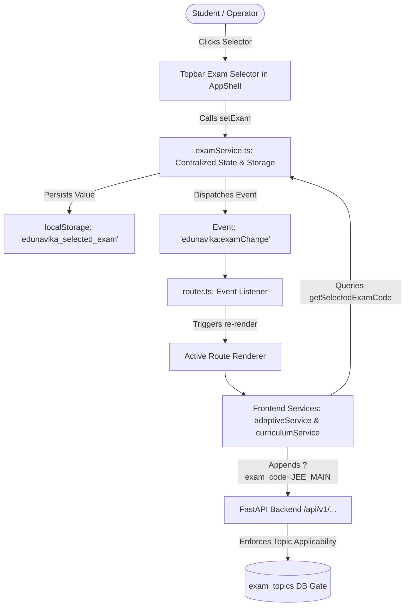

# EduNavika — Milestone 4 Phase E.6: Frontend Exam Selection & End-to-End Integration Design

**Document Version:** 1.0.0
**Date:** October 19, 2026
**Status:** Approved Architecture Specification
**Target Scope:** Frontend Exam State, Topbar Selector, Reactive Routing, API Client Scope Propagation, and Multi-Exam Visual Integrity
**Applicable Exams:** `JEE_MAIN`, `JEE_ADVANCED`, `NEET_UG`, and `GENERAL` (Standard 10–12 School Study)

---

## 1. Objective & Architecture Overview

The purpose of Phase E.6 is to bridge the verified Milestone 4 Phase E.4 backend exam-topic applicability architecture with the user-facing frontend. This allows students to explicitly select their target competitive examination or remain in general school-study mode, ensuring that:
1. All curriculum browsing, adaptive practice recommendations, question retrieval, revision plans, and progress analytics consistently reflect the active exam scope.
2. The selected exam persists reliably across in-app navigation and browser refreshes.
3. Switching exams immediately purges stale data and refreshes all active screens.
4. Legacy Standard 10 and general textbook-only content remain 100% accessible in general study mode.
5. Invalid exam codes are strictly rejected with explicit validation rather than silently falling back.



---

## 2. State Management & Persistence (`examService.ts`)

### 2.1 Supported Examination Identifiers
In alignment with the backend schema and canonical manifest:
- **`JEE_MAIN`**: National Testing Agency (NTA) Joint Entrance Examination Main. (Physics, Chemistry, Mathematics; 436 verified topics).
- **`JEE_ADVANCED`**: IIT Joint Admission Board (JAB) Joint Entrance Examination Advanced. (Physics, Chemistry, Mathematics; 444 verified topics including 8 classical analytical topics).
- **`NEET_UG`**: National Medical Commission (NMC) National Eligibility cum Entrance Test. (Physics, Chemistry, Biology; 497 verified topics).
- **`GENERAL`**: General School Curriculum mode. Exposes the complete GSEB/NCERT Standard 10–12 textbook scope (including textbook-only topics and unreviewed school content) without competitive exam filtering.

### 2.2 Storage & Validation Rules
- **Storage Key:** `edunavika_selected_exam` in `localStorage`.
- **Default State:** If no entry exists in `localStorage`, the system defaults to `'GENERAL'`.
- **Strict Validation:** `isValidExamSelection(value: string)` validates against the whitelist `['GENERAL', 'JEE_MAIN', 'JEE_ADVANCED', 'NEET_UG']`. Any unrecognized value triggers an explicit `Error` and is rejected, preventing silent data corruption or accidental default behavior.
- **Student Profile Clarification:** The selected examination is maintained client-side in persistent session storage. In accordance with safety rules, the system makes no false claim that the selection is permanently bound to the backend database `StudentProfile` until a future migration adds a dedicated column.

---

## 3. Topbar Exam Selector & Visual Design System

### 3.1 Topbar Placement
The exam selector is placed in the topbar (`.tb-right`) of `frontend/src/layouts/AppShell.ts`, directly adjacent to the existing multilingual language selector pill. This ensures the active examination is immediately visible and switchable from every screen in the portal.

### 3.2 Visual Styling & Badges
The exam selector adopts EduNavika's design system tokens (CSS variables: `--bg-2`, `--border-2`, `--text`, `--primary`, `--green-700`):
```html
<div class="tb-exam-wrap" style="display:inline-flex;align-items:center;margin-right:6px">
  <select id="topbarExamSelect" class="input select" style="padding:4px 8px;font-size:11.5px;font-weight:700;border-radius:12px;background:var(--bg-2);border:1px solid var(--border-2);cursor:pointer;color:var(--text)">
    <option value="GENERAL">📚 General School Study</option>
    <option value="JEE_MAIN">🎯 JEE Main</option>
    <option value="JEE_ADVANCED">🚀 JEE Advanced</option>
    <option value="NEET_UG">🩺 NEET UG</option>
  </select>
</div>
```

### 3.3 Active Exam Status Banner
On key learning screens (Dashboard, Curriculum Browse, Adaptive Practice, Revision Plan, Progress Analytics), an active exam status badge displays:
- For `JEE_MAIN`: `[🎯 JEE Main Mode • 436 Topics • Math, Phys, Chem]`
- For `JEE_ADVANCED`: `[🚀 JEE Advanced Mode • 444 Topics • Classical Extensions Active]`
- For `NEET_UG`: `[🩺 NEET UG Mode • 497 Topics • Bio, Phys, Chem]`
- For `GENERAL`: `[📚 General Curriculum • Standard 10–12 Full Syllabus]`

---

## 4. API Client Scope Propagation Trace

### 4.1 Propagation Rules
When an API method is called:
1. If the caller provides an explicit `examCode` argument, that argument is used.
2. Otherwise, the method calls `getSelectedExamCode()` from `examService.ts`.
3. If `getSelectedExamCode()` returns `null` (i.e. `'GENERAL'` mode), **no `exam_code` parameter is sent**, preserving unfiltered school study behavior.
4. If `getSelectedExamCode()` returns a competitive exam code (`'JEE_MAIN'`, `'JEE_ADVANCED'`, `'NEET_UG'`), `exam_code=<CODE>` is appended to the query string.

### 4.2 Endpoint Mapping Matrix
| Frontend Service Method | Backend Endpoint | Query String in General Mode | Query String in Competitive Exam Mode |
| :--- | :--- | :--- | :--- |
| `curriculumService.getTopics(chId)` | `GET /api/v1/chapters/{id}/topics` | `/api/v1/chapters/{id}/topics` | `/api/v1/chapters/{id}/topics?exam_code=JEE_MAIN` |
| `curriculumService.getHierarchy(grade)` | `GET /api/v1/curriculum/hierarchy` | `/api/v1/curriculum/hierarchy?grade={g}` | `/api/v1/curriculum/hierarchy?grade={g}&exam_code=JEE_MAIN` |
| `adaptiveService.getNextPracticeRecommendation(...)` | `GET /api/v1/adaptive/next-practice/{id}` | `...?language={l}` | `...?language={l}&exam_code=JEE_MAIN` |
| `adaptiveService.getPracticeQuestions(...)` | `GET /api/v1/adaptive/practice/{id}` | `...?topic_id={t}&count={c}&language={l}` | `...?topic_id={t}&count={c}&language={l}&exam_code=JEE_MAIN` |
| `adaptiveService.getRecommendations(...)` | `GET /api/v1/adaptive/recommendations/{id}` | `...?limit={n}&language={l}` | `...?limit={n}&language={l}&exam_code=JEE_MAIN` |
| `adaptiveService.getRevisionPlan(...)` | `GET /api/v1/adaptive/revision-plan/{id}` | `...?language={l}` | `...?language={l}&exam_code=JEE_MAIN` |
| `adaptiveService.getRevisionPlans(...)` | `GET /api/v1/revision/plans` | `...?student_id={id}` | `...?student_id={id}&exam_code=JEE_MAIN` |
| `adaptiveService.getProgress(...)` | `GET /api/v1/adaptive/progress/{id}` | `...?language={l}` | `...?language={l}&exam_code=JEE_MAIN` |

---

## 5. Reactive Re-Rendering & Stale Data Prevention

1. **Change Handler:**
   ```typescript
   export function setExam(exam: ExamSelection): void {
     if (!isValidExamSelection(exam)) {
       throw new Error(`Invalid exam selection: '${exam}'. Must be one of ${SUPPORTED_EXAMS.join(', ')}.`);
     }
     localStorage.setItem('edunavika_selected_exam', exam);
     UI.examSelection = exam;
     window.dispatchEvent(new CustomEvent('edunavika:examChange', { detail: { exam } }));
   }
   ```
2. **Router Event Listener:**
   In `frontend/src/routes/router.ts`:
   ```typescript
   window.addEventListener('edunavika:examChange', () => {
     renderCurrentRoute();
   });
   ```
   When the event fires, `renderCurrentRoute()` re-executes the active route function. All sub-view fetch routines execute afresh with the new `exam_code`, purging previously rendered DOM cards, topic lists, and analytics widgets.

---

## 6. Safety & Isolation Verification
- **Persistent Database:** All frontend tests use mock handlers or isolated backend servers. Under no circumstances will any frontend test connect to `D:\EduNavika\edunavika.db`.
- **Pre-Test Checksum:** `84432E58EB4B67F12DA53A914E806B448212948A307A799F7DE35B4CF04A2174`.
- **Post-Test Checksum:** Re-verified after test runs to ensure 0 bytes modified.
