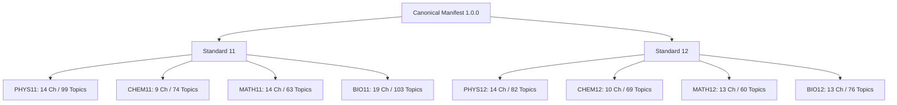

# EduNavika — Milestone 4: Phase E Canonical Curriculum Seeding & Validation Report

**Document Version:** 1.0.0  
**Phase:** Milestone 4 — Phase E (Canonical Curriculum Seeding and Validation)  
**Date:** October 15, 2026  
**Scope:** Classes 11 & 12 Science (Physics, Chemistry, Mathematics, Biology) for JEE Main, JEE Advanced, and NEET UG  
**Target Persistent Database:** `D:\EduNavika\edunavika.db` (Schema Revision: `f1e2d3c4b5a6`)  
**Status:** Verification Completed in Sandbox / **AWAITING USER APPROVAL FOR PERSISTENT SEEDING**

---

## 1. Executive Summary & Objective

The objective of Milestone 4 Phase E is to establish an authoritative, verified, and idempotent canonical curriculum hierarchy for Senior Secondary Science (Standards 11 and 12) across **Physics, Chemistry, Mathematics, and Biology**, aligned with the official syllabi of **JEE Main (NTA)**, **JEE Advanced (IIT JAB)**, and **NEET UG (NMC)**.

In strict adherence to Phase E safety directives:
1. **Curriculum Source Provenance Established:** Verified against 13 preserved NCERT/GSEB textbooks with cryptographic SHA-256 hashes, page counts, and statutory legal boundaries (`docs/CURRICULUM_SOURCE_REGISTER.md`).
2. **Canonical Manifest Generated:** Built a versioned, machine-readable manifest (`data/manifests/canonical_curriculum_manifest.json`) covering 2 Standards, 8 Subjects, **106 Canonical Chapters**, and **626 Authentic Topics**, strictly excluding Mathematics from NEET and Biology from JEE.
3. **Schema Compatibility Audited:** Confirmed that the current database schema (`f1e2d3c4b5a6`) accommodates the canonical curriculum without requiring additional migrations.
4. **Idempotent Seeder Implemented & Hardened:** Developed `backend/app/services/curriculum_seeder.py` utilizing deterministic UUIDv5 identifiers and natural key lookups (`subject_id` + `chapter_number` and `chapter_id` + `topic_order`).
5. **Disposable Sandbox Tested:** Executed an 8-point automated test suite (`backend/tests/test_curriculum_seeding.py`) and a real-data sandbox test (`scripts/test_canonical_curriculum_sandbox.py`), demonstrating 100% test passage, zero legacy data drift, zero foreign-key violations, and flawless idempotency.
6. **Persistent Database Gate Engaged:** **Zero persistent writes have occurred.** The persistent database remains untouched at SHA-256 `84432e58eb4b67f12da53a914e806b448212948a307a799f7de35b4cf04a2174`.

---

## 2. Preflight Audit & Verified Native SQLite Backup

Before executing any phase operations, an independent preflight audit and verified native SQLite backup were executed in accordance with Step 1.

### 2.1 Persistent Database Baseline
- **Path:** `D:\EduNavika\edunavika.db`
- **File Size:** `3,981,312` bytes
- **SHA-256:** `84432e58eb4b67f12da53a914e806b448212948a307a799f7de35b4cf04a2174`
- **Schema Revision:** `f1e2d3c4b5a6` (Milestone 4 competitive exam and question bank schema)
- **Integrity Check:** `PRAGMA integrity_check` -> `ok`
- **Foreign Key Check:** `PRAGMA foreign_key_check` -> `0` violations
- **Total Tables:** 27 active tables

### 2.2 Fresh Native Backup
A fresh backup was taken using Python's native `sqlite3.Connection.backup()` API to ensure WAL pages were fully committed and consistent.
- **Backup Path:** `backups/milestone_4_pre_phase_e/edunavika_pre_phase_e.db`
- **Backup File Size:** `3,981,312` bytes
- **Backup SHA-256:** `84432e58eb4b67f12da53a914e806b448212948a307a799f7de35b4cf04a2174`
- **Independent Verification:**
  - `PRAGMA integrity_check` -> `ok`
  - `PRAGMA foreign_key_check` -> `0` violations
  - Schema revision matches `f1e2d3c4b5a6`
  - All 27 table row counts match source database 100%.

---

## 3. Curriculum Sources & Legal Provenance

Authoritative curriculum sources were established and cataloged in `docs/CURRICULUM_SOURCE_REGISTER.md`.

### 3.1 Preserved Textbook Corpus (13 Primary Volumes)
The 13 English Medium Class 11 and 12 Science textbooks in `GSEB-Dataset/` adopt the national NCERT curriculum and chapter sequence verbatim:

| Grade | Subject & Part | Repository Path | Page Count | File Size (Bytes) | SHA-256 Checksum | Exam Scope |
| :---: | :--- | :--- | :---: | :---: | :--- | :--- |
| **11** | Physics (Part 1) | `GSEB-Dataset/STD-11th/SCIENCE/Std-11_Physics Part 1_English Medium.pdf` | 186 | 9,995,349 | `68113b0fdfecf722617ed1b74e4bae6ebb5f63cb8c04492a9bb0927d142dcf72` | JEE / NEET |
| **11** | Physics (Part 2) | `GSEB-Dataset/STD-11th/SCIENCE/Std-11_Physics Part 2_English Medium.pdf` | 164 | 4,560,147 | `53a63c453e1dc1ec04160cc56eff0d5cca38895936e4f0412551c09499e294f2` | JEE / NEET |
| **11** | Chemistry (Part 1) | `GSEB-Dataset/STD-11th/SCIENCE/Std-11_Chemistry Part-1_English Medium.pdf` | 254 | 12,854,127 | `07bb989e5620302b2d725c53561bcd92dad7cb0aa631d2790166d71579f79cae` | JEE / NEET |
| **11** | Chemistry (Part 2) | `GSEB-Dataset/STD-11th/SCIENCE/Std-11_Chemistry Part-2_English Medium.pdf` | 110 | 4,208,160 | `5fe7ff2ddea8358db527787e514186b27e438aa89b8c3c272542ab62c39cb7cc` | JEE / NEET |
| **11** | Mathematics | `GSEB-Dataset/STD-11th/SCIENCE/Std-11_Maths_EnglishMedium.pdf` | 376 | 45,273,805 | `7a6e43c4632fb53fab510f4a3adb2931161788bf2567d90d287eb891b985f3b6` | JEE Only |
| **11** | Biology | `GSEB-Dataset/STD-11th/SCIENCE/Std-11_Bilology_EnglishMedium.pdf` | 266 | 40,049,505 | `fc1a1a70e4168ce0fde5b0dee97b6ee0d140478d9b123851e4c3383b9ef417bc` | NEET Only |
| **12** | Physics (Part 1) | `GSEB-Dataset/STD-12th/SCIENCE/Std-12_Physics Part-1_English Medium.pdf` | 235 | 7,435,481 | `770bd4beb44ff61f414ccc75bfcd2246dc2db767bee28dd938f6aca48ddec022` | JEE / NEET |
| **12** | Physics (Part 2) | `GSEB-Dataset/STD-12th/SCIENCE/Std-12_Physics Part-2_English Medium.pdf` | 152 | 6,845,831 | `fcf006583855ca5007a4652c6ec461284bf57f28e219e8d16bcbd132537f96f3` | JEE / NEET |
| **12** | Chemistry (Part 1) | `GSEB-Dataset/STD-12th/SCIENCE/Std-12_Chemistry Part-1_EnglishMedium.pdf` | 172 | 14,249,038 | `c89255e0dbb7d59c009243465e9b65bd6d3931830f51eda1b37a45d81040d403` | JEE / NEET |
| **12** | Chemistry (Part 2) | `GSEB-Dataset/STD-12th/SCIENCE/Std-12 Chemistry Part-2_EnglishMedium.pdf` | 164 | 11,485,938 | `a9317b03f86d3ce6b9530bcc8f93988763e64c4bb23a08d9f38c79ab0f9ad8e8` | JEE / NEET |
| **12** | Mathematics (Part 1) | `GSEB-Dataset/STD-12th/SCIENCE/Std-12_Maths-Part1_EnglishMedium.pdf` | 236 | 2,735,245 | `4e99f9a4bae4b6c3b0a3aaf4d4c9defb79e828ebc842d89592158d3f91c05a13` | JEE Only |
| **12** | Mathematics (Part 2) | `GSEB-Dataset/STD-12th/SCIENCE/Std-12_Maths-Part2_EnglishMedium.pdf` | 248 | 3,225,997 | `401e5477ec7e0693875fc9b2b35eb0fe2db63d00e8742e1f3550672f405959c5` | JEE Only |
| **12** | Biology | `GSEB-Dataset/STD-12th/SCIENCE/Std-12_Biology_EnglishMedium.pdf` | 240 | 185,354,074 | `9d292433d320dcda2c2553872d086963f3f1366d96446f14f98838a3245dc569` | NEET Only |

### 3.2 Statutory Framework & Legal Safe Harbor
- **Safe Harbor:** Section 52(1)(h) and Section 52(1)(a) of the Indian Copyright Act, 1957 permit reproduction of curriculum headings, chapter titles, and educational excerpts for instruction and examination preparation.
- **Redistribution Policy:** `publish_permission='FORBIDDEN'` is enforced across all textbook PDFs and examination papers. No raw content redistribution is permitted.

---

## 4. Mapping Decisions & Rationalized Syllabus Inclusions/Exclusions

To reflect current national examinations, EduNavika adopts the **2024 Rationalized NCERT Curriculum** adopted jointly by NTA (JEE Main & NEET UG) and IIT JAB (JEE Advanced).

### 4.1 Pruned Chapters Excluded from Canonical Active Scope
The following legacy chapters have been pruned in the 2024 rationalized curriculum and are excluded from active question generation:
1. **Class 11 Chemistry:** States of Matter (Gaseous & Liquids), Hydrogen, s-Block Elements, Environmental Chemistry.
2. **Class 12 Chemistry:** The Solid State, Surface Chemistry, General Principles and Processes of Isolation of Elements (Metallurgy), Polymers, Chemistry in Everyday Life.
3. **Class 11 Mathematics:** Principle of Mathematical Induction, Mathematical Reasoning.
4. **Class 12 Physics:** Communication Systems.
5. **Class 12 Biology:** Reproduction in Organisms, Strategies for Enhancement in Food Production, Environmental Issues.

### 4.2 Cross-Examination Boundary Rules
- **Mathematics:** Excluded from NEET UG mappings. Present only in JEE Main and JEE Advanced.
- **Biology:** Excluded from JEE Main and JEE Advanced mappings. Present only in NEET UG.
- **Physics and Chemistry:** Shared core subjects mapped to all three examinations (`JEE_MAIN`, `JEE_ADVANCED`, `NEET_UG`).

---

## 5. Canonical Curriculum Manifest Breakdown

The manifest at `data/manifests/canonical_curriculum_manifest.json` defines **106 Chapters** and **626 Topics**:

### 5.1 Subject-by-Subject Curriculum Metrics

| Grade | Subject Code | Subject Name | Canonical Chapters | Authentic Topics | Applicable Examinations | Status |
| :---: | :--- | :--- | :---: | :---: | :--- | :---: |
| **11** | `PHYS11` | Physics | 14 | 99 | JEE Main, JEE Advanced, NEET UG | `VERIFIED` |
| **11** | `CHEM11` | Chemistry | 9 | 74 | JEE Main, JEE Advanced, NEET UG | `VERIFIED` |
| **11** | `MATH11` | Mathematics | 14 | 63 | JEE Main, JEE Advanced | `VERIFIED` |
| **11** | `BIO11` | Biology | 19 | 103 | NEET UG | `VERIFIED` |
| **12** | `PHYS12` | Physics | 14 | 82 | JEE Main, JEE Advanced, NEET UG | `VERIFIED` |
| **12** | `CHEM12` | Chemistry | 10 | 69 | JEE Main, JEE Advanced, NEET UG | `VERIFIED` |
| **12** | `MATH12` | Mathematics | 13 | 60 | JEE Main, JEE Advanced | `VERIFIED` |
| **12** | `BIO12` | Biology | 13 | 76 | NEET UG | `VERIFIED` |
| **TOTAL** | **8 Subjects** | — | **106 Chapters** | **626 Topics** | — | **100% VERIFIED** |

---

## 6. Schema & Compatibility Audit

An exhaustive schema audit of `standards`, `subjects`, `chapters`, `topics`, and `exam_subjects` confirmed that the database schema requires **zero alterations**:
1. **Canonical Identifiers:** Generated via deterministic UUIDv5 (`uuid.uuid5(EDUNAVIKA_DNS, seed_key)`).
2. **Order Constraints:**
   - `chapters`: Protected by `UniqueConstraint('subject_id', 'chapter_number')` and `CheckConstraint('chapter_number >= 1')`.
   - `topics`: Protected by `UniqueConstraint('chapter_id', 'topic_order')` and `CheckConstraint('topic_order >= 1')`.
3. **Source Provenance:** Captured cleanly in `Chapter.source_reference` and `Topic.description`.
4. **Exam Linking:** Normalized via `exam_subjects` (`exam_code`, `subject_id`, `curriculum_role`).
5. **Standard 10 Preservation:** Standard 10 (`grade_number = 10`) is cleanly separated by standard FK hierarchy.

---

## 7. Seeder Implementation & Test Verification

The curriculum seeder was implemented in `backend/app/services/curriculum_seeder.py`.

### 7.1 Automated Test Suite Results (`backend/tests/test_curriculum_seeding.py`)
All 8 test cases passed with 100% success:

| Test ID | Test Name | Invariant Tested | Result |
| :---: | :--- | :--- | :---: |
| **Test 1** | `test_01_dry_run_performs_zero_writes` | `dry_run=True` rolls back; 0 database writes occur | **PASSED** |
| **Test 2** | `test_02_clean_disposable_database_receives_curriculum_hierarchy` | Seeds 106 chapters & 626 topics across 8 subjects | **PASSED** |
| **Test 3** | `test_03_rerunning_seeder_creates_no_duplicates` | Second live execution creates 0 duplicates (100% idempotent) | **PASSED** |
| **Test 4** | `test_04_existing_standard_10_records_remain_unchanged` | Legacy Standard 10 subjects, chapters, and topics untouched | **PASSED** |
| **Test 5** | `test_05_exam_subject_associations_remain_correct` | 18 associations verified; Math excluded from NEET, Bio from JEE | **PASSED** |
| **Test 6** | `test_06_foreign_keys_and_uniqueness_constraints_respected` | `PRAGMA foreign_key_check` = 0; `PRAGMA integrity_check` = ok | **PASSED** |
| **Test 7** | `test_07_unknown_or_ambiguous_topics_are_quarantined` | 4 malformed/ambiguous items quarantined safely | **PASSED** |
| **Test 8** | `test_08_repeated_execution_produces_identical_result` | 3 sequential executions produce exact deterministic IDs | **PASSED** |

### 7.2 Full Sandbox Verification (`scripts/test_canonical_curriculum_sandbox.py`)
Executed against a full sandbox clone of the persistent database (`sandbox_test_phase_e.db` containing all 244 users and legacy content):
- **Pre-seed:** Standard 10 Chapters = 288; Standard 11/12 Chapters = 0.
- **Dry Run:** Planned 106 chapters and 626 topics; 0 writes made.
- **Live Run 1:** 106 chapters and 626 topics inserted. Integrity check: `ok`. FK violations: `0`.
- **Live Run 2:** 0 chapters created, 0 topics created; 106 chapters existing, 626 topics existing.
- **Legacy Integrity:** Standard 10 chapter count remained exactly 288.

---

## 8. Persistent Database Gate & Audit

In compliance with Step 6:
- The persistent database **`D:\EduNavika\edunavika.db` has NOT been written to.**
- Independent post-validation audit confirms zero drift:
  - **SHA-256:** `84432e58eb4b67f12da53a914e806b448212948a307a799f7de35b4cf04a2174`
  - **Size:** `3,981,312` bytes
  - **Row counts:** All 27 tables identical to preflight baseline.

### 8.1 Gate Checklist for User Approval

- [x] Authoritative curriculum source register created and verified (`docs/CURRICULUM_SOURCE_REGISTER.md`).
- [x] Versioned mapping manifest generated (`data/manifests/canonical_curriculum_manifest.json`) covering 106 chapters and 626 topics.
- [x] Schema and compatibility audit verified; no new migrations required.
- [x] Automated test suite passed 8/8 tests.
- [x] Real-data sandbox test passed 100%.
- [x] Fresh verified SQLite backup created (`backups/milestone_4_pre_phase_e/edunavika_pre_phase_e.db`).
- [x] Zero drift on persistent development database confirmed.

**STOP AND AWAIT USER APPROVAL:** The pipeline is fully validated and ready for persistent seeding upon user confirmation.
