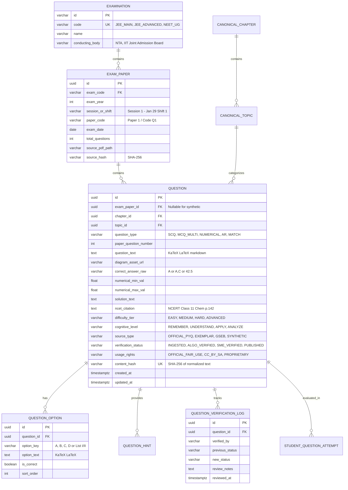
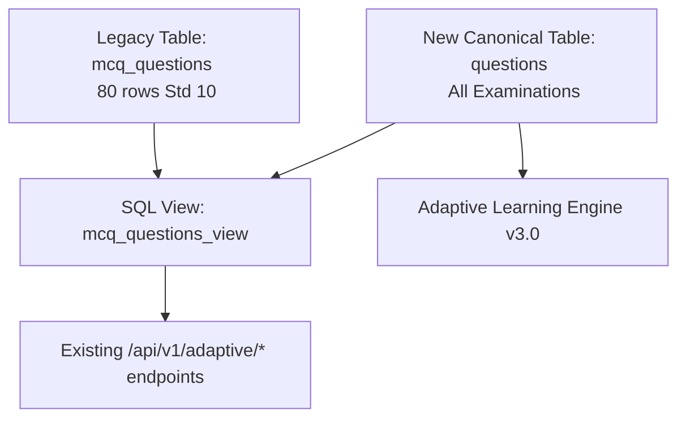

# EduNavika — Question-Bank Architecture & Schema Specification

**Version:** 3.0.0  
**Target Examinations:** JEE Main, JEE Advanced, NEET UG  
**Audience:** Data Engineers, Backend Architects, ML/NLP Engineers, Subject Matter Experts (SMEs)  
**Status:** Canonical Design Specification (Milestone 3)

---

## 1. Architectural Overview & Design Principles

The EduNavika Question-Bank is the cognitive core of the platform's adaptive learning engine. A generic MCQ schema designed for simple secondary school multiple-choice tests is incapable of supporting the structural and pedagogical demands of national competitive examinations such as **JEE Main**, **JEE Advanced**, and **NEET UG**.

### 1.1 Structural Divergences in Competitive Exam Questions

| Attribute | JEE Main | JEE Advanced | NEET UG |
| :--- | :--- | :--- | :--- |
| **Primary Question Formats** | Single-Choice (SCQ), Numerical Value (NVQ) | Single-Choice, Multi-Correct (MCQ), Numerical, List/Matrix Match, Paragraph Comprehension | Single-Choice (SCQ), Assertion-Reason (AR), Match the Column, Statement I & II |
| **Marking Scheme** | +4, -1 for SCQ & NVQ | Variable (+4/-2, +3/-1, partial marking for multi-correct e.g. +1 per correct option with no wrong option) | +4, -1 for all 180 questions |
| **Numerical Tolerance** | Non-negative integer or rounded to 2 decimal places | Exact integer or interval range (e.g. $[2.45, 2.55]$) | N/A (Exclusively single-choice objective) |
| **Cognitive Depth** | Formula speed, single/dual concept application, calculation accuracy | Multi-concept synthesis across chapters, deep conceptual rigor, edge-case analysis | NCERT line-by-line verbatim recall, rapid biological diagram interpretation, speed |
| **Formula & Math Representation** | High density of LaTeX (calculus, coordinate geometry, matrices, thermodynamics) | Extremely high density of complex mathematical proofs, tensors, vector calculus | Chemical equations, genetics notation, biochemical cycles, moderate physics formulas |

### 1.2 Design Principles
1. **Mathematical Rigor & KaTeX Compliance:** All mathematical expressions, chemical equations, and physical units must be represented in normalized LaTeX delimiters (`$...$` for inline, `$$...$$` for display block).
2. **Immutable Provenance:** Every question must trace back to its exact origin (e.g., *NTA JEE Main 2024 Session 1, 29th January Shift 1, Question 14, Physics*), including source PDF hash, page number, and extraction timestamp.
3. **Multi-Model Scoring Rules:** The schema must support varied evaluation modes (exact match, subset matching with partial credit, numerical tolerance bounds).
4. **Strict Audit & Verification Lifecycle:** Questions flow through rigorous states (`INGESTED` $\rightarrow$ `ALGORITHMICALLY_VERIFIED` $\rightarrow$ `SME_VERIFIED` $\rightarrow$ `PUBLISHED`). Unverified questions are never surfaced in graded student tests.
5. **Zero Data Loss for Existing Corpus:** The schema must maintain backward compatibility with the existing 80 Standard 10 MCQs while establishing clean separation for competitive exam tiers.

---

## 2. Canonical Relational Database Schema

### 2.1 Entity Relationship Diagram



### 2.2 SQL DDL Specification (PostgreSQL / SQLite Compatible)

```sql
-- Enums represented as constrained VARCHARs for cross-engine compatibility

-- 1. Examination Master Table
CREATE TABLE IF NOT EXISTS examinations (
    id VARCHAR(36) PRIMARY KEY,
    code VARCHAR(32) NOT NULL UNIQUE,       -- 'JEE_MAIN', 'JEE_ADVANCED', 'NEET_UG'
    name VARCHAR(128) NOT NULL,
    conducting_body VARCHAR(128) NOT NULL,  -- 'NTA', 'IIT_JAB'
    total_marks INT NOT NULL,
    duration_minutes INT NOT NULL,
    is_active BOOLEAN NOT NULL DEFAULT 1
);

-- 2. Official Exam Papers / Shifts Master Table
CREATE TABLE IF NOT EXISTS exam_papers (
    id VARCHAR(36) PRIMARY KEY,
    exam_code VARCHAR(32) NOT NULL,
    exam_year INT NOT NULL,
    session_or_shift VARCHAR(64) NOT NULL,  -- '2024_JAN_29_SHIFT_1', '2023_PAPER_1'
    paper_code VARCHAR(32) DEFAULT NULL,    -- 'SET_A', 'CODE_E1'
    exam_date DATE,
    total_questions INT NOT NULL,
    source_pdf_path VARCHAR(512),
    source_pdf_hash VARCHAR(64),            -- SHA-256 of original official PDF
    created_at TIMESTAMP WITH TIME ZONE DEFAULT CURRENT_TIMESTAMP,
    FOREIGN KEY (exam_code) REFERENCES examinations(code) ON DELETE RESTRICT,
    UNIQUE (exam_code, exam_year, session_or_shift, paper_code)
);

-- 3. Core Question Table
CREATE TABLE IF NOT EXISTS questions (
    id VARCHAR(36) PRIMARY KEY,
    exam_paper_id VARCHAR(36) DEFAULT NULL,  -- NULL for synthetic practice questions
    paper_question_number INT DEFAULT NULL,  -- 1 to 90 for JEE Main, 1 to 200 for NEET
    
    -- Canonical Curriculum Links
    standard_id VARCHAR(36) NOT NULL,
    subject_id VARCHAR(36) NOT NULL,
    chapter_id VARCHAR(36) NOT NULL,
    topic_id VARCHAR(36) NOT NULL,
    
    -- Question Classification
    question_type VARCHAR(32) NOT NULL CHECK (
        question_type IN (
            'SCQ',              -- Single Choice Question
            'MCQ_MULTI',        -- Multiple Choice (One or more correct, JEE Advanced)
            'NUMERICAL',        -- Non-negative integer or decimal (JEE Main & Adv)
            'ASSERTION_REASON', -- Assertion & Reason format (NEET UG / JEE)
            'MATCH_COLUMN',     -- Column/Matrix Match (JEE Adv / NEET)
            'COMPREHENSION'     -- Paragraph-based linked question
        )
    ),
    
    -- Question Content
    question_text TEXT NOT NULL,
    diagram_asset_url VARCHAR(512) DEFAULT NULL,
    
    -- Scoring & Answers
    correct_answer_raw VARCHAR(256) NOT NULL, -- 'B', 'A,C', '45', '2.50'
    numerical_min_val DOUBLE PRECISION DEFAULT NULL, -- Lower bound for tolerance
    numerical_max_val DOUBLE PRECISION DEFAULT NULL, -- Upper bound for tolerance
    solution_text TEXT NOT NULL,
    ncert_citation VARCHAR(256) DEFAULT NULL,  -- e.g., 'NCERT Class 11 Physics Part 1, p. 112'
    
    -- Pedagogical Metadata
    difficulty_tier VARCHAR(16) NOT NULL CHECK (
        difficulty_tier IN ('EASY', 'MEDIUM', 'HARD', 'ADVANCED_OLYMPIAD')
    ),
    cognitive_level VARCHAR(24) NOT NULL CHECK (
        cognitive_level IN ('REMEMBERING', 'UNDERSTANDING', 'APPLYING', 'ANALYZING', 'EVALUATING')
    ),
    estimated_seconds INT DEFAULT 120,
    
    -- Provenance & Integrity
    source_type VARCHAR(32) NOT NULL CHECK (
        source_type IN (
            'OFFICIAL_PYQ',       -- NTA / IIT Official Past Paper
            'NCERT_EXEMPLAR',     -- NCERT Official Exemplar Problems
            'GSEB_QUESTION_BANK', -- Official Gujarat State Board Question Bank
            'CURATED_PRACTICE',   -- Verified textbook end-of-chapter problems
            'SYNTHETIC_LLM'       -- AI generated/augmented (requires human SME verification)
        )
    ),
    verification_status VARCHAR(32) NOT NULL DEFAULT 'INGESTED' CHECK (
        verification_status IN (
            'INGESTED',               -- Raw extraction from PDF/OCR
            'ALGORITHMICALLY_VERIFIED',-- Passed automated KaTeX, option count, and regex checks
            'SME_VERIFIED',           -- Reviewed & approved by subject matter expert
            'PUBLISHED',              -- Active in student adaptive pool
            'CHALLENGED',             -- Flagged by students or revised by NTA answer key
            'DEPRECATED'              -- Obsolete syllabus or invalid question
        )
    ),
    usage_rights VARCHAR(32) NOT NULL DEFAULT 'OFFICIAL_FAIR_USE' CHECK (
        usage_rights IN ('OFFICIAL_FAIR_USE', 'CC_BY_SA_4.0', 'PROPRIETARY', 'PUBLIC_DOMAIN')
    ),
    
    -- Uniqueness & Deduplication
    content_hash VARCHAR(64) NOT NULL UNIQUE, -- SHA-256(normalized_question_text + normalized_answers)
    
    created_at TIMESTAMP WITH TIME ZONE DEFAULT CURRENT_TIMESTAMP,
    updated_at TIMESTAMP WITH TIME ZONE DEFAULT CURRENT_TIMESTAMP,
    
    FOREIGN KEY (exam_paper_id) REFERENCES exam_papers(id) ON DELETE SET NULL,
    FOREIGN KEY (chapter_id) REFERENCES chapters(id) ON DELETE RESTRICT,
    FOREIGN KEY (topic_id) REFERENCES topics(id) ON DELETE RESTRICT
);

-- Index for high-performance adaptive test assembly
CREATE INDEX idx_questions_topic_diff ON questions (topic_id, difficulty_tier, verification_status);
CREATE INDEX idx_questions_exam_year ON questions (exam_paper_id, paper_question_number);
CREATE INDEX idx_questions_hash ON questions (content_hash);

-- 4. Question Options (for SCQ, MCQ_MULTI, AR, MATCH)
CREATE TABLE IF NOT EXISTS question_options (
    id VARCHAR(36) PRIMARY KEY,
    question_id VARCHAR(36) NOT NULL,
    option_key VARCHAR(8) NOT NULL,          -- 'A', 'B', 'C', 'D'
    option_text TEXT NOT NULL,
    is_correct BOOLEAN NOT NULL DEFAULT 0,
    explanation TEXT DEFAULT NULL,
    sort_order INT NOT NULL DEFAULT 0,
    FOREIGN KEY (question_id) REFERENCES questions(id) ON DELETE CASCADE,
    UNIQUE (question_id, option_key)
);

CREATE INDEX idx_options_question ON question_options (question_id);

-- 5. Human SME Verification & Audit Log
CREATE TABLE IF NOT EXISTS question_verification_logs (
    id VARCHAR(36) PRIMARY KEY,
    question_id VARCHAR(36) NOT NULL,
    verified_by VARCHAR(128) NOT NULL,      -- SME User ID or 'NTA_FINAL_KEY_SCRIPT'
    previous_status VARCHAR(32) NOT NULL,
    new_status VARCHAR(32) NOT NULL,
    correction_details TEXT DEFAULT NULL,   -- e.g. "Changed answer from B to Bonus per NTA revised key"
    reviewed_at TIMESTAMP WITH TIME ZONE DEFAULT CURRENT_TIMESTAMP,
    FOREIGN KEY (question_id) REFERENCES questions(id) ON DELETE CASCADE
);
```

---

## 3. Pydantic v2 Canonical Schemas (Backend Models)

```python
"""
EduNavika Canonical Question Bank Schemas (Pydantic v2).
Ensures zero-tolerance validation for mathematical formulas, option counts, and answer integrity.
"""
from enum import Enum
from typing import List, Optional, Union
from pydantic import BaseModel, Field, field_validator, model_validator
import re


class ExaminationEnum(str, Enum):
    JEE_MAIN = "JEE_MAIN"
    JEE_ADVANCED = "JEE_ADVANCED"
    NEET_UG = "NEET_UG"
    GSEB_HSC = "GSEB_HSC"


class QuestionTypeEnum(str, Enum):
    SCQ = "SCQ"
    MCQ_MULTI = "MCQ_MULTI"
    NUMERICAL = "NUMERICAL"
    ASSERTION_REASON = "ASSERTION_REASON"
    MATCH_COLUMN = "MATCH_COLUMN"
    COMPREHENSION = "COMPREHENSION"


class DifficultyTierEnum(str, Enum):
    EASY = "EASY"
    MEDIUM = "MEDIUM"
    HARD = "HARD"
    ADVANCED_OLYMPIAD = "ADVANCED_OLYMPIAD"


class CognitiveLevelEnum(str, Enum):
    REMEMBERING = "REMEMBERING"
    UNDERSTANDING = "UNDERSTANDING"
    APPLYING = "APPLYING"
    ANALYZING = "ANALYZING"
    EVALUATING = "EVALUATING"


class SourceTypeEnum(str, Enum):
    OFFICIAL_PYQ = "OFFICIAL_PYQ"
    NCERT_EXEMPLAR = "NCERT_EXEMPLAR"
    GSEB_QUESTION_BANK = "GSEB_QUESTION_BANK"
    CURATED_PRACTICE = "CURATED_PRACTICE"
    SYNTHETIC_LLM = "SYNTHETIC_LLM"


class VerificationStatusEnum(str, Enum):
    INGESTED = "INGESTED"
    ALGORITHMICALLY_VERIFIED = "ALGORITHMICALLY_VERIFIED"
    SME_VERIFIED = "SME_VERIFIED"
    PUBLISHED = "PUBLISHED"
    CHALLENGED = "CHALLENGED"
    DEPRECATED = "DEPRECATED"


class UsageRightsEnum(str, Enum):
    OFFICIAL_FAIR_USE = "OFFICIAL_FAIR_USE"
    CC_BY_SA_4_0 = "CC_BY_SA_4.0"
    PROPRIETARY = "PROPRIETARY"
    PUBLIC_DOMAIN = "PUBLIC_DOMAIN"


class OptionCreate(BaseModel):
    option_key: str = Field(..., pattern=r"^[A-D]$", description="Option label A, B, C, or D")
    option_text: str = Field(..., min_length=1, description="Option content in Markdown/KaTeX")
    is_correct: bool = Field(default=False)
    explanation: Optional[str] = None
    sort_order: int = Field(default=0)


class QuestionCreate(BaseModel):
    exam_paper_id: Optional[str] = None
    paper_question_number: Optional[int] = Field(None, ge=1, le=200)
    
    chapter_id: str
    topic_id: str
    question_type: QuestionTypeEnum
    
    question_text: str = Field(..., min_length=10, description="Question stem with LaTeX equations")
    diagram_asset_url: Optional[str] = None
    
    options: List[OptionCreate] = Field(default_factory=list)
    correct_answer_raw: str = Field(..., description="Canonical answer representation, e.g. 'A', 'B', 'A,C', '42.5'")
    
    numerical_min_val: Optional[float] = None
    numerical_max_val: Optional[float] = None
    
    solution_text: str = Field(..., min_length=10, description="Step-by-step solution derivation")
    ncert_citation: Optional[str] = None
    
    difficulty_tier: DifficultyTierEnum = DifficultyTierEnum.MEDIUM
    cognitive_level: CognitiveLevelEnum = CognitiveLevelEnum.APPLYING
    estimated_seconds: int = Field(default=120, ge=30, le=600)
    
    source_type: SourceTypeEnum = SourceTypeEnum.OFFICIAL_PYQ
    verification_status: VerificationStatusEnum = VerificationStatusEnum.INGESTED
    usage_rights: UsageRightsEnum = UsageRightsEnum.OFFICIAL_FAIR_USE

    @model_validator(mode="after")
    def validate_question_format_and_answers(self) -> "QuestionCreate":
        q_type = self.question_type
        opts = self.options
        
        # 1. SCQ and Assertion-Reason validation
        if q_type in (QuestionTypeEnum.SCQ, QuestionTypeEnum.ASSERTION_REASON):
            if len(opts) != 4:
                raise ValueError(f"{q_type.value} requires exactly 4 options (A, B, C, D), got {len(opts)}")
            correct_opts = [o for o in opts if o.is_correct]
            if len(correct_opts) != 1:
                raise ValueError(f"{q_type.value} must have exactly 1 correct option, got {len(correct_opts)}")
            if self.correct_answer_raw not in ["A", "B", "C", "D"]:
                raise ValueError(f"correct_answer_raw for {q_type.value} must be one of A, B, C, D")
                
        # 2. Multi-Correct validation
        elif q_type == QuestionTypeEnum.MCQ_MULTI:
            if len(opts) != 4:
                raise ValueError(f"MCQ_MULTI requires exactly 4 options, got {len(opts)}")
            correct_opts = [o for o in opts if o.is_correct]
            if len(correct_opts) < 1:
                raise ValueError("MCQ_MULTI must have at least 1 correct option")
            valid_keys = {"A", "B", "C", "D"}
            submitted_keys = set(self.correct_answer_raw.replace(" ", "").split(","))
            if not submitted_keys.issubset(valid_keys):
                raise ValueError(f"Invalid keys in MCQ_MULTI correct_answer_raw: {submitted_keys}")

        # 3. Numerical question validation
        elif q_type == QuestionTypeEnum.NUMERICAL:
            if len(opts) > 0:
                raise ValueError(f"NUMERICAL questions must not have multiple-choice options, found {len(opts)}")
            try:
                val = float(self.correct_answer_raw)
            except ValueError:
                raise ValueError(f"NUMERICAL correct_answer_raw must be parseable float/int, got: '{self.correct_answer_raw}'")
            if self.numerical_min_val is not None and self.numerical_max_val is not None:
                if self.numerical_min_val > self.numerical_max_val:
                    raise ValueError("numerical_min_val cannot exceed numerical_max_val")

        return self
```

---

## 4. Concrete Sample Records by Examination

### 4.1 JEE Main — Numerical Value Question (Physics)
```json
{
  "id": "7a3e8f12-04b1-4f93-871d-5b23d91c1001",
  "examination": "JEE_MAIN",
  "exam_year": 2024,
  "session_or_shift": "Session 1 - 29 Jan 2024 Shift 1",
  "paper_set": "Paper 1 (B.E./B.Tech)",
  "paper_question_number": 23,
  "chapter": "Work, Energy and Power",
  "topic": "Conservation of Mechanical Energy & Springs",
  "question_type": "NUMERICAL",
  "question_text": "A block of mass $m = 2\\text{ kg}$ is attached to a massless spring of spring constant $k = 200\\text{ N/m}$. The other end of the spring is fixed to a rigid vertical wall. The block rests on a horizontal frictionless surface. If the block is pulled by a distance $x_0 = 10\\text{ cm}$ from its equilibrium position and released from rest, the maximum speed of the block during oscillation is $v_{\\max} = \\text{______ } \\times 10^{-1}\\text{ m/s}$.",
  "diagram_asset_url": null,
  "options": [],
  "correct_answer_raw": "10",
  "numerical_min_val": 10.0,
  "numerical_max_val": 10.0,
  "solution_text": "Using conservation of mechanical energy:\n$$\\frac{1}{2} k x_0^2 = \\frac{1}{2} m v_{\\max}^2$$\n$$v_{\\max} = x_0 \\sqrt{\\frac{k}{m}}$$\nGiven $x_0 = 0.1\\text{ m}$, $k = 200\\text{ N/m}$, and $m = 2\\text{ kg}$:\n$$v_{\\max} = 0.1 \\times \\sqrt{\\frac{200}{2}} = 0.1 \\times 10 = 1.0\\text{ m/s} = 10 \\times 10^{-1}\\text{ m/s}$$\nTherefore, the integer value to be entered is **10**.",
  "ncert_citation": "NCERT Class 11 Physics Part 1, Chapter 6, Section 6.8, Page 124",
  "difficulty_tier": "MEDIUM",
  "cognitive_level": "APPLYING",
  "source_type": "OFFICIAL_PYQ",
  "provenance_metadata": {
    "source_file": "JEE_Main_2024_29Jan_Shift1_Official.pdf",
    "nta_item_id": "874521094",
    "pdf_page_number": 14,
    "sha256": "4a71b128e49320dcfb940e4f3a7f80219c63283f510b6d21e89b21f37b1248ac"
  },
  "verification_status": "SME_VERIFIED",
  "verified_by": "dr_sharma_physics_sme",
  "usage_rights": "OFFICIAL_FAIR_USE"
}
```

### 4.2 JEE Advanced — Multiple-Correct MCQ with Partial Marking (Physics)
```json
{
  "id": "8c4f9a23-15c2-4a04-982e-6c34ea2d2002",
  "examination": "JEE_ADVANCED",
  "exam_year": 2023,
  "session_or_shift": "Paper 1",
  "paper_set": "Code 1",
  "paper_question_number": 7,
  "chapter": "Electromagnetic Induction",
  "topic": "Motional EMF and Faraday's Law in Rotating Conductors",
  "question_type": "MCQ_MULTI",
  "question_text": "A conducting rod of length $L$ rotates with uniform angular velocity $\\omega$ in a uniform magnetic field $\\vec{B}$ perpendicular to the plane of rotation about one of its ends $O$. Let $V_O$ be the potential at $O$ and $V_P$ be the potential at the free end $P$. Which of the following statements is/are correct?\n\n(A) The induced EMF between $O$ and $P$ is $\\frac{1}{2} B \\omega L^2$.\n(B) The induced electric field inside the rod is non-conservative.\n(C) If the magnetic field is directed out of the plane and rotation is counterclockwise, $V_P > V_O$.\n(D) No work is done by the magnetic force on the conduction electrons.",
  "diagram_asset_url": "/assets/diagrams/jee_adv_2023_p1_q7.svg",
  "options": [
    {"option_key": "A", "option_text": "The induced EMF between $O$ and $P$ is $\\frac{1}{2} B \\omega L^2$.", "is_correct": true},
    {"option_key": "B", "option_text": "The induced electric field inside the rod is non-conservative.", "is_correct": false},
    {"option_key": "C", "option_text": "If the magnetic field is directed out of the plane and rotation is counterclockwise, $V_P > V_O$.", "is_correct": false},
    {"option_key": "D", "option_text": "No work is done by the magnetic force on the conduction electrons.", "is_correct": true}
  ],
  "correct_answer_raw": "A,D",
  "numerical_min_val": null,
  "numerical_max_val": null,
  "solution_text": "1. Motional EMF across rotating rod: $\\mathcal{E} = \\int_0^L (\\omega r) B \\, dr = \\frac{1}{2} B \\omega L^2$. Thus, **(A)** is correct.\n2. The electric field is electrostatic in origin (re-arrangement of charges until $qE = qvB$), so it is conservative. Hence **(B)** is incorrect.\n3. By $\\vec{v} \\times \\vec{B}$, magnetic force pushes electrons towards $P$, making $P$ negative and $O$ positive ($V_O > V_P$). Hence **(C)** is incorrect.\n4. Magnetic Lorentz force $\\vec{F} = q(\\vec{v} \\times \\vec{B})$ is always orthogonal to velocity, doing zero work. Hence **(D)** is correct.\n\nCorrect Options: **A, D**.",
  "ncert_citation": "NCERT Class 12 Physics Part 1, Chapter 6, Section 6.6, Page 214",
  "difficulty_tier": "HARD",
  "cognitive_level": "ANALYZING",
  "source_type": "OFFICIAL_PYQ",
  "provenance_metadata": {
    "source_file": "JEE_Adv_2023_Paper1_Official.pdf",
    "pdf_page_number": 8,
    "sha256": "9b12e8432a104c9dcfb183492aef31829cd8a271983e2098418320498a1290bb"
  },
  "verification_status": "SME_VERIFIED",
  "verified_by": "iit_faculty_reviewer_04",
  "usage_rights": "OFFICIAL_FAIR_USE"
}
```

### 4.3 NEET UG — Assertion-Reasoning Question (Biology / Botany)
```json
{
  "id": "9d5a0b34-26d3-4b15-a93f-7d45fb3e3003",
  "examination": "NEET_UG",
  "exam_year": 2024,
  "session_or_shift": "May 5 2024 Pen-Paper Test",
  "paper_set": "Code Q1",
  "paper_question_number": 112,
  "chapter": "Photosynthesis in Higher Plants",
  "topic": "The $C_4$ Pathway and Kranz Anatomy",
  "question_type": "ASSERTION_REASON",
  "question_text": "Given below are two statements: one is labelled as **Assertion (A)** and the other is labelled as **Reason (R)**.\n\n**Assertion (A):** In $C_4$ plants, photorespiration does not occur.\n**Reason (R):** $C_4$ plants have a mechanism that increases the concentration of $\\text{CO}_2$ at the enzyme site (RuBisCO) in bundle sheath cells.\n\nIn the light of the above statements, choose the most appropriate answer from the options given below:",
  "diagram_asset_url": null,
  "options": [
    {"option_key": "A", "option_text": "Both (A) and (R) are true and (R) is the correct explanation of (A).", "is_correct": true},
    {"option_key": "B", "option_text": "Both (A) and (R) are true but (R) is NOT the correct explanation of (A).", "is_correct": false},
    {"option_key": "C", "option_text": "(A) is true but (R) is false.", "is_correct": false},
    {"option_key": "D", "option_text": "(A) is false but (R) is true.", "is_correct": false}
  ],
  "correct_answer_raw": "A",
  "numerical_min_val": null,
  "numerical_max_val": null,
  "solution_text": "NCERT Class 11 Biology clearly states: In $C_4$ plants, $C_4$ acid from mesophyll is broken down in bundle sheath cells to release $\\text{CO}_2$. This results in a high intracellular $\\text{CO}_2$ concentration around RuBisCO, ensuring RuBisCO operates purely as a carboxylase, minimizing oxygenase activity and entirely eliminating photorespiration.\n\nThus, both (A) and (R) are true and (R) correctly explains (A). Correct Option is **A**.",
  "ncert_citation": "NCERT Class 11 Biology, Chapter 13 (Photosynthesis), Page 219, Lines 14-22",
  "difficulty_tier": "EASY",
  "cognitive_level": "UNDERSTANDING",
  "source_type": "OFFICIAL_PYQ",
  "provenance_metadata": {
    "source_file": "NEET_UG_2024_Code_Q1_Official.pdf",
    "pdf_page_number": 28,
    "sha256": "3e91823abf109287349182374981729384719283749182739487192837491823"
  },
  "verification_status": "SME_VERIFIED",
  "verified_by": "dr_patel_botany_sme",
  "usage_rights": "OFFICIAL_FAIR_USE"
}
```

---

## 5. Backward Compatibility & Migration Strategy

The existing database contains an `mcq_questions` table with 80 questions (Standard 10 science and mathematics). To transition without destructive changes:



### Migration Steps:
1. **Preserve Legacy Data:** Do not drop or alter `mcq_questions`.
2. **Execute Non-Destructive Schema Expansion:** Create `examinations`, `exam_papers`, `questions`, `question_options`, and `question_verification_logs`.
3. **Bridge Migration Script:** A migration script will insert a synthetic examination record (`GSEB_CLASS_10`) and populate `questions` with the existing 80 records, ensuring zero data loss and persistent foreign key integrity.
4. **Adapter Layer:** Update `QuestionBankService` to query `questions` while honoring legacy schema queries seamlessly.
