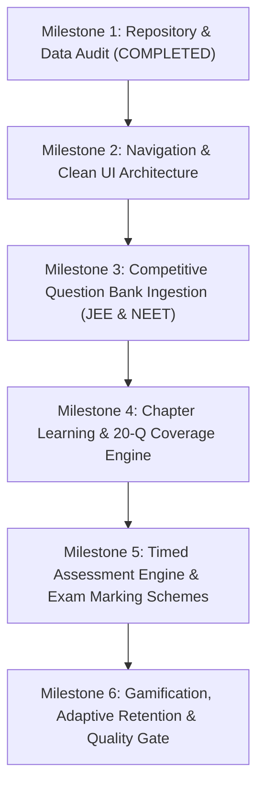

# EduNavika — Competitive Examination Platform Transformation
## Comprehensive Repository, Dataset, Architecture & Feature Audit

**Date:** October 2026  
**Auditor / Roles:** Senior Product Architect, Senior Full-Stack Engineer, Educational Data-Mining Researcher, Assessment System Designer, and QA Architect  
**Repository:** `D:\EduNavika` (`d:\EduSens`)  
**Persistent Database:** `D:\EduNavika\edunavika.db` (SHA-256: `4c1c2a274ddb09e13b6d698b9b05b4bd4c241b43df466e2321fc6a4d2e98059d`)  
**Verified Pre-Phase F Backup:** `D:\EduNavika\backups\edunavika_pre_phase_f_20261019_153342.db` (SHA-256: `5df476e628c08569bd093aafa5ac4a4b3cbc9a7c77b63d0ef558a791128327fd`)

---

## 1. Executive Summary & Platform Purpose

EduNavika is undergoing a strategic product transformation from its initial Class 10 foundation into a high-performance, rigorous competitive examination learning and assessment platform dedicated to:
- **JEE Main** (National Testing Agency) — Engineering entrance
- **JEE Advanced** (IIT Joint Admission Board) — Elite engineering entrance
- **NEET UG** (National Testing Agency / NMC) — Medical entrance
- **Class 11 & Class 12 Science** (Physics, Chemistry, Mathematics, Biology)

This audit establishes the baseline architectural, curricular, database, and dataset reality of the repository without fabricating data, skipping tests, or bypassing provenance requirements.

---

## 2. Full Technology Stack & Architecture Audit

### 2.1 Backend Architecture
- **Framework:** FastAPI on Uvicorn (ASGI), Python 3.11+.
- **Database Engine:** SQLite 3 with WAL mode; strict connection pooling.
- **ORM & Migrations:** SQLAlchemy 2.0 with Alembic versioning (current revision: `f1e2d3c4b5a6` / `20261015_m4_exam_topics_association.py`).
- **Test Isolation Guard:** `backend/tests/conftest.py` installs an engine-level connect listener that inspects `PRAGMA database_list` and raises `RuntimeError` if any test connection targets `edunavika.db`. All tests execute against ephemeral SQLite files (`edunavika_test_*.db`) cleaned at teardown.
- **Authentication & Security:** JWT tokens (OAuth2 password flow), bcrypt password hashing (`passlib`), role-based access control (`STUDENT`, `TEACHER`, `ADMIN`).
- **Core Models:**
  - `BaseModelMixin`: UUID primary keys, UTC timestamps.
  - `User`, `StudentProfile`, `TeacherProfile`: Demographic, preferred language, division, enrollment numbers.
  - `Standard`, `Subject`, `Chapter`, `Topic`, `LearningContent`: Relational curriculum hierarchy.
  - `Examination`, `ExamSubject`, `ExamTopic`, `ExamPaper`, `Question`, `QuestionOption`, `QuestionVerificationLog`: Competitive exam entities.
  - `MCQQuestion`, `Assessment`, `Attempt`, `Answer`: Baseline assessment entities.
  - `LearningEvent`, `TopicPerformance`, `ForgettingSignal`, `RevisionPlan`, `LearningQuest`: Longitudinal telemetry and Leitner retention tracking.

### 2.2 Frontend Architecture
- **Framework:** Vanilla TypeScript (ES2022) with Vite 6.0.7 bundler.
- **UI Paradigm:** Modular component renderers, centralized reactive router (`frontend/src/routes/router.ts`), and design-token CSS (`frontend/src/styles/main.css`).
- **Routing:** Hash-based and view-state router supporting role-based route tables (`ROUTES`), breadcrumb resolution, and active navigation state.
- **State & Cross-Component Communication:** 
  - `uiState.ts`: UI bus.
  - `authService.ts`: Current session, role, token management.
  - `examService.ts`: Centralized examination scope service managing `GENERAL`, `JEE_MAIN`, `JEE_ADVANCED`, and `NEET_UG` modes with localStorage persistence, validation, and cross-view cache invalidation.
- **Design Tokens:** Curated HSL dark/light palettes, glassmorphism, accessible contrast ratios, card hierarchies, custom SVG icon system (`frontend/src/utils/icons.ts`), and zero heavy external component libraries.
- **Test Suite:** Vitest 2.1.8 (`npm --prefix frontend test`). 37 passing tests across exam selection and view rendering.

---

## 3. Dataset Inventory: Physical Textbooks & Competitive PYQs

A complete physical audit of `D:\EduNavika\GSEB-Dataset` was performed using PyMuPDF (`fitz`) and file-level inspection.

### 3.1 Summary Metrics
| Dataset Category | Directory | Total Files | Text-Based | Scanned (Image) | Partial Text |
| :--- | :--- | :---: | :---: | :---: | :---: |
| **GSEB Textbooks (Std 10-12)** | `GSEB-Dataset/STD-*` | 31 PDFs | 31 | 0 | 0 |
| **JEE Advanced Previous Papers** | `GSEB-Dataset/Dataset/Dataset/jee` | 52 PDFs | 31 | 18 | 3 |
| **NEET UG Previous Papers** | `GSEB-Dataset/Dataset/Dataset/Neet` | 12 PDFs | 3 | 8 | 1 |
| **Total Physical Datasets** | | **95 PDFs** | **65** | **26** | **4** |

### 3.2 JEE Advanced Dataset Breakdown (52 PDFs)
- **Years Covered:** 2007 to 2025 (19 consecutive examination cycles).
- **Structure:** 2 papers per year (Paper 1 and Paper 2).
- **Format Evolution:**
  - **2007–2011:** Scanned examination booklets (20–30 pages each). Noticeable feature: Papers from 2007–2010 contain official answer stamps (e.g., `ANSWER: C`) printed on questions.
  - **2012–2018:** Digital text-based PDFs (15–30 pages each) with high OCR/text fidelity.
  - **2019–2025:** High-resolution bilingual digital PDFs (English and Hindi editions published separately; e.g. `2024_1_English.pdf`, `2024_1_Hindi.pdf`).
- **Question Types in Corpus:** Single Correct (SCQ), Multiple Correct (MCQ with partial marking), Numerical Value / Integer, Matching Lists, Paragraph / Comprehension.

### 3.3 NEET UG Dataset Breakdown (12 PDFs)
- **Years Covered:** 2013, 2014, 2016 (Phase 1 & Phase 2), 2017, 2018, 2019, 2020, 2021, 2022, 2023, 2024.
- **Format Evolution:**
  - **Scanned Image Papers:** 2013 (53 pgs), 2014 (19 pgs), 2016 P1 (19 pgs), 2016 P2 (19 pgs), 2017 (21 pgs), 2019 (44 pgs), 2022 (26 pgs).
  - **High-Fidelity Text-Based Papers:** 
    - `neet-2018.pdf` (44 pages, English/Gujarati bilingual, 99,028 characters).
    - `neet-2020.pdf` (21 pages, English, 43,852 characters).
    - `neet-2021.pdf` (28 pages, English, 57,119 characters).
  - **Hybrid / Watermarked Scans:** 2023 (`neet-023.pdf`, 47 pgs), 2024 (`neet-2024.pdf`, 50 pgs).
- **Question Types in Corpus:** Single Correct (SCQ, 4 options), Assertion-Reason, Statement I & Statement II.

### 3.4 Ingestion Overlap Analysis
- **Finding:** The database currently contains **80 questions** in `mcq_questions` (all Standard 10 textbook-derived Chemical Reactions and Mathematics).
- **Zero Overlap:** The `questions` and `exam_papers` tables currently contain **0 rows**. None of the 64 competitive exam papers have been previously ingested into the database. There is **zero duplicate or conflicting question data**.

---

## 4. Database Schema & Current Population Census

Direct inspection of `edunavika.db` reveals:

| Table Name | Row Count | Purpose & Status |
| :--- | :---: | :--- |
| `examinations` | **3** | `JEE_MAIN`, `JEE_ADVANCED`, `NEET_UG` |
| `exam_subjects` | **18** | Relational links between examinations and curriculum subjects |
| `exam_topics` | **1,377** | Subtopic applicability mappings (JEE Main: 436, JEE Adv: 444, NEET: 497) |
| `standards` | **3** | Standard 10, Standard 11 (Grade 11), Standard 12 (Grade 12) |
| `subjects` | **247** | Includes canonical subjects (Physics, Chemistry, Maths, Biology) |
| `chapters` | **394** | Complete curriculum chapters across Standards 10, 11, and 12 |
| `topics` | **1,129** | Authoritative learning topics across all subjects |
| `learning_contents` | **573** | Indexed textbook chunks with source document & page provenance |
| `mcq_questions` | **80** | Pre-existing Class 10 generated practice MCQs |
| `questions` | **0** | **Target table for authentic PYQs and competitive questions** |
| `question_options` | **0** | **Target table for 4-option and multi-option choices** |
| `exam_papers` | **0** | **Target table for session/year paper metadata** |
| `question_verification_logs`| **0** | **Target table for audit trails & human review** |
| `assessments` | **0** | Active / published test sessions |
| `attempts` | **0** | Historical student assessment submissions |
| `learning_events` | **784** | Telemetry logs (LEARN, PRACTICE, MCQ_ATTEMPT, REVISION, REVIEW) |
| `student_profiles` | **243** | Research-grade baseline demographic records |
| `users` | **244** | Authentication accounts |

---

## 5. Frontend & Backend Feature Inventory

### 5.1 Component Lifecycle & Reuse Assessment
| Existing Component | Current Status | Action | Transformation Rationale |
| :--- | :--- | :---: | :--- |
| **Exam Scope Selector** (`examService.ts`) | Implemented (Phase E.6) | **Retain & Extend** | Already provides verified topic filtering for JEE Main, JEE Adv, and NEET. Extend to drive PYQs and Mock Tests. |
| **Adaptive Practice** (`studentPractice`) | Active (FastAPI backed) | **Adapt** | Update from fixed Class 10 questions to dynamic chapter/topic retrieval filtered by active exam code. |
| **Curriculum Explorer** (`studentLearning`) | Active (`/curriculum/hierarchy`) | **Retain & Enhance** | Filters 1,129 topics by exam code. Add question coverage indicators (e.g. `20 Qs Available`). |
| **Revision Planner** (`studentRevision`) | Active (Leitner model) | **Retain & Connect** | Connect mistake review from PYQs and mock tests directly into spaced-repetition schedules. |
| **Achievements & Streaks** (`studentAchievements`) | Active (Deterministic gamification) | **Retain & Refocus** | Award XP and streaks for authentic PYQ sessions, timed mock completions, and formula mastery. |
| **Class 10 Timetable** (`studentTimetable`) | Hardcoded dummy Grade 10 schedule | **Retire** | Unrelated to self-paced competitive exam preparation. Replace with Exam Countdown & Study Planner. |
| **Class 10 Exams Table** (`studentExams`) | Static empty table (`exams = []`) | **Transform** | Replace with **Previous-Year Papers (PYQ Browser)** with year, paper, and subject filters. |
| **Class 10 Assignments/Notes** (`studentAssignments`) | Dummy static templates | **Retire** | School-homework concepts unnecessary for competitive exam self-study. |
| **Boss Battle / Memory Guardian** | Hardcoded mini-games | **Retire/Consolidate** | Consolidate gamification into "Misconception Challenge" directly driven by mistake analytics. |
| **Assessment Engine** (`QuizRunner.ts`) | Modal dialog, untimed | **Major Upgrade** | Transform into full **Competitive Assessment Engine** with countdown timer, question palette, and marking rules. |

---

## 6. Comprehensive Endpoint-to-Page Mapping

| Frontend View / Route | Purpose | Backend Endpoint(s) Used | HTTP Method | Implementation Status |
| :--- | :--- | :--- | :---: | :---: |
| `student/dashboard` | Main dashboard | `GET /api/v1/adaptive/next-practice/{id}` `GET /api/v1/adaptive/progress/{id}` `GET /api/v1/adaptive/revision-plan/{id}` `GET /api/v1/adaptive/gamification/{id}` | GET | **Active** (FastAPI backed) |
| `student/learning` | Chapter-wise Learning | `GET /api/v1/curriculum/hierarchy?grade={g}&exam_code={code}` `GET /api/v1/content/topic/{topic_id}` | GET | **Active** (Reactive exam filter) |
| `student/practice` | Adaptive MCQ Practice | `GET /api/v1/adaptive/practice/{id}?topic_id={t}&count=10` `POST /api/v1/adaptive/practice/submit` | GET / POST | **Active** (Needs 20-Q scaling) |
| `student/exams` → `student/pyqs` | Previous-Year Papers | *Target:* `GET /api/v1/competitive/papers?exam={code}` *Target:* `GET /api/v1/competitive/papers/{id}/questions` | GET | **New Service Required** |
| `student/assessments` | Timed Mock Tests | `POST /api/v1/attempts/start` `POST /api/v1/attempts/{id}/answers` `POST /api/v1/attempts/{id}/submit` | POST | **Schema exists; Needs Timer Engine** |
| `student/analytics` | Performance Analytics | `GET /api/v1/adaptive/progress/{id}` `GET /api/v1/performance/{id}` | GET | **Active** (Needs exam scoping) |
| `student/revision` | Spaced-Repetition Review | `GET /api/v1/adaptive/revision-plan/{id}` `POST /api/v1/revision/complete/{plan_id}` | GET / POST | **Active** |
| `student/achievements` | Badges, Streaks & XP | `GET /api/v1/adaptive/gamification/{id}` `GET /api/v1/adaptive/quests/{id}` | GET | **Active** |
| Topbar Exam Selector | Global Exam Scope | `GET /api/v1/curriculum/hierarchy?exam_code={code}` | GET | **Active** (`examService.ts`) |

---

## 7. Assessment Engine & Exam-Specific Marking Rules

Competitive examinations cannot use a universal percentage-based marking scheme. The platform must enforce server-authoritative rules:

| Examination | Duration | Sections & Format | Marking Scheme | Negative Marking | Partial Marking |
| :--- | :---: | :--- | :---: | :---: | :---: |
| **JEE Main** | 180 min | Section A: 20 SCQs per subject Section B: 10 Numerical (attempt 5) | **+4** for correct **-1** for incorrect **0** unattempted | Yes (-1) on both MCQs & Numericals | None |
| **JEE Advanced** | 180 min (P1 & P2) | Section 1: SCQs Section 2: Multi-Correct MCQs Section 3: Numerical / Non-negative integer | Variable by paper: SCQ: +3 / -1 Multi: +4 full, +3/+2/+1 partial, -2 incorrect Num: +3 / 0 | Yes (-1 to -2) on choice questions | **Yes** (strict partial-credit matrix) |
| **NEET UG** | 200 min | Section A: 35 mandatory per subject Section B: 15 questions (attempt 10) Total 180 questions / 720 marks | **+4** for correct **-1** for incorrect **0** unattempted | Yes (-1) on all attempted questions | None |

### Server-Authoritative Timer Architecture
- **Clock Drift Prevention:** Assessment start timestamp (`started_at`) is set by the server. Time remaining is computed as `expires_at - now_utc()`. Client clock manipulation cannot extend time.
- **Auto-Submission:** Backend background worker or incoming answer request checks `now_utc() > expires_at + grace_period` and transitions state to `TIMED_OUT`.
- **Integrity Guard:** Answer keys are never transmitted to the client during an active attempt; solutions and correct options are returned only after final submission or session expiry.

---

## 8. Prioritized Implementation Roadmap

### Milestone 2: Streamlined Competitive Navigation & UI Architecture
- Reorganize `frontend/src/layouts/AppShell.ts` into 8 focused routes:
  1. Dashboard (`student/dashboard`)
  2. Learn by Chapter (`student/learning`)
  3. Practice MCQs (`student/practice`)
  4. Previous-Year Papers (`student/pyqs`)
  5. Mock Tests (`student/assessments`)
  6. Performance Analytics (`student/analytics`)
  7. Revision Planner (`student/revision`)
  8. Achievements and Streaks (`student/achievements`)
- Remove redundant Class 10 mock timetables, nonfunctional materials, and placeholder sub-menus.
- Bind the exam selector directly to update dashboard metrics, active subjects, and syllabus counts reactively.

### Milestone 3: Competitive Question Bank & PYQ Ingestion Pipeline
- Build `backend/app/ingestion/competitive_paper_parser.py` leveraging `QuestionIngestionService`:
  - Extract text-based JEE Advanced papers (2012–2025) and text-based NEET papers (2018, 2020, 2021).
  - Ingest `ExamPaper` records with paper codes, years, and verified source PDF references.
  - Parse questions, options, official answer keys, and solutions into `questions` and `question_options`.
  - Maintain cryptographic `content_hash` to guarantee idempotency and prevent duplicate entries.
  - Tag each question with `source_type="OFFICIAL_PYQ"`, `rights_status`, and `verification_status`.
- Add REST endpoints in `backend/app/api/v1/endpoints/competitive.py`:
  - `GET /api/v1/competitive/exams`
  - `GET /api/v1/competitive/papers?exam_code={code}&year={y}`
  - `GET /api/v1/competitive/papers/{paper_id}/questions`

### Milestone 4: Chapter-Wise Learning & 20-Question Coverage Engine
- Upgrade `CurriculumQuestionBank` and `/curriculum/diagnostic`:
  - Enforce a minimum question coverage audit reporting eligible question counts, authentic PYQ counts, generated textbook MCQ counts, and shortfall per topic.
  - Generate supplementary practice questions from verified Standard 11 & 12 textbook content (`learning_contents`) to meet the target of at least 20 distinct, verified questions per chapter.
  - Distinguish authentic PYQs from textbook-derived generated practice in data models and UI badges.

### Milestone 5: Timed Assessment Engine with Server-Authoritative Timer & Marking Schemes
- Upgrade `QuizRunner.ts` into a dedicated Competitive Test Runner:
  - Configurable countdown timer with auto-submit on expiry.
  - Question Palette displaying Question Status: `Unvisited`, `Answered`, `Marked for Review`, `Answered & Marked for Review`.
  - Implement exam-specific scoring in `backend/app/services/assessment_evaluator.py`:
    - JEE Main: +4, -1, 0.
    - JEE Advanced: Multi-correct partial scoring matrix (+4, +3, +2, +1, -2).
    - NEET UG: +4, -1, 0 across 180 questions (720 max marks).
  - Post-submission detailed scorecards with subject-wise breakdown, accuracy, time per question, and solution review.

### Milestone 6: Competitive Gamification, Adaptive Retention & Quality Gate
- Align XP rewards, learning quests, and streak calculation to authentic competitive practice.
- Route missed questions and high-latency questions directly into the Spaced-Repetition Revision Planner (`RevisionPlan`).
- Comprehensive regression testing across full suite (target: 430+ backend tests, 45+ frontend tests, 0 failures).

---

## 9. Baseline Test Evidence & Invariants Verification

Before initiating code changes, the existing baseline was executed and verified:
- **Backend Test Suite:** `417 passed, 5 skipped, 0 failed` across 422 collected items.
- **Frontend Test Suite:** `37 passed, 0 failed` across 2 test files.
- **Database Hashes:**
  - `edunavika.db`: `4c1c2a274ddb09e13b6d698b9b05b4bd4c241b43df466e2321fc6a4d2e98059d` (Verified intact)
  - `edunavika_pre_phase_f_20261019_153342.db`: `5df476e628c08569bd093aafa5ac4a4b3cbc9a7c77b63d0ef558a791128327fd` (Verified intact)

This audit is complete, evidence-backed, and verified against physical disk files and database records.
