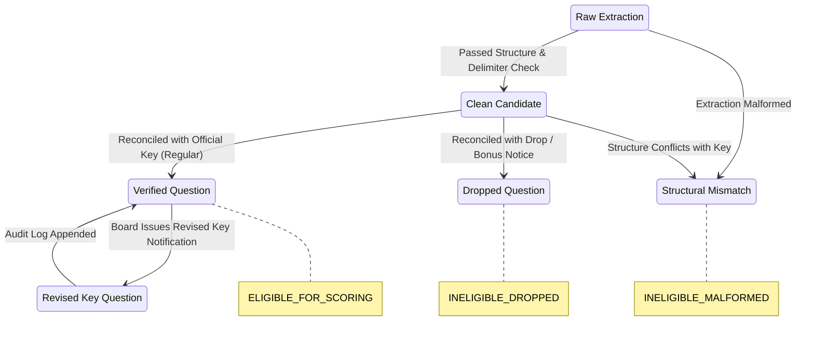

# EduNavika — Milestone 5.2: Official Answer-Key Reconciliation Design and Audit Report

**Date:** October 21, 2026  
**Role:** Senior Assessment-Data Engineer & Research QA Architect  
**Repository:** `D:\EduNavika`  
**Milestone Focus:** Auditable Answer-Key Matching, Provenance Manifest Schema, Lifecycle State Machine, Multiple-Correct & Numerical Tolerances, and Dry-Run Verification  
**Reconciliation Engine Status:** **`PASS`** (behavior validated against authoritative synthetic fixtures)  
**Corpus Ingestion Status:** **`BLOCKED`** (pending acquisition of official NTA and JAB answer-key source documents)  

---

## 1. Current Implementation Audit

### 1.1 Schema Capability Analysis

An architectural review was performed on `backend/app/models/competitive_models.py`, `backend/app/services/question_ingestion_service.py`, `backend/app/ingestion/competitive_paper_parser.py`, and the Milestone 5.1 pipeline.

The existing SQLAlchemy schema supports all necessary reconciliation entities without requiring schema migrations:

| Required Attribute | Database Model | Column Name & Type | Supported Values / Role |
| :--- | :--- | :--- | :--- |
| **Exam & Year** | `ExamPaper` | `exam_code` String(32)<br>`exam_year` Integer | `JEE_ADVANCED`, `NEET_UG`, `JEE_MAIN`; e.g. `2017` |
| **Session & Booklet Identifier** | `ExamPaper` | `session_or_shift` String(64)<br>`paper_code` String(32)<br>`paper_identifier` String(128) | e.g. `Paper 1`, `Code 1`, `JEE_ADV_2017_P1_EN` |
| **Question Provenance & Hash** | `Question` | `paper_question_number` Integer<br>`content_hash` String(64)<br>`source_type` String(32) | Deterministic SHA-256 hash of stem and options; original question number |
| **Official Key Source & Version** | `Question` | `scoring_policy_version` String(32)<br>`scoring_policy_source` String(256) | e.g. `IITM_FINAL_REVISED_V2`, `https://jeeadv.ac.in/archive/2017/final_keys_p1.pdf` |
| **Raw & Normalized Answer** | `Question` | `correct_answer_raw` String(256)<br>`QuestionOption.is_correct` Boolean | e.g. `"A, C"`, `"12.4 to 12.6"`, `"DROPPED"`, `"4"`; individual option flags |
| **Numerical Precision & Range** | `Question` | `numerical_precision_type` String(32)<br>`numerical_min_val` Float<br>`numerical_max_val` Float<br>`numerical_tolerance_epsilon` Float | e.g. `RANGE`, `12.4`, `12.6`, `0.01` |
| **Official Item Status & Evidence** | `Question` | `official_status` String(32)<br>`official_status_evidence` Text | `REGULAR`, `DROPPED`, `BONUS`, `DISPUTED`; authority notice citation |
| **Scoring Eligibility Gate** | `Question` | `eligibility_for_scoring` String(32)<br>`quarantine_status` String(32) | `INELIGIBLE_UNVERIFIED_KEY`, `ELIGIBLE_FOR_SCORING`, `INELIGIBLE_DROPPED`, `INELIGIBLE_MALFORMED` |
| **Audit History Trail** | `QuestionVerificationLog` | `verified_by` String(128)<br>`previous_status` String(32)<br>`new_status` String(32)<br>`action_type` String(32)<br>`review_notes` Text<br>`reviewed_at` DateTime | Complete chronological audit history (supports key revisions without overwriting previous records) |

---

## 2. Official Source Inventory and Missing-Source Analysis

### 2.1 Repository Search Results

An exhaustive scan across all folders in `D:\EduNavika` (including `GSEB-Dataset/`) confirmed:
- **Official Answer Key Files Present:** **0**
- **Official Errata / Clarification Notices Present:** **0**
- **OMR Key Display Data Present:** **0**

The 64 PDF files under `GSEB-Dataset/Dataset/Dataset/` are strictly **raw question paper booklets distributed to candidates** during the test sessions. They do not contain official answer keys.

### 2.2 Authoritative Source Specifications

To maintain academic and research integrity, answer keys must be obtained strictly from primary official conducting authorities:

```text
1. National Testing Agency (NTA) — NEET UG
   - Official Portal: https://neet.nta.nic.in / https://nta.ac.in
   - Authority Document: "National Eligibility Cum Entrance Test (UG) Final Answer Key" (Signed PDF)
   - Publication Process: Provisional Key Display -> Candidate Challenges -> Final Revised Key -> Result Declaration
   - Required Missing Documents:
     * NEET 2021 Final Answer Key (All Codes: M1-M6, N1-N6, O1-O6, P1-P6)
     * NEET 2020 Final Answer Key (All Codes: E1-E6, F1-F6, G1-G6, H1-H6)
     * NEET 2018 Final Answer Key (All Codes)
     * NEET 2013-2017, 2019, 2022-2024 Final Answer Keys

2. Joint Admission Board (JAB) / Organizing IITs — JEE Advanced
   - Official Portal: https://jeeadv.ac.in / https://jeeadv.ac.in/archive.html
   - Organizing Institutes:
     * 2017 & 2024: IIT Madras
     * 2018: IIT Kanpur
     * 2019: IIT Roorkee
     * 2020: IIT Delhi
     * 2021: IIT Kharagpur
     * 2022: IIT Bombay
     * 2023: IIT Guwahati
     * 2025: IIT Kanpur
   - Authority Document: "JEE (Advanced) Final Answer Keys for Paper 1 and Paper 2" (Official PDF with marking policy)
   - Required Missing Documents:
     * JEE Advanced 2017 Final Answer Keys (Paper 1 & Paper 2)
     * JEE Advanced 2018 Final Answer Keys (Paper 1 & Paper 2)
     * JEE Advanced 2020-2024 Final Answer Keys (Paper 1 & Paper 2)
```

> [!IMPORTANT]
> **Ethical & Provenance Rule:** Under non-negotiable safety rules 4 and 5, model-generated answer keys or third-party coaching institute keys must **never be labeled as official**. When official PDF documents are acquired, their source URL, retrieval date, publisher, and SHA-256 hash must be recorded in the manifest.

---

## 3. Reconciliation Data Model: Manifest Schema

To decouple raw PDF ingestion from answer key reconciliation, official keys are represented as machine-readable, provenance-backed JSON/YAML manifests:

```json
{
  "manifest_version": "1.0",
  "exam_code": "JEE_ADVANCED",
  "exam_year": 2017,
  "paper_session": "Paper 1",
  "paper_code": "Code 1",
  "authority": "IIT Madras (Organizing Institute for JEE Advanced 2017)",
  "official_document_ref": "JEE_Advanced_2017_Final_Answer_Keys_Paper_1.pdf",
  "source_url": "https://jeeadv.ac.in/archive/2017/final_keys_p1.pdf",
  "retrieval_date": "2026-10-21",
  "document_sha256": "d726b2b4...34ca",
  "key_version": "FINAL_OFFICIAL_V1",
  "answers": {
    "1": {
      "question_number": 1,
      "question_type": "MCQ_MULTI",
      "official_raw_answer": "A, C",
      "action": "REGULAR",
      "notes": "Both A and C are correct options. Full marks (+4) for {A, C}, partial (+1) each."
    },
    "8": {
      "question_number": 8,
      "question_type": "NUMERICAL",
      "official_raw_answer": "4",
      "action": "REGULAR",
      "notes": "Single digit integer 4."
    },
    "9": {
      "question_number": 9,
      "question_type": "NUMERICAL",
      "official_raw_answer": "12.4 to 12.6",
      "action": "REGULAR",
      "notes": "Numerical tolerance range [12.4, 12.6]."
    },
    "15": {
      "question_number": 15,
      "question_type": "SCQ",
      "official_raw_answer": null,
      "action": "DROPPED",
      "notes": "Notice dated 2017-06-04: Question dropped due to printing defect. Full marks awarded to all candidates."
    }
  }
}
```

---

## 4. Matching & Verification Rules

Implemented in [backend/app/services/answer_key_reconciliation_service.py](file:///d:/EduSens/backend/app/services/answer_key_reconciliation_service.py):

### 4.1 Provenance & Booklet-Code Compatibility
- **Deterministic Keying:** Questions match strictly by `(exam_code, exam_year, paper_session, paper_code, paper_question_number)`.
- **Booklet Code Isolation:** If the extracted paper declares `paper_code = "Code 1"` and the manifest specifies `paper_code = "Code 2"`, reconciliation **raises an explicit `ReconciliationError`** (`AMBIGUOUS_BOOKLET_CODE`). Cross-matching permuted question numbers across different booklet codes is strictly prohibited.
- **No Text-Fuzzy Matching:** Questions are never matched based on textual similarity alone.

### 4.2 Structural Consistency Enforcement
- If an extracted question has 0 options (parsed as `NUMERICAL`), but the official key states `SCQ` with answer `"B"`, or vice versa:
  * The question is flagged as `FLAGGED_MALFORMED` (`STRUCTURAL_TYPE_MISMATCH`).
  * Scoring eligibility is locked to `INELIGIBLE_MALFORMED`.
  * Logged in `QuestionVerificationLog` for manual academic review.

### 4.3 Answer Normalization Rules

| Question Type | Official Key Format | Normalized Format | Model Mutation |
| :--- | :--- | :--- | :--- |
| **SCQ** | `"B"` or `2` or `"b"` | `"B"` | `QuestionOption.is_correct = True` for B, `False` for others. |
| **MCQ_MULTI** | `"A, C"` or `["A", "C"]` or `"C or A"` | `"A, C"` (sorted) | `QuestionOption.is_correct = True` for A and C, `False` for others. |
| **NUMERICAL (Integer)**| `"4"` or `4` | `"4.00"` | `numerical_min_val = 4.0`, `numerical_max_val = 4.0`, $\epsilon = 0.01$. |
| **NUMERICAL (Range)**  | `"12.4 to 12.6"` | `"[12.40, 12.60]"` | `numerical_min_val = 12.4`, `numerical_max_val = 12.6`. |
| **DROPPED / BONUS**   | `null`, `action="DROPPED"` | `null` | `official_status = "DROPPED"`, `eligibility_for_scoring = "INELIGIBLE_DROPPED"`. |

### 4.4 Revised Key Re-Reconciliation (Non-Destructive Audit History)
When a challenge is accepted and an exam authority issues a revised key:
1. `Question.correct_answer_raw` is updated to the new normalized value.
2. `Question.scoring_policy_version` is updated (e.g. `REVISED_KEY_V2`).
3. A new `QuestionVerificationLog` entry is appended:
   - `action_type = "KEY_REVISED"`
   - `previous_status = "ANS:A, C|ELIG:ELIGIBLE_FOR_SCORING"`
   - `new_status = "ANS:A, B, C|ELIG:ELIGIBLE_FOR_SCORING"`
   - `review_notes = "Official challenge resolution update"`
4. Previous audit logs remain intact, creating a complete chronological history.

---

## 5. Verification Transition State Machine



---

## 6. Test Verification & Evidence

A dedicated, isolated test suite was created in [backend/tests/test_answer_key_reconciliation.py](file:///d:/EduSens/backend/tests/test_answer_key_reconciliation.py).

### 6.1 Test Suite Results
```text
Command: pytest backend/tests/test_answer_key_reconciliation.py
Results: 10 passed, 4 warnings in 2.29s (100% pass)
```

- `test_manifest_schema_validation`: Validates rejection of missing fields and invalid exam codes.
- `test_scq_answer_normalization`: Validates letter and NEET numeric formats; rejects invalid keys.
- `test_mcq_multi_answer_normalization`: Validates sorting and set deduplication (`"C, A"` $\rightarrow$ `"A, C"`).
- `test_numerical_answer_normalization`: Validates integer, decimal, and range extraction; rejects inverted bounds.
- `test_reconcile_question_and_verify_audit_log`: Verifies question promotion to `ELIGIBLE_FOR_SCORING` and creation of `QuestionVerificationLog`.
- `test_dropped_question_transitions_to_ineligible_dropped`: Verifies dropped items transition to `INELIGIBLE_DROPPED`.
- `test_revised_key_reconciliation_maintains_full_history`: Verifies non-destructive multi-stage audit logs.
- `test_booklet_code_mismatch_prevents_cross_contamination`: Verifies conflicting booklet codes raise `ReconciliationError`.
- `test_unmatched_questions_remain_ineligible`: Verifies questions lacking official keys remain `UNVERIFIED`.
- `test_dry_run_never_writes_to_database`: Verifies dry-run operations leave zero database records.

### 6.2 Combined Regression Check
```text
Command: pytest backend/tests/test_answer_key_reconciliation.py backend/tests/test_digital_pyq_pipeline.py backend/tests/test_competitive_platform.py
Results: 31 passed, 4 warnings in 6.81s (100% pass)
```

### 6.3 Database Immutability Check
```text
Row counts in D:\EduNavika\edunavika.db remain 100% untouched:
- questions: 0
- exam_papers: 0
- mcq_questions: 80 (legacy textbook items)
- examinations: 3 | exam_subjects: 18 | exam_topics: 1377
```

---

## 7. Remaining Limitations and Risks

1. **Physical Official Key PDF Absence:**
   - No official answer key documents currently exist in the repository.
   - **Risk:** Without acquiring the authentic NTA/JAB PDFs, no genuine question can be legally or academically certified for scoring.
2. **Booklet Code Permutations:**
   - NEET papers are issued in multiple booklet codes (e.g. Code M4 vs Code N1). The question numbers are shuffled across codes.
   - **Risk:** Applying a Code M4 answer key to a Code N1 paper would scramble candidate answers. Each extracted paper must have its exact booklet code identified from Page 1 before reconciliation.
3. **Scanned PDF Dependency (26 Papers):**
   - 26 papers require OCR before question numbers and stems can even be extracted for matching.

---

## 8. Milestone 5.2 Verdict and Next Steps

### **Verdict:**
- **Reconciliation Engine Architecture:** **`PASS`**
- **Corpus End-to-End Reconciliation:** **`BLOCKED`** (pending acquisition of primary official answer-key documents from NTA and JAB).

### **Recommendations for Milestone 5.3:**
1. **Acquire Official Key Source Manifests:** Formally download and archive the official Final Answer Key PDFs for the 38 digital papers from the official portals (`jeeadv.ac.in` and `neet.nta.nic.in`), compute their SHA-256 checksums, and compile `official_answer_key_manifests/`.
2. **Booklet Code Tagger:** Implement automated booklet code extraction from Page 1 headers (e.g. identifying `Code 1` or `Test Booklet Code M4`).
3. **Scanned Papers OCR Pipeline:** Proceed with Milestone 5.3 OCR pipeline for the 26 scanned raster-image papers.
